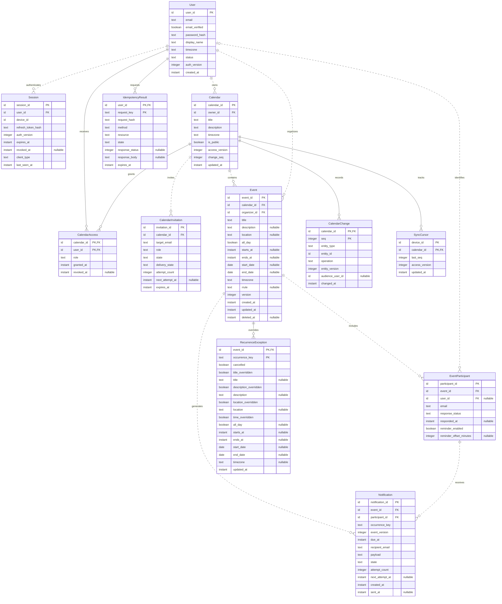
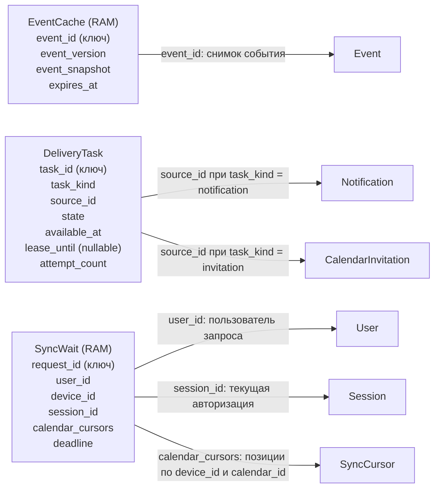
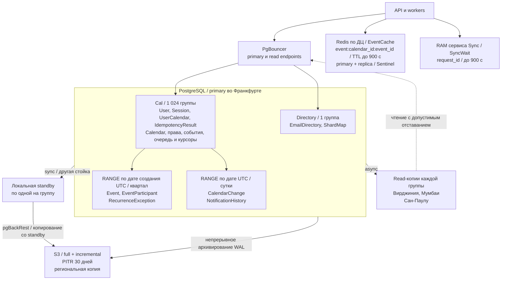
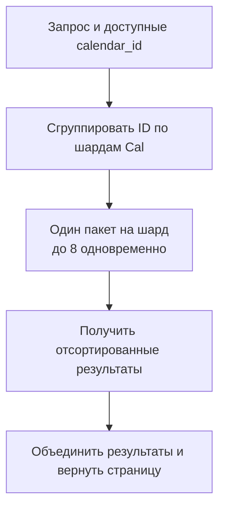
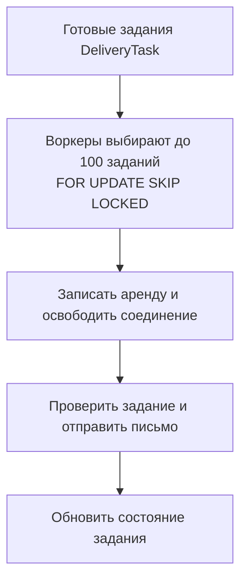
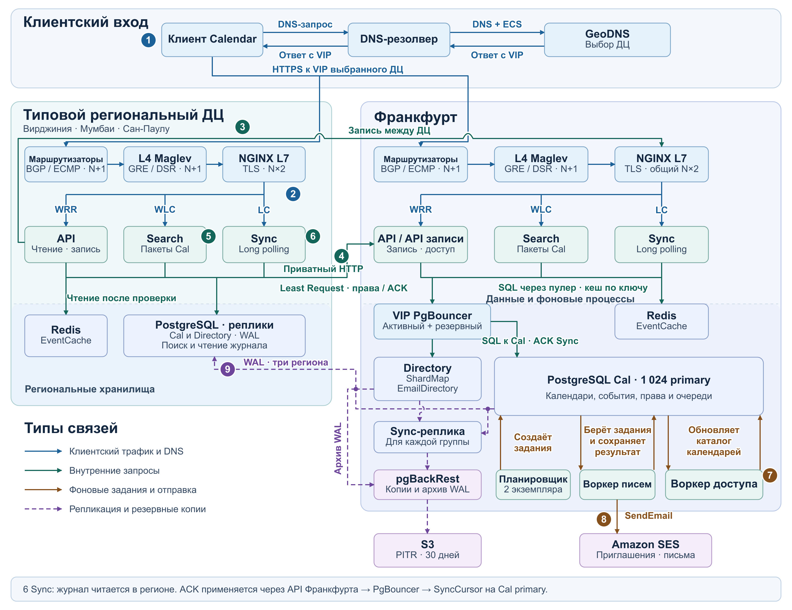

# Google Calendar

## Оглавление

1. [Тема и целевая аудитория](#глава-1-тема-и-целевая-аудитория)
2. [Расчёт нагрузки](#2-расчёт-нагрузки)
3. [Глобальная балансировка нагрузки](#3-глобальная-балансировка-нагрузки)
4. [Локальная балансировка нагрузки](#4-локальная-балансировка-нагрузки)
5. [Логическая схема базы данных](#5-логическая-схема-базы-данных)
6. [Физическая схема базы данных](#6-физическая-схема-базы-данных)
7. [Алгоритмы](#7-алгоритмы)
8. [Технологии](#8-технологии)
9. [Обеспечение надёжности](#9-обеспечение-надёжности)
10. [Схема проекта](#10-схема-проекта)
11. [Список серверов и расчёт ресурсов](#11-список-серверов-и-расчёт-ресурсов)
12. [Список использованных источников](#список-использованных-источников)

---

## Глава 1. Тема и целевая аудитория

### 1.1 Тема проекта, рыночная ниша и аналоги

**Выбранная тема:** проектирование бэкенда высоконагруженного сервиса для планирования встреч, событий и дел - **«Google Calendar»**.

**Реальные аналоги:** Microsoft Outlook Calendar, Apple iCloud Calendar, Zoho Calendar, Calendly. Наличие независимых глобальных игроков на протяжении последних лет однозначно подтверждает существование устойчивой и крупной рыночной ниши - потребности массового пользователя и корпоративных клиентов в планировании встреч, событий, дел и синхронизации расписаний между различными устройствами.

---

### 1.2 Целевая аудитория: размер и локализация

Целевая аудитория - массовый пользователь мобильных устройств и ПК, использующий сервис для планирования встреч, событий и дел, а также корпоративные клиенты через Google Workspace. Сервис имеет глобальное распространение с выраженной концентрацией в США и развитых рынках.

#### Ключевые метрики аудитории

| Метрика | Значение | Период | Источник |
| :--- | :--- | :--- | :--- |
| **Месячная аудитория Google Calendar (MAU)** | **500 млн** | Оценка из публикаций | Patronum [2] и Exploding Topics [1] приводят более 500 млн пользователей в месяц. Для расчётов используется округлённое значение 500 млн |
| **Пользователей Google Workspace** (включая Gmail, Drive, Calendar) | **3 млрд** | 2025 | [1], [2] |
| **Платящих B2B-компаний Workspace** | **6 млн** | 2025 | [2] |
| **Компаний из Fortune 500, использующих Google Workspace** | **40%** | 2025 | [2] |

Google не публикует отдельные метрики по количеству событий, уведомлений и устройств для Google Calendar. Эти значения выводятся в разделе 2 как расчётные продуктовые допущения на основе исследований рынка труда и официальных документов.

#### Региональное распределение рынка Workspace и оценка аудитории Calendar

Региональные доли взяты из отраслевого отчёта Dataintelo о рынке Google Workspace [3]. В курсовой эти доли используются как приближение для географии пользователей Google Calendar. Значения в столбце MAU получены умножением исходных долей на 500 млн.

| Регион | Доля рынка Workspace по Dataintelo [3] | MAU Calendar по модели |
| :--- | :--- | :--- |
| **Северная Америка** | **38,4%** [3] | ~192 млн |
| **Европа** | **26,7%** [3] | ~134 млн |
| **Азиатско-Тихоокеанский регион** | **22,8%** [3] | ~114 млн |
| **Латинская Америка + MEA** | **~12%** [3] | ~60 млн |

---

### 1.3 Функционал MVP

Для проектирования выделены следующие **6 ключевых функций**, покрывающих основной пользовательский путь:

1. **Регистрация и авторизация.** Создание аккаунта, вход в систему и управление сессиями.
2. **Создание и редактирование календарей.** Базовое управление сущностями календарей.
3. **Управление доступом.** Каждый календарь можно сделать общедоступным либо предоставить отдельным людям доступ к нему (просмотр или редактирование) через приглашение по электронной почте.
4. **Уведомления.** Отправка уведомлений о предстоящих событиях по электронной почте.
5. **Управление событиями.** Создание и редактирование событий внутри календарей.
6. **Поиск по событиям.** Полнотекстовый поиск по названию, описанию, участникам и дате события внутри всех календарей пользователя с фильтрацией по дате и ключевым словам.

#### Ключевые продуктовые решения

1. **Хранение повторяющихся событий.** Вместо создания тысяч отдельных записей для каждой встречи (например, "планёрка каждый понедельник на год вперёд") в базе данных хранится только одно правило повторения. Конкретные встречи создаются "на лету" при просмотре календаря. Это позволяет экономить огромное количество места и легко редактировать всю серию сразу.

2. **Синхронизация между устройствами.** Когда пользователь открывает календарь на телефоне, приложение не скачивает все события заново. Оно запрашивает только те события, которые изменились с момента последнего открытия. Это экономит мобильный трафик пользователя и снижает нагрузку на серверы.

3. **Асинхронная отправка уведомлений.** Задание сохраняется в PostgreSQL и повторяется при временной ошибке. Между приёмом письма Amazon SES и фиксацией результата возможен дубль. Постоянные ошибки требуют разбора, а аварийное повышение асинхронной реплики может привести к потере последних изменений.

---

## 2. Расчёт нагрузки

### 2.1. Исходные продуктовые метрики

| Показатель | Значение | Основание |
| --- | --- | --- |
| Месячная аудитория (MAU) | **500 млн** | Округлённая опубликованная оценка [1], [2] |
| Дневная аудитория (DAU) | **275 млн** | MAU × 55%; проектное допущение |
| Зарегистрированных аккаунтов | 3 млрд | Проектная оценка ёмкости Calendar на основе аудитории Workspace [1], [2] |
| Событий создаётся в месяц | **3,55 млрд** | DAU × 0,43 × 30; проектная частота |
| Уведомлений доставляется в месяц | **16,8 млрд** | События × 7,9 × 0,6; проектные средние |
| Устройств на пользователя | **3** | Телефон + рабочее устройство + личное устройство |
| Окно использования календаря на DAU | **15 минут/день** | Одно активное устройство; проектное допущение |
| Sync-запросов на DAU в день | **1** | Один long-polling запрос в принятом дневном окне |
| Коэффициент пика | **4** | Утренний и вечерний пики |

#### Обоснование DAU

Для смешанной аудитории корпоративных и личных пользователей принимается проектный коэффициент DAU/MAU = 55%.
```
DAU = 500 млн × 0,55 = 275 млн
```

#### Обоснование количества событий

Частоты действий и доли сегментов ниже являются проектными допущениями.

| Сегмент | Доля | Событий/день | Обоснование частоты | Вклад |
| --- | ---: | ---: | --- | ---: |
| Корпоративные организаторы | 8% | 3,0 | Активный организатор: 3 создаваемых события/день | 0,240 |
| Корпоративные участники | 12% | 0,1 | В основном принимают приглашения, редко создают сами | 0,012 |
| Личные активные | 20% | 0,8 | Типичный паттерн: 5-6 личных событий в неделю | 0,160 |
| Пассивные | 45% | 0,03 | ~1 событие в месяц | 0,0135 |
| Минимальные | 15% | 0,005 | 1-2 события в год | 0,00075 |
| **Итого** | **100%** | — | — | **0,426 ≈ 0,43** |

```
Событий в месяц = 275 млн × 0,43 × 30 ≈ 3,55 млрд
```

#### Обоснование количества уведомлений

Уведомления считаются как фан-аут событий на участников. 

Среднее число участников определяется проектной сегментацией. Лимит гостей — 200 [4]; модель участника описана в iCalendar [5].

| Тип события | Доля | Участников | Обоснование | Вклад |
| --- | ---: | ---: | --- | ---: |
| Личная встреча | 50% | 1,5 | Встречи 1-на-1, личные дела | 0,75 |
| Рабочая встреча | 35% | 5 | Проектное среднее: 5 участников | 1,75 |
| Крупное мероприятие | 12% | 20 | Командные встречи, тренинги | 2,40 |
| Массовое | 3% | 100 | All-hands, вебинары (лимит 200 [4]) | 3,00 |
| **Итого** | **100%** | — | Средневзвешенное количество участников | **7,9** |

Принимаем, что **60% событий генерируют уведомления** (остальные 40% - личные заметки и события без гостей, которые не требуют фан-аута).

```
Уведомлений в месяц = 3,55 млрд × 7,9 × 0,6 ≈ 16,8 млрд
```

#### Обоснование частоты синхронизации

Проектный сценарий: одно 15-минутное окно открытого календаря на DAU в день и одно одновременно активное устройство. В окне выполняется один GET /sync: ответ при наличии изменений либо через 900 секунд; при закрытии календаря запрос отменяется. После ответа клиент применяет полученные изменения и подтверждает фактически применённую позицию. В расчётном окне второй long-poll не открывается. Подтверждение может прийти со следующим запросом Sync или отдельным коротким вызовом `POST /sync/ack`. До подтверждения повторная выдача изменений при переподключении допустима. Для отдельного подтверждения в §11 предусмотрено до одного короткого запроса на long-poll. Email-уведомления работают независимо от открытого приложения.

```text
Sync-запросов/сутки = 275 млн DAU × 1 = 275 млн
Средний Sync RPS = 275 млн / 86 400 ≈ 3 183
Пиковый Sync RPS = round(275 млн / 86 400 × 4) = 12 731
Q_peak = ceil(275 млн × 900 / 86 400 × 4) = 11 458 334 ожидания
```

Q_peak — оценка при ожидании всех запросов до таймаута и распределённых началах окон с коэффициентом пика 4; ранние ответы и закрытие уменьшают её. Три устройства относятся к хранению за 30 дней, а не к одновременному подключению. Время использования — допущение, не опубликованная статистика сервиса.

Для объёмов хранения используются двоичные приставки: 1 КиБ = 1024 Б, 1 МиБ = 1024² Б, 1 ГиБ = 1024³ Б, 1 ТиБ = 1024⁴ Б. Для сетевого трафика используются десятичные приставки: 1 Гбит/с = 10⁹ бит/с.

---

### 2.2. Действия пользователей и RPS

$$N_i = DAU \times a_i, \quad RPS_{avg,i} = \frac{N_i}{86\,400}, \quad RPS_{peak,i} = 4 \times RPS_{avg,i}$$

| Действие | Метод | На DAU в день | Млн запросов/сутки | Средний RPS | Пиковый RPS |
| --- | --- | --: | --: | --: | --: |
| Вход / регистрация | `POST /auth/login` | 0,01 | 2,75 | 32 | 127 |
| Обновление сессии | `POST /auth/refresh` | 0,3 | 82,5 | 955 | 3 819 |
| Создание календаря | `POST /calendars` | 0,001 | 0,275 | 3 | 13 |
| Редактирование календаря | `PATCH /calendars/{id}` | 0,01 | 2,75 | 32 | 127 |
| Создание события | `POST /events` | 0,43 | 118,25 | 1 369 | 5 475 |
| Редактирование события | `PATCH /events/{id}` | 0,22 | 60,5 | 700 | 2 801 |
| Удаление события | `DELETE /events/{id}` | 0,07 | 19,25 | 223 | 891 |
| Приглашение / изменение доступа | `POST /calendars/{id}/share` | 0,02 | 5,5 | 64 | 255 |
| Ответ на приглашение | `POST /events/{id}/respond` | 0,05 | 13,75 | 159 | 637 |
| Поиск по событиям | `GET /search` | 0,5 | 137,5 | 1 591 | 6 366 |
| Синхронизация устройств (long-polling) | `GET /sync` | 1 | 275 | 3 183 | 12 731 |
| **Итого** | - | **2,611** | **718,025** | **8 311** | **33 242** |

Создание событий: `3,55 млрд/мес ÷ 30 дней ÷ 275 млн DAU = 0,43`. Sync — один запрос на DAU в принятом дневном окне; RPS округлены по строкам, итог — сумма строк.

---

### 2.3. Хранилище активного пользователя

| Тип данных | Количество | Б/объект | Объём, Б |
| --- | ---: | ---: | ---: |
| Профиль и настройки (`User`) | 1 | 965 | 965 |
| Личные календари (`Calendar`) | 5 | 3 480 | 17 400 |
| Доступ к чужим календарям (`CalendarAccess`) | 10 | 48 | 480 |
| События за 5 лет, включая правила (`Event`) | 785 | 3 577 | 2 807 945 |
| Участники событий (`EventParticipant`) | 785×7,9 | 128 | 793 792 |
| Исключения серии (`RecurrenceException`) | 785×1% | 512 | 4 019,20 |
| Будущие напоминания и успешная история (`Notification`) | ≈75,35 | 1 280 | 96 442,18 |
| Сессии со сведениями о клиентах (`Session`) | 3 | 320 | 960 |
| Курсоры синхронизации (`SyncCursor`) | 3×15 | 48 | 2 160 |
| **Итого** | | | **3 724 163,38** |

Итого: `3 724 163,38 / 1 048 576 ≈ 3,55164 МиБ`, или **≈3,55 МиБ** на расчётный профиль. Промежуточные величины считаются без округления; в таблице показаны округлённые значения.

Профиль сохраняет 785 событий за пять лет, пять личных и десять доступных календарей, три клиентские установки и по одной активной сессии на установку. Средний размер события 3 577 Б уже включает правило повторения: `3 513+0,1×640`. Исключение серии в среднем занимает 512 Б; поиск использует исходные таблицы. Размер сессии 320 Б включает сведения о клиенте; отдельные объёмы устройств и правил не прибавляются.

Для оценки `Notification` поток `H=560 млн/сутки` распределён между **275 млн расчётных активных профилей**: успешная история — `30H/DAU ≈ 61,09` записи, будущие напоминания — `7H/DAU ≈ 14,25`, всего `(30H+7H)/DAU ≈ 75,35`. Это принятое распределение потока между типовыми активными профилями, а не статистика месячных уникальных получателей.

Это расчётный профиль активного пользователя, а не среднее по MAU или по всем 3 млрд аккаунтов. Его нельзя умножать на 3 млрд для получения глобального объёма. Глобальная ёмкость в 2.4 рассчитывается по числу объектов и срокам хранения; приглашения, идемпотентные результаты, журнал, очереди, кеш и рабочие буферы учитываются там отдельно.

---

### 2.4. Общий объём хранения

Состав данных и размеры записей соответствуют логической модели раздела 5: 12 основных сущностей и три служебные структуры. Объёмы рассчитаны для одной логической копии; физические индексы, репликация и резервные копии не включены. Постоянное хранение и RAM показаны раздельно.

| Сущность / набор | Количество, млн | Б/объект | Объём, ТиБ |
| --- | ---: | ---: | ---: |
| `User` | 3 000,000 | 965 | 2,633 |
| `Session` | 1 500,000 | 320 | 0,437 |
| `Calendar` | 15 000,000 | 3 480 | 47,476 |
| `CalendarAccess` | 30 000,000 | 48 | 1,310 |
| `CalendarInvitation` | 165,000 | 160 | 0,024 |
| `Event` | 213 000,000 | 3 577 | 692,945 |
| `EventParticipant` | 1 682 700,000 | 128 | 195,892 |
| `RecurrenceException` | 2 130,000 | 512 | 0,992 |
| `Notification` | 20 720,000 | 1 280 | 24,121 |
| `CalendarChange` | 42 459,552 | 256 | 9,886 |
| `SyncCursor` | 22 500,000 | 48 | 0,982 |
| `IdempotencyResult` | 1 222,128 | 2 048 | 2,276 |
| `EventCache` (RAM) | 1,146 | 4 096 | 0,004 |
| `DeliveryTask` | 141,375 | 256 | 0,033 |
| `SyncWait` (RAM) | 11,458 | 65 536 | 0,683 |
| Служебные позиции и резерв журнала/очередей | — | — | 0,005 |
| **Постоянное хранение** |  |  | **979,012** |
| **Оперативная память** |  |  | **0,687** |
| **Всего, включая RAM** |  |  | **979,699** |

**Количество записей:** события — `3,55 млрд/месяц×60 месяцев = 213 млрд` до вычета досрочных удалений; участники — `события×7,9`; исключения — `события×1%`. Календари — `3 млрд×5`, права — `3 млрд×10`; сессии — `500 млн MAU×3`, курсоры — `500 млн×3×15`. Число 3 млрд аккаунтов — проектная оценка ёмкости, не подтверждённая статистика аккаунтов Calendar.

`Event` в среднем занимает `3 513+0,1×640 = 3 577 Б`, поэтому правило повторения отдельно не учитывается. `Session` размером 320 Б уже содержит сведения о клиентской установке. `Notification`: `(7+30)×560 млн = 20,72 млрд` записей по 1 280 Б — будущие напоминания и успешная история одной сущности. Ошибочные/незавершённые задания при длительном отказе потребуют дополнительной ёмкости.

Поиск использует события, участников и исключения; отдельные копии поисковых документов не хранятся. Идемпотентные результаты рассчитаны на `14 145×86 400` записей за сутки непрерывного пика. Резерв журнала — `16 381×86 400×30` записей по 256 Б; очередь — час пикового email-потока с запасом 50%. Вместе со служебными позициями их бюджет составляет 9,924 ТиБ; это не срок автоматического удаления необработанных заданий.

`SyncWait` содержит принятые в 2.1 `11 458 334` ожидания по 65 536 Б. Кеш рассчитывается по пиковому наполнению и TTL: `ceil(0,1×275 млн/86 400×4×900)` записей по 4 096 Б. Кеш и буферы относятся к RAM; это прежняя сводная оценка ожидания запроса и его соединений. В §11 ресурсный бюджет разделён по процессам, эту сводную величину повторно к нему не прибавляем.

Итого: постоянное хранение **979,012 ТиБ**, RAM **0,687 ТиБ**. Общий справочный объём — **979,699 ТиБ**; он получен из неокруглённых значений. Дисковая ёмкость и RAM при расчёте серверов учитываются отдельно. Подробные составы записей, сроки хранения и QPS приведены в разделе 5.

---

### 2.5. Сетевой трафик

$$V_{day,i} = \frac{N_i \times S_i}{10^9} \text{ [ГБ]}, \quad B_{peak,i} = \frac{V_{day,i} \times 8 \times 4}{86\,400} \text{ [Гбит/с]}$$

| Тип трафика | Направление | ГБ/сутки | Пик, Гбит/с |
| --- | --- | --: | --: |
| API: входящие запросы | Входящий | 765 | 0,28 |
| API: ответы | Исходящий | 4 412 | 1,63 |
| Синхронизация: запросы | Входящий | 137,5 | 0,05 |
| Синхронизация: ответы | Исходящий | 162,25 | 0,06 |
| Уведомления, включая запущенные напоминаниями | Исходящий | 560 | 0,21 |
| Email-приглашения в календарь | Исходящий | 5,632 | 0,002 |
| **Всего входящий** | Клиент - сервис | **902,5** | **0,33** |
| **Всего исходящий** | Сервис - клиент | **5 139,882** | **1,90** |

Sync-запрос — 500 Б, средний ответ — 590 Б. Расчёт использует неокруглённые значения; таблица показывает округлённый трафик.

С **20% запасом** на транспортные накладные расходы:

| Направление | Без запаса | С запасом 20% |
| --- | --: | --: |
| Входящий | 0,33 Гбит/с | **0,40 Гбит/с** |
| Исходящий | 1,90 Гбит/с | **2,28 Гбит/с** |

---

## 3. Глобальная балансировка нагрузки

### 3.1 Функциональное разбиение по поддоменам

| Поддомен | Назначение | Транспорт | Таймаут | Выбор ДЦ |
| --- | --- | --- | --- | --- |
| api.calendar.google.com | Авторизация, календари, доступ и события | HTTPS | 5–30 с | GeoDNS + ECS |
| sync.calendar.google.com | Инкрементальная синхронизация | HTTPS long-polling | Ожидание до 900 с; прокси-таймаут 930 с | GeoDNS + ECS |
| search.calendar.google.com | Поиск по событиям | HTTPS | 60–120 с | GeoDNS + ECS |

Поддомены позволяют независимо масштабировать сервисы и задавать таймауты. DNS выбирает адрес ДЦ, а локальные L4/L7 выполняют балансировку соединений и запросов.

### 3.2 Обоснование расположения ДЦ и их ролей

| ДЦ | Регион | Доля | Роль |
| --- | --- | ---: | --- |
| Франкфурт | Европа | 26,7% | Единый мастер и локальное чтение |
| Вирджиния | Северная Америка | 38,4% | Реплика для чтения |
| Мумбаи | АТР | 22,8% | Реплика для чтения |
| Сан-Паулу | Латинская Америка и MEA | 12,1% | Реплика для чтения |

Расположение соответствует аудитории раздела 1. Все изменения фиксируются во Франкфурте; содержимое читается из региональной реплики. Сессия, отзыв и права проверяются по актуальному состоянию primary через приватные сервисные соединения. Подтверждение позиции Sync также обрабатывается на primary.

### 3.3 Распределение трафика по ДЦ

Из раздела 2.2: клиентский пик 33 242 RPS; операции изменения — 14 145 RPS, чтение и Sync — 19 097 RPS. Клиентские запросы распределяются по региональным долям методом наибольших остатков; неевропейские изменения дополнительно обрабатываются во Франкфурте.

| ДЦ | Клиентские RPS | Из них запись | Проксированные записи, дополнительно | Обработки Ingress/с | Клиентский вход, Гбит/с | Клиентский выход, Гбит/с |
| --- | ---: | ---: | ---: | ---: | ---: | ---: |
| Вирджиния | 12 765 | 5 432 | 0 | 12 765 | 0,154 | 0,877 |
| Франкфурт | 8 876 | 3 777 | 10 368 | 19 244 | 0,107 | 0,610 |
| Мумбаи | 7 579 | 3 225 | 0 | 7 579 | 0,091 | 0,521 |
| Сан-Паулу | 4 022 | 1 711 | 0 | 4 022 | 0,049 | 0,276 |
| Всего | 33 242 | 14 145 | 10 368 | 43 610 | 0,401 | 2,284 |

| Межрегиональный поток | Расчёт |
| --- | --- |
| Проксирование записи | 10 368 запросов/с; при 1 КиБ запроса и ответа — 0,085 Гбит/с в каждом направлении |
| Проверка актуальной авторизации | Верхняя оценка: 24 366 первых проверок/с и ≈13 998 повторных проверок Search/Sync, всего ≈38 364 приватных RPC/с. При 1 КиБ запроса и ответа — ≈0,314 Гбит/с в каждом направлении Франкфурта. Первые проверки заложены с запасом, включая запросы записи, чья авторизация может выполняться уже после проксирования |
| Передача журнала в три ДЦ | 16 381 изменений/с × 256 Б × 8 × 3 = 0,101 Гбит/с; содержимое объектов передаётся отдельно |

Служебные RPC используют постоянные соединения и не проходят через внешний Ingress. Журнал переносит порядок изменений и tombstones, но не заменяет полную передачу содержимого данных.

### 3.4 Схема DNS балансировки (GeoDNS + EDNS)

GeoDNS возвращает адрес регионального ДЦ. При поддержке ECS резолвер передаёт префикс клиентской подсети; иначе выбор выполняется по адресу резолвера. TTL записи — 30 с: он ограничивает время кеширования DNS, но не срок существования уже открытого long-polling соединения.

### 3.5 Отказ от BGP Anycast для прикладного трафика

Глобальный BGP Anycast не используется. Внутри ДЦ ECMP распределяет потоки между локальными L4.

### 3.6 Механизм регулировки трафика между ДЦ

При отказе ДЦ health checks исключают его из DNS-выдачи; клиент переподключается к доступному региону с задержкой и случайным разбросом повторов. Перенос нагрузки ограничивается доступной ёмкостью принимающих ДЦ. При перегрузке вход ограничивает допуск, в том числе новых долгих ожиданий Sync, и отвечает 503 с Retry-After, где применимо. Локальные резервы рассчитаны на отказ узла или группы в своём ДЦ. Полный пик отказавшего ДЦ в бюджет не заложен.

При отказе Франкфурта запись и операции, требующие актуальной авторизации, приостанавливаются до ручного выбора нового мастера. Старый мастер изолируется от записи; доступность и позиция реплики проверяются до переключения. Асинхронные копии допускают потерю последних изменений; обратно мастер переключается только после согласования данных.

---

## 4. Локальная балансировка нагрузки

### 4.1 Схема балансировки и уровни резервирования

GeoDNS возвращает клиенту IP регионального ДЦ. После этого клиент подключается напрямую к его L4; DNS не участвует в передаче HTTP-трафика.

```text
                 [ Клиент → IP регионального ДЦ ]
                                │
                                ▼
┌──────────────────────────────────────────────────────────────────┐
│ 1. L4: балансировка TCP-соединений                               │
│    • BGP-анонс VIP; ECMP от двух маршрутизаторов                 │
│    • Maglev: GRE к NGINX; ответ клиенту напрямую (DSR)           │
│    • Резервирование: N+1, группы A и B в режиме active-active    │
└───────────────────────────────┬──────────────────────────────────┘
                                │ TCP / TLS
                                ▼
┌──────────────────────────────────────────────────────────────────┐
│ 2. L7: NGINX Ingress                                             │
│    • TLS termination и маршрутизация к API / Sync / Search       │
│    • API: weighted round-robin; Search/Sync: least_conn          │
│    • Sync: HTTPS long-polling, ожидание до 900 секунд            │
│    • Резервирование: N×2, независимые группы A и B               │
└───────────────────────────────┬──────────────────────────────────┘
                                │ HTTP, переиспользуемые соединения
                                ▼
┌──────────────────────────────────────────────────────────────────┐
│ 3. Межсервисная клиентская балансировка                          │
│    • Service discovery и выбор доступного endpoint               │
│    • Least request для HTTP-вызовов                              │
│    • Резервирование: минимум два экземпляра каждого сервиса      │
└──────────────────────────────────────────────────────────────────┘

Запись из другого ДЦ:
Региональный API → внутренний Ingress Франкфурта → API записи
                 → VIP пулеров (1 активный + 1 резервный) → мастер
```

Внутренний Ingress Франкфурта входит в его общий пул L7; местные записи идут из Ingress сразу к API записи. Проверки актуальных прав выполняются по приватным сервисным соединениям.

### 4.2 Алгоритмы и резервирование

#### 4.2.1 Алгоритмы балансировки

| Уровень | Компонент | Алгоритм | Причина выбора |
| --- | --- | --- | --- |
| Вход в ДЦ | Два маршрутизатора | ECMP по параметрам потока | Распределение потоков между активными L4 |
| L4 → NGINX | Программный L4 по схеме Maglev [11] | Согласованное хеширование и учёт соединений | Устойчивое назначение TCP-потоков; GRE доставляет пакеты, DSR возвращает ответы в обход L4 |
| NGINX → API, включая внутренний вход Франкфурта | Общий пул NGINX Ingress | Weighted Round Robin, фиксированные веса | Простое распределение коротких запросов с учётом мощности экземпляров |
| NGINX → Search | Общий пул NGINX Ingress | Weighted Least Connections (`least_conn` с весами) | Учёт активных соединений при различной длительности поиска |
| NGINX → Sync | Общий пул NGINX Ingress | Least Connections | Распределение ожидающих long-polling соединений и расхода памяти |
| Межсервисный HTTP | Клиентский балансировщик | Least Request | Учёт выполняемых запросов при переиспользовании соединений |

Веса фиксированы и не корректируются автоматически. `least_conn` не измеряет стоимость запроса или CPU; длительное ожидание Sync не считается медленным выполнением. Алгоритмы NGINX — в [документации](https://nginx.org/en/docs/http/ngx_http_upstream_module.html).

#### 4.2.2 Режимы резервирования и переключение

| Компонент | Формула / количество | Режим | Протокол / механизм переключения |
| --- | --- | --- | --- |
| Маршрутизаторы | N+1, независимые пути | Active-Active | Маршрутизация BGP и исключение недоступного пути; оставшийся маршрутизатор выдерживает поток |
| L4 | N+1 | Active-Active | BGP-анонс VIP + ECMP; проверка L4 и отзыв маршрута при отказе [11] |
| Общий пул NGINX | N×2, две независимые группы | Active-Active | Health checks со стороны L4 и исключение недоступного NGINX; API/Search/Sync используют один расчётный пул L7 |
| API / Search / Sync | N×2 для каждого сервиса; N определяется его нагрузкой и производительностью. | Active-Active | Readiness, service discovery и исключение по ошибкам; количество определяется нагрузкой |
| Пулеры во Франкфурте | N+1, каждый выдерживает полный поток | Active-Passive | Keepalived/VRRP, общий VIP и проверка процесса пулера; резервный принимает VIP |

N×2 рассчитано на потерю одной из двух групп; N+1 рассчитано на потерю одного узла. Минимум два экземпляра сервиса сам по себе не доказывает достаточность мощности. При плановом отключении используется graceful drain; отказ может оборвать TCP-соединения, Sync переподключается с курсором.

Пулеры размещаются в общей локальной сети; активный предоставляет соединение на транзакцию. [VRRP (RFC 9568)](https://www.rfc-editor.org/rfc/rfc9568.html) переключает VIP, но не сохраняет соединения: приложения переподключаются. Запись повторяется только с тем же ключом идемпотентности и телом запроса.

### 4.3 Расчёт количества

| Параметр | Значение |
| --- | --- |
| Нагрузка | Региональные обработки Ingress из раздела 3.3; короткие подтверждения Sync проверяются отдельно в §11 |
| NGINX, 8 CPU без HT [8] | 31 485 новых TLS-соединений/с; 8,64 Гбит/с в отдельных тестах |
| Коэффициент загрузки u | 0,8: 25 188 TLS-соединений/с; 6,912 Гбит/с |
| Консервативный TLS-сценарий | Каждый запрос, включая Sync и проксированную запись, создаёт новое TLS-соединение |
| Одновременные Sync-запросы | Q=11 458 334 по сценарию раздела 2.1; одно активное устройство на пользователя |
| Проектный L7-узел | 8 физических ядер сопоставимого класса, 192 ГиБ RAM |
| Условная память ожидания | 64 КиБ на запрос и пару соединений; сценарий оценки, не измеренный расход NGINX |
| Сетевые допущения | Дополнительно 3 КиБ TLS/TCP-обмена в каждом направлении на новое соединение; проксированная запись — по 1 КиБ запроса и ответа |
| L4, ориентир Maglev [11] | 10 Гбит/с на узел; с u=0,8 — 8 Гбит/с. Проектный запас IPv4/GRE — 30% к входящему потоку |

T_i — обработки Ingress/с, p_i — доля региона. Q_i распределяются методом наибольших остатков из Q. Базовые B_in и B_out берутся из неокруглённых расчётов раздела 2.5; сеть измеряется в Гбит/с.

```text
B_in,base = 902,5 × 8 × 4 / 86 400 × 1,2 = 0,401111… Гбит/с
B_out,base = 5 139,882 × 8 × 4 / 86 400 × 1,2 = 2,284392 Гбит/с
B_proxy,F = 10 368 × 1 024 × 8 / 10^9; в других ДЦ B_proxy = 0
B_in,i  = B_in,base × p_i + T_i × 3 072 × 8 / 10^9 + B_proxy,i
B_out,i = B_out,base × p_i + T_i × 3 072 × 8 / 10^9 + B_proxy,i

N_TLS = ceil(T_i / 25 188)
N_net = ceil(max(B_in,i, B_out,i) / 6,912)
N_conn = ceil(Q_i × m / (0,8 × 192 × 2^30)); m = 65 536 Б
L7_i = 2 × max(N_TLS, N_net, N_conn)
L4_i = 2 × ceil(1,3 × B_in,i / 8)
```

| ДЦ | T_i, соединений/с | Вход / выход, Гбит/с | Q_i, ожиданий | N_TLS | N_net | N_conn | L7 с резервом | L4 с резервом |
| --- | ---: | ---: | ---: | ---: | ---: | ---: | ---: | ---: |
| Вирджиния | 12 765 | 0,468 / 1,191 | 4 400 000 | 1 | 1 | 2 | 4 | 2 |
| Франкфурт | 19 244 | 0,665 / 1,168 | 3 059 375 | 1 | 1 | 2 | 4 | 2 |
| Мумбаи | 7 579 | 0,278 / 0,707 | 2 612 500 | 1 | 1 | 2 | 4 | 2 |
| Сан-Паулу | 4 022 | 0,147 / 0,375 | 1 386 459 | 1 | 1 | 1 | 2 | 2 |
| Всего | 43 610 | 1,558 / 3,441 | 11 458 334 | 4 | 4 | 7 | 14 | 8 |

Пример для Вирджинии: N_conn=ceil(4 400 000×65 536/(0,8×192×2^30))=2; L7=2×max(1,1,2)=4, L4=2×ceil(1,3×0,467739/8)=2.

Итог — предварительно 14 L7 и 8 L4, два пулера отдельно. Производительность подтверждается тестом совместной нагрузки: память, клиентские/upstream-соединения, TLS и сеть; отдельные тесты [8] не измеряют long-polling. Keep-alive и TLS resumption не уменьшают расчёт без измерений, ориентир Maglev не переносится на произвольный L4.

---
## 5. Логическая схема базы данных

Модель включает 12 основных сущностей и три служебные структуры; выбор СУБД и физического размещения относится к разделу 6 [13].

### 5.1. Идентификаторы

`PK` — первичный ключ, `FK` — ссылка на сущность, `nullable` — необязательное поле. Составные ключи: `CalendarAccess` — `(calendar_id, user_id)`, `RecurrenceException` — `(event_id, occurrence_key)`, `CalendarChange` — `(calendar_id, seq)`, `SyncCursor` — `(device_id, calendar_id)`, `IdempotencyResult` — `(user_id, request_key)`. Email аккаунта и пара `(event_id, email)` среди участников уникальны.

`device_id` обозначает установку клиента, сохраняется при смене сессии и проверяется через текущую авторизованную сессию; курсор от `session_id` не зависит. У `Notification` собственный ключ `notification_id` и уникальная пара `(participant_id, occurrence_key)` — одно напоминание участнику о вхождении.

### 5.2. Логическая схема

**Основные данные:**



`||` — ровно один, `o|` — ноль или один, `o{` — ноль или много. Сплошная связь — ключ родителя входит в ключ дочерней записи, пунктирная — не входит; необязательный `EventParticipant.user_id` допускает гостя без аккаунта.

**Служебные структуры и связи с основными данными:**



Стрелки показывают логические ссылки, а не физические FK; `task_kind` выбирает ровно один источник `source_id`: уведомление либо приглашение. Имена без полей — ссылки на основную схему; `nullable` — необязательное значение. Служебные структуры не обязательно являются самостоятельными таблицами БД.

### 5.3. Особенности хранения и консистентность

- **Повторения.** Правило хранится в `Event.rrule` и применяется в часовом поясе события [5]; исключения — в `RecurrenceException` по неизменному исходному началу вхождения `occurrence_key`. Флаги `*_overridden` выбирают наследование или собственное значение; description/location можно очистить, title при переопределении обязателен. При time_overridden задаются timezone и целиком либо starts_at/ends_at, либо start_date/end_date с all_day; конец позже начала. Неактивные значения пусты. cancelled отменяет вхождение, rrule остаётся у серии. Обычные события используют моменты времени, события на весь день — даты; конец интервала исключающий.
- **Консистентность и доступ.** Событие, участники/исключения, версия и запись журнала изменяются атомарно как одна логическая операция. Участие не даёт доступа ко всему календарю; принятие приглашения требует подтверждённого email. Актуальные сессия и права проверяются перед выдачей поиска/Sync. Повтор запроса с тем же ключом защищён идемпотентностью на 24 часа; незавершённый результат не удаляется по TTL.
- **Напоминания.** До отправки перенос обновляет ту же `Notification`; после успешной отправки новое напоминание автоматически не создаётся. Задание очереди ссылается на уведомление или приглашение; отправитель проверяет срок, состояние и версию. Возможны дубли email и потеря последних изменений при аварии мастера согласно разделу 3. Отменённые неотправленные записи удаляются после обработки отмены; незавершённые и ошибочные не удаляются по TTL успешной истории, отправленные сохраняют снимок письма независимо от удаления события.
- **Sync, поиск и кеш.** Calendar.updated_at меняется при правке свойств календаря, CalendarChange.changed_at — время записи журнала. Изменение события, гостей или исключений повышает версию Event и даёт одну запись entity_type=event с event_id; несколько полей не создают отдельных записей. Для прав/свойств используется entity_type=calendar с calendar_id и entity_version=change_seq; seq задаёт порядок. Курсор подтверждает применённые изменения, включая удаления; вне 30 дней нужен полный Sync. Поиск читает исходные Event, EventParticipant и RecurrenceException с проверкой текста, дат и прав; кеш может устаревать. Файловых вложений нет.

### 5.4. Описание данных

| Сущность | Назначение |
| --- | --- |
| `User` | Учётная запись, авторизация и настройки пользователя. |
| `Session` | Авторизованный вход и сведения о клиентской установке. |
| `Calendar` | Календарь, его владелец, публичность и версии. |
| `CalendarAccess` | Персональное право чтения или редактирования календаря. |
| `CalendarInvitation` | Приглашение на календарь по email и результат отправки письма. |
| `Event` | Событие или шаблон серии с необязательным правилом повторения. |
| `EventParticipant` | Участник, его ответ и настройка одного email-напоминания. |
| `RecurrenceException` | Отмена или изменение отдельного вхождения серии. |
| `Notification` | Запланированное напоминание и его последующий результат доставки. |
| `CalendarChange` | Порядок изменений календаря; записи событий охватывают гостей и исключения, удаления передаются tombstone. |
| `SyncCursor` | Подтверждённая позиция календаря для клиентской установки. |
| `IdempotencyResult` | Ключ, состояние и сохранённый результат изменяющего запроса. |

**Кеши, очередь и временные данные:**

| Структура | Назначение | Срок жизни |
| --- | --- | --- |
| `EventCache` | RAM: снимок основного события с правилом повторения. | До 900 с; инвалидируется при изменении. |
| `DeliveryTask` | Работа на отправку напоминания или приглашения в календарь. | До подтверждения; расчётная ёмкость на час пика. |
| `SyncWait` | RAM: контекст ожидающего long-polling и буферы соединений. | До ответа/отмены, не более 900 с. |

### 5.5. Размеры данных и нагрузка

Исходные потоки — из раздела 2: DAU 275 млн, MAU 500 млн; 3 млрд аккаунтов — проектная оценка, не подтверждённая статистика Calendar.
Объёмы даны для одной логической копии без физических индексов, реплик и резервных копий. QPS — логические, в том числе пакетные обращения; для RAM — операции с памятью. В таблице указаны среднее / пик с округлением.

| Сущность / набор | Записей, млн | Б/запись | Объём, ТиБ | QPS чтение ср./пик | QPS запись ср./пик | Срок хранения |
| --- | ---: | ---: | ---: | ---: | ---: | --- |
| `User` | 3 000,000 | 965 | 2,633 | 13 148 / 52 594 | 0,32 / 1 | До удаления аккаунта |
| `Session` | 1 500,000 | 320 | 0,437 | 13 053 / 52 212 | 987 / 3 947 | До истечения; расчёт по MAU за 30 дней |
| `Calendar` | 15 000,000 | 3 480 | 47,476 | 12 095 / 48 380 | 2 549 / 10 198 | До удаления календаря |
| `CalendarAccess` | 30 000,000 | 48 | 1,310 | 12 095 / 48 380 | 64 / 255 | До отзыва |
| `CalendarInvitation` | 165,000 | 160 | 0,024 | 95 / 382 | 127 / 509 | 30 дней |
| `Event` | 213 000,000 | 3 577 | 692,945 | 17 546 / 70 185 | 2 451 / 9 803 | Пятилетняя ёмкость; действующая серия — до завершения |
| `EventParticipant` | 1 682 700,000 | 128 | 195,892 | 15 955 / 63 819 | 2 451 / 9 803 | Вместе с событием |
| `RecurrenceException` | 2 130,000 | 512 | 0,992 | 9 473 / 37 894 | 23 / 92 | Вместе с серией |
| `Notification` | 20 720,000 | 1 280 | 24,121 | 12 963 / 51 852 | 26 480 / 105 919 | Планирование на 7 дней; успешная история 30 дней |
| `CalendarChange` | 42 459,552 | 256 | 9,886 | 14 014 / 56 057 | 2 549 / 10 198 | Не менее 30 дней |
| `SyncCursor` | 22 500,000 | 48 | 0,982 | 3 183 / 12 731 | 3 183 / 12 731 | 30 дней неактивности |
| `IdempotencyResult` | 1 222,128 | 2 048 | 2,276 | 3 536 / 14 145 | 7 072 / 28 289 | 24 часа для результата |
| `EventCache` (RAM) | 1,146 | 4 096 | 0,004 | 318 / 1 273 | 2 769 / 11 076 | До 900 с |
| `DeliveryTask` | 141,375 | 256 | 0,033 | 6 545 / 26 181 | 19 635 / 78 542 | До подтверждения; запас на час пика |
| `SyncWait` (RAM) | 11,458 | 65 536 | 0,683 | 3 183 / 12 731 | 6 366 / 25 463 | До 900 с |
| Служебные позиции и резерв журнала/очередей | — | — | 0,005 | — | — | По состоянию обработки |
| **Постоянное хранение** | | | **979,012** | | | |
| **Оперативная память** | | | **0,687** | | | |
| **Всего, включая RAM** | | | **979,699** | | | |

**Общие формулы:**

- `Объём, ТиБ = число записей × Б/запись / 2^40`.
- `Средний QPS = обращений за сутки / 86 400`.
- `Пиковый QPS = средний QPS × 4`.

**Расчётные допущения:**

- Количество записей и ёмкостные резервы приняты по разделу 2.4; размеры — проектные средние, не ограничения полей API. RAM ожиданий Sync здесь показана сводно. В §11 ресурсы NGINX и приложения учтены на тех узлах, которые их выделяют, без повторного прибавления сводной величины.
- Обоснование размеров: `Event = 3 513 + 10% × 640 = 3 577 Б`; участник — `3×8 + 48 + 1 + 8 + 1 + 4 + 42 = 128 Б` (ID, email, ответ, время, флаг, интервал и резерв).
- QPS учитывает пакетные обращения: проверка доступа — в среднем по 15 календарям, поиск — по одному пакету отбора в Event, EventParticipant и RecurrenceException и проверка до 20 кандидатов. Пакет не равен одной строке или IOPS: участники — 1 160,5 млн изменённых строк/сутки, курсоры — 4 125 млн строк/сутки.
- Исключение серии — средние 512 Б: 128 Б на ключи, признаки и время, 384 Б на изменённые тексты; это проектный бюджет.
- 1% входов — регистрации; 10% базовых Sync возвращают одно изменившееся событие, каждый поиск отбирает кандидатов из событий, участников и исключений; 10% дополнительно раскрывают серию, 1% операций записи событий затрагивает исключения.
- Учтены повторные проверки прав перед ответом поиска/Sync; попадания в кеш не уменьшают оценку чтений источника. Повторы доставки, очистка и полная пересинхронизация требуют дополнительной нагрузки и ёмкости при накоплении заданий.

**Обоснование расчётов:**

- **Напоминания:** 560 млн/сутки, включая вхождения серий; приглашения в календарь учтены отдельно, письма об изменениях событий в MVP не входят.
  Семидневное расписание и 30-дневная история: `560 млн × (7 + 30) = 20,72 млрд` записей по `1 024 + 256 = 1 280 Б` — 24,121 ТиБ.
  Два чтения на напоминание: `560 млн × 2 / 86 400 ≈ 12 963 QPS`. Четыре записи состояния и перепланирование у 60% изменяемых/удаляемых событий внутри семидневного горизонта:
  `[4 × 560 млн + 0,6 × (60,5 + 19,25) млн] / 86 400 ≈ 26 480 QPS`.
- **Кеш:** `ceil(27,5 млн / 86 400 × 4 × 900) = 1 145 834` уникальных заполнения за TTL при непрерывном пике; по 4 096 Б — 4,371 ГиБ. Инвалидации учитываются в QPS, но не увеличивают вместимость.
- **Резервы:** журнал — `16 381 × 86 400 × 30` записей по 256 Б; очередь — `565,5 млн / 86 400 × 4 × 3 600 × 1,5` записей по 256 Б, час пика с запасом 50%.
  Вместе со служебными позициями — 9,924 ТиБ; результаты идемпотентности рассчитаны на `14 145 × 86 400` записей. Это запас вместимости, а не TTL необработанных заданий.

**Ограничения исходных расчётов.** QPS использует базовый один Sync-запрос на DAU за окно; непрерывный long-polling повторяет запрос после ответа и требует уточнения частоты, доли непустых ответов и времени одновременных ожиданий.
Повторные проверки перед выдачей поиска/Sync учитываются в §3.3: `24 366 + round((6 366 + 12 731) × 0,733) = 38 364 RPC/с` вне Франкфурта. Одна проверка может включать пакет SQL к нескольким шардам.

### 5.6. Распределение нагрузки

Популярные календари создают горячие `calendar_id`, массовые события — всплески по `event_id` и участникам, начала встреч в :00/:30 — пики напоминаний по `due_at`.
Восстановление связи вызывает волну Sync, повторы запросов концентрируются на ключах идемпотентности; средние 7,9 участника не заменяют предел 200 гостей [4].

---

## 6. Физическая схема базы данных

### 6.1. Размещение данных и маршрутизация

PostgreSQL хранит сессии, данные календаря, поиск и очередь. Redis хранит кеш событий, сервис Sync держит ожидающие запросы в RAM, S3 хранит резервные копии. Поля основных сущностей приведены в §5, физические поля, ключи и индексы — в §6.2.



В Cal запись `User`, сессии, каталог `UserCalendar` и результаты идемпотентности размещаем по `user_id`. Календарь и связанные с ним данные размещаем по неизменяемому `Calendar.owner_id`. Для владельца это один и тот же ID, поэтому профиль и собственные календари находятся в одной физической группе. `ShardMap` сопоставляет **16 384 виртуальных сегмента** с **1 024 группами Cal**, в среднем по 16 сегментов на группу. Номер сегмента — первые 14 бит SHA-256 от восьми байтов ID в сетевом порядке.

Сервис авторизации получает `user_id` по нормализованному email из отдельной группы Directory и читает профиль и сессию на группе пользователя. Чужие календари находим через `UserCalendar` на группе читателя. Их данные и актуальные права проверяем на primary группы владельца по `Calendar` и `CalendarAccess`. Запросы к нескольким календарям группируем по физической группе. Для популярного календаря ограничиваем параллелизм, а перенос его сегмента помогает разгрузить группу. [§7.1](#71-распределение-поисковых-запросов-по-шардам)

Положительные `bigint` для `calendar_id` и `event_id` кодируются как `(bucket << 49) | sequence`. Старшие 14 бит содержат виртуальный сегмент Cal, младшие 49 — номер из общего для календарей и событий монотонного счётчика сегмента. При выдаче номера используются зарезервированные блоки, поэтому отдельный счётчик обновляется на блок, а не на каждый запрос. По `bucket = id >> 49` и текущей карте сервис определяет группу. Для запроса по `event_id` локальный `EventLocator` возвращает `calendar_id` и дату партиции. Маршруты API с одним ID сохраняются.

При переносе сегмента копируем данные и догоняем изменения до контрольной позиции WAL, останавливаем запись сегмента на источнике и публикуем новую версию карты после применения остатка изменений на цели. Верхнюю границу зарезервированных ID переносим вместе с данными. Старый endpoint отклоняет запись с устаревшей версией маршрута. Для чтений с проверкой прав старый endpoint тоже помечается недействительным. Клиент обновляет карту и повторяет операцию с тем же ключом идемпотентности. SQL FK действуют внутри группы, межшардовые ссылки согласуются сервисами.

### 6.2. Таблицы, индексы и партиции

**PG 1+1+3** — primary, локальная sync-standby в другой стойке и три региональные async-копии [14]. PK и UNIQUE создают B-tree. IDX обозначает вторичный B-tree, если тип явно не указан. Ниже указаны физические дополнения к §5.

| Данные | Хранилище, поля, ключи и индексы | Размещение и резервирование |
| --- | --- | --- |
| `User` | PostgreSQL 18. PK `(user_id)`, IDX `(email)`. Глобальный UNIQUE нормализованного email обеспечивает `EmailDirectory`. | Cal пользователя, PG 1+1+3 |
| `Session` | PostgreSQL 18. PK `(user_id, session_id)`, UNIQUE `(user_id, refresh_token_hash)`, IDX `(user_id, device_id)` и `(expires_at)`. | Cal пользователя, PG 1+1+3 |
| `Calendar` | PostgreSQL 18. PK `(calendar_id)`, локальный FK `Calendar.owner_id → User.user_id`, IDX `(owner_id, calendar_id)`. `change_seq bigint` и `last_change_day date` задают позицию журнала. | Cal владельца, PG 1+1+3 |
| `CalendarAccess` | PostgreSQL 18. PK `(calendar_id, user_id)`, FK на `Calendar`, IDX `(user_id, calendar_id) WHERE revoked_at IS NULL`. Версия права берётся из позиции журнала. | Cal владельца, PG 1+1+3 |
| `CalendarInvitation` | PostgreSQL 18. PK `(calendar_id, invitation_id)`, FK на `Calendar`, IDX `(target_email, state)` и `(expires_at)`. | Cal владельца, PG 1+1+3 |
| `Event` | PostgreSQL 18. Доп. `event_created_on date`, `event_span tstzrange`, `next_plan_at timestamptz` и `planned_through timestamptz`. PK `(calendar_id, event_id, event_created_on)`, FK на `Calendar` и составной FK на `EventLocator`. IDX `(calendar_id, starts_at) WHERE deleted_at IS NULL`, `(calendar_id, start_date) WHERE all_day`, `(calendar_id) WHERE rrule IS NOT NULL`, `(next_plan_at, event_id) WHERE next_plan_at IS NOT NULL AND deleted_at IS NULL`. GIN по тексту названия, описания и места, GiST по `event_span`. | Cal владельца, квартал `event_created_on`, PG 1+1+3 |
| `EventLocator` | PostgreSQL 18. `event_id bigint`, `calendar_id bigint`, `event_created_on date`. PK `(event_id)`, UNIQUE `(calendar_id, event_id, event_created_on)`, FK на `Calendar`. | Cal владельца, PG 1+1+3 |
| `EventParticipant` | PostgreSQL 18. Доп. `calendar_id bigint` и `event_created_on date`. PK `(calendar_id, participant_id, event_created_on)`, UNIQUE `(calendar_id, event_id, email, event_created_on)`, FK `(calendar_id, event_id, event_created_on)` на `Event`, GIN по тексту email. | Cal владельца, квартал `event_created_on`, PG 1+1+3 |
| `RecurrenceException` | PostgreSQL 18. Доп. `calendar_id bigint` и `event_created_on date`. PK `(calendar_id, event_id, occurrence_key, event_created_on)`, составной FK на `Event`. IDX `(updated_at)`, GIN по переопределённому тексту, GiST по `override_span tstzrange` для фактических интервалов переносов. Флаги переопределения, тексты и поля времени соответствуют §5. | Cal владельца, квартал `event_created_on`, PG 1+1+3 |
| `Notification` | PostgreSQL 18. Рабочая часть сущности из §5. PK `(calendar_id, notification_id)`, UNIQUE `(calendar_id, participant_id, occurrence_key)`, IDX `(due_at) WHERE state='scheduled'`, `(next_attempt_at) WHERE state='retry'` и `(calendar_id, event_id)`. Доп. `source_version bigint`. | Cal владельца, PG 1+1+3 |
| `NotificationHistory` | PostgreSQL 18. Успешная часть той же сущности. PK `(calendar_id, notification_id, sent_on)`, IDX `(calendar_id, event_id, sent_at)`. Снимок доставки с датой `sent_on date` в UTC живёт независимо от события. | Cal владельца, сутки `sent_on`, PG 1+1+3 |
| `CalendarChange` | PostgreSQL 18. Доп. `changed_on date`, PK `(calendar_id, seq, changed_on)`, FK на `Calendar`. Порядок и уникальность `seq` задаёт обновление `Calendar.change_seq` под блокировкой строки. | Cal владельца, сутки `changed_on`, PG 1+1+3 |
| `SyncCursor` | PostgreSQL 18. PK `(calendar_id, device_id)`, IDX `(updated_at)`. Доп. `last_changed_on date` хранит день подтверждённой позиции журнала. | Cal владельца, PG 1+1+3 |
| `IdempotencyResult` | PostgreSQL 18. PK `(user_id, request_key)`, IDX `(expires_at) WHERE state='completed'`. Поля `target_kind text, target_bucket bigint, target_id bigint` маршрутизируют повтор. | Cal пользователя, PG 1+1+3 |
| `DeliveryTask` | PostgreSQL 18. PK `(calendar_id, task_id)`, частичные IDX `(available_at, task_id)` для готовых/повторных и `(lease_until)` для арендованных, UNIQUE `(calendar_id, task_kind, source_id, source_version)` для активных. Поля `lease_token uuid` и `source_version bigint` проверяются при завершении. | Cal владельца, PG 1+1+3 |
| `SentReminder` | PostgreSQL 18. PK `(calendar_id, participant_id, occurrence_key)`, IDX `(calendar_id, event_id)`. Хранит `sent_at timestamptz` и сохраняет отметку, пока вхождение можно перепланировать. | Cal владельца, PG 1+1+3 |
| `EmailDirectory` | PostgreSQL 18. PK `(email_norm)`, UNIQUE `(user_id)`. Поля `email_norm text, user_id bigint, state text, created_at timestamptz`. | Directory, PG 1+1+3 |
| `UserCalendar` | PostgreSQL 18. PK `(user_id, calendar_id)`, IDX `(user_id, is_owner)`. Поля `role, is_owner, access_version, updated_at, revoked_at`. Отозванная запись хранит версию для защиты от старых обновлений. | Cal пользователя, PG 1+1+3 |
| `AccessProjectionTask` | PostgreSQL 18. PK `(calendar_id, user_id, access_version)`, IDX `(available_at)`, поля `role, is_owner, revoked_at, available_at, lease_until, lease_token`. Подтверждённая задача удаляется. | Cal владельца, PG 1+1+3 |
| `OperationResult` | PostgreSQL 18. PK `(user_id, request_key)`, IDX `(expires_at) WHERE state='completed'`. Хранит `request_hash`, цель, состояние и сохранённый ответ. | Целевая группа, PG 1+1+3 |
| `ShardMap` | PostgreSQL 18. PK `(domain, bucket)`, IDX `(map_version)`. Поля `primary_endpoint text, read_endpoints jsonb, map_version bigint`. | Directory, PG 1+1+3 |
| `EventCache` | Redis, ключ `event:{calendar_id}:{event_id}`, версия и TTL до 900 с с момента начала загрузки. | По ДЦ, primary + replica, Sentinel |
| `SyncWait` | RAM, Map по `request_id`, обратный индекс по `calendar_id` и таймер `deadline`. | По экземплярам Sync, восстановление переподключением |

Дата `event_created_on` фиксируется при создании события в UTC и копируется в дочерние строки. Локатор, событие, изменения участников и исключений, версия и журнал записываются атомарно. `event_span` охватывает серию и перенесённые вхождения, у бессрочной серии верхняя граница открыта. `override_span` хранит фактический интервал переноса. `CHECK` проверяет согласованность флагов и полей времени. `Calendar.updated_at` меняется при правке самого календаря. `calendar_id` и дата создания в дочерних строках, каталог доступа, поисковые интервалы и снимок письма — денормализация под операции чтения.

Квартальные и дневные RANGE-партиции используют полуоткрытые границы UTC. Создаём их заранее, на один квартал и семь дней вперёд соответственно. Ключ даты входит в PK и UNIQUE каждой партиционированной таблицы. Перенос встречи меняет её время и напоминания в исходном квартале. Точечное чтение передаёт дату из локатора и открывает одну партицию каждой нужной таблицы. Фильтр по дате встречи проверяет локальные индексы в кварталах создания, поскольку встречу могли перенести из любого квартала. Пять лет данных дают 20 кварталов по выровненным границам и до 21 при скользящем окне. Более старые партиции остаются доступны через родительские таблицы и могут использовать более дешёвый tablespace. Пятилетний объём — горизонт ёмкостной оценки. [18]

Партицию журнала или успешной истории удаляем, когда её верхняя граница старше 30 суток. Рабочие, ошибочные и просроченные задания имеют отдельный жизненный цикл. Факт отправки сохраняется в `SentReminder` после очистки истории писем, пока вхождение можно перепланировать.

Запись, проверки прав и сессий, очередь и чтение сразу после записи идут на primary. Прочие чтения допускают региональную реплику при достаточной позиции WAL. Кеш загружается после авторизации. Журнал инвалидирует запись кеша при изменении, TTL ограничивает устаревание. При сбое Redis чтение идёт в PostgreSQL с ограничением параллелизма.

### 6.3. Ёмкость и эксплуатация

Расчётная конфигурация сервера PostgreSQL — 64 vCPU, 256 ГиБ RAM, 16 ТиБ NVMe и сеть 25 Гбит/с. Один сервер Cal размещает два экземпляра разных шардов в одном пуле роли. Состав копий каждой группы описан в §6.2, расчёт размещения — в §11.2. В объём Cal входят календарные данные, служебные структуры и пользовательские таблицы.

| PostgreSQL | Полезный объём, ТиБ | Физические группы | ТиБ на экземпляр | Пиковые SQL/с на группу с запасом |
| --- | ---: | ---: | ---: | ---: |
| Cal | 1 078,240 | 1 024 | ≈4,12 | ≈8 175 |
| Directory | 0,349 | 1 | ≈1,60 | ≈925 |

- **Диск Cal.** `(2 × (1 078,240 / 1 024) × 1,25 + 0,25) / 0,7 ≈ 4,12 ТиБ`. Учтены индексы, перекос объёма, 0,25 ТиБ на WAL и 30% свободного места.
- **Пиковая нагрузка Cal.** `((2 792 854 + 523 643) × 2 × 1,2 + 12 850 × 32) / 1 024 ≈ 8 175 SQL/с`. Первые два слагаемых внутри скобок — календарные чтения и записи до запаса. Бюджет пользовательских запросов уже учитывает запас и переносится на те же группы. Оценки проверяются нагрузочным тестом.

**Подключения.** Go `pgx/v5` и PgBouncer в режиме `transaction`. Суммарный лимит серверных соединений по всем пулерам на экземпляр: Cal 128, Directory 32. Redis подключается через `go-redis` и Sentinel. [15] [16]

**Репликация и резервные копии.** На группу одна локальная sync-standby и три региональные async-копии. Перед повышением реплики изолируем старый primary. pgBackRest сохраняет в S3 еженедельную полную и ежедневную инкрементную копии, непрерывный архив WAL и отдельную региональную копию. PITR — 30 дней. [14] [17]

---

## 7. Алгоритмы

### 7.1. Распределение поисковых запросов по шардам

Search распределяет чтение доступных календарей между группами Cal и собирает одну страницу результатов.



| Правило | Эффект на нагрузку |
| --- | --- |
| По пакету на физический шард | По маршруту из [§6.1](#61-размещение-данных-и-маршрутизация) собираем ID в пакеты. Все 5 своих календарей лежат вместе, 10 чужих могут лежать на разных группах. Получается **до 11 пакетов вместо 15** при отдельном запросе на каждый календарь. |
| До 8 пакетов одновременно | Стартовый лимит позволяет опрашивать шарды параллельно и ограничивает нагрузку одного поиска на пулы соединений. При 11 пакетах последние три запускаются по мере освобождения слотов. |
| Три начальные SQL-выборки в пакете | Читаем кандидатов из `Event`, `EventParticipant` и `RecurrenceException`. При `6 366 поисках/с × 11 групп × 3 выборки` получаем **до 210 078 SQL-выборок/с**. При запросах по отдельным календарям оценка составила бы `6 366 × 15 × 3 = 286 470`. Повторные выборки кандидатов считаются отдельно. [§6.3](#63-ёмкость-и-эксплуатация) |
| Общий порядок результатов | Каждый шард проверяет права и сортирует совпадения по общему ключу. С датами это (effective_start, calendar_id, event_id, occurrence_key), без дат — (calendar_id, event_id). Search сливает потоки, применяет лимит к общей странице и возвращает курсор последнего результата. |

Если нужный шард недоступен, Search возвращает ошибку с возможностью повтора. Это позволяет избежать выдачи неполной страницы.

### 7.2. Распределение заданий доставки между воркерами

Воркеры Cal распределяют между собой готовые задания `DeliveryTask` из очередей на шардах владельцев. Результат обработки — завершение задания, повтор или сохранение ошибки для разбора.



| Состояние задания | Кому оно доступно |
| --- | --- |
| **Готово** | Любому воркеру, обслуживающему эту группу Cal. Воркеры берут строки по `available_at`. `FOR UPDATE SKIP LOCKED` позволяет пропустить строки, которые сейчас захватывает другой воркер. [19] |
| **Арендовано** | Воркер получает `lease_token` на 60 с. Перед отправкой он проверяет версию события, срок и отсутствие отметки об успехе, затем вызывает `SendEmail` Amazon SES с таймаутом 15 с. Фиксация результата требует действующего токена. [26] |
| **Аренда истекла** | После снятия просроченной аренды задание может взять другой воркер. Если Amazon SES уже принял письмо, а результат ещё не записан, повтор может привести к дублированию письма. |
| **Временная ошибка** | Любому обслуживающему группу воркеру после наступления нового `available_at`. Повтор назначается с экспоненциальной задержкой и случайным разбросом. |
| **Успех или постоянная ошибка** | Из очереди отправки задание выбывает. После подтверждения приёма письма Amazon SES воркер завершает задание и фиксирует успех напоминания в `SentReminder` и `NotificationHistory` одной транзакцией. Доставку на почтовый сервер получателя Amazon SES отражает отдельным событием `Delivery`. Постоянную ошибку оставляем для разбора. [26] [27] |

Общая очередь позволяет свободному воркеру взять работу. При постоянном закреплении задания за одним воркером после его сбоя потребовалось бы отдельное переназначение.

| Пиковая нагрузка | Расчёт |
| --- | --- |
| Основной поток | `560 млн / 86 400 × 4 ≈ 25 926` напоминаний/с. До 100 заданий за транзакцию — стартовый размер пакета. При полных пакетах получаем около 260 захватов/с, при неполных — больше. Размер пакета проверяем на стенде по числу транзакций и доле заданий, обработанных до истечения аренды. |
| Повторы | При 5% временных ошибок на попытку и независимых повторах `25 926 × 0,05 / 0,95 ≈ 1 365` дополнительных отправок/с. По три SQL-операции на повтор — **≈4 095 SQL/с**. [§6.3](#63-ёмкость-и-эксплуатация) |

---

## 8. Технологии

| Технология | Область применения | Мотивация |
| --- | --- | --- |
| GeoDNS и EDNS Client Subnet | Выбор регионального ДЦ (§3.4) | DNS направляет клиента в доступный регион. Если резолвер передаёт ECS, при выборе учитывается префикс клиентской сети. [20] |
| BGP и ECMP | Маршрутизация VIP внутри ДЦ (§4.1–4.2) | ECMP распределяет потоки между активными L4. Отзыв BGP-маршрута исключает недоступный путь. |
| Maglev, GRE и DSR | L4-балансировка TCP (§4.1–4.2) | Maglev назначает соединение выбранному NGINX, GRE доставляет входящие пакеты. При DSR ответы идут клиенту напрямую и разгружают L4. [11] |
| NGINX Ingress и TLS | L7 для API, Search и Sync (§4.1–4.2) | NGINX завершает TLS и направляет запрос нужному сервису. API использует Weighted Round Robin, Search — Weighted Least Connections, Sync — Least Connections для длительных ожиданий. |
| Keepalived и VRRP | Пулеры PostgreSQL во Франкфурте (§4.2.2) | При отказе активного пулера резервный принимает общий VIP, через который сервисы подключаются к БД. |
| Go | API, Search, Sync и воркеры (§6.3, §7) | Горутины позволяют выполнять независимые сетевые операции параллельно, в том числе запросы к шардам и фоновые отправки писем. |
| HTTP(S) и long polling | Внешнее API, межсервисные вызовы и Sync (§3.1, §4.1) | Внешний трафик защищён TLS, внутренние HTTP-вызовы переиспользуют соединения. Long polling сокращает число пустых опросов, контекст ожидания хранится в RAM сервиса Sync. |
| Service Discovery и Least Request | Клиентская балансировка внутренних HTTP-вызовов (§4.1–4.2) | Service Discovery находит доступные экземпляры сервиса. Least Request предпочитает экземпляры с меньшим числом выполняемых запросов. |
| PostgreSQL 18 | Пользователи, календари, события, права, сессии и журналы (§6.1–6.2) | Профиль и собственные календари размещаются на одном шарде Cal по ID владельца, а `ShardMap` определяет физическую группу. Транзакции и локальные внешние ключи поддерживают целостность данных. Реплики обеспечивают резервирование, партиции упрощают обслуживание крупных таблиц по периодам. [14] [18] |
| GIN и GiST в PostgreSQL | Поиск по тексту и временным интервалам (§6.2, §7.1) | GIN отбирает кандидатов для полнотекстового поиска. [21] GiST ускоряет отбор по пересечению временных диапазонов. [24] |
| `pgx/v5` и PgBouncer | Доступ Go-сервисов к PostgreSQL (§6.3) | `pgx` выполняет SQL из Go. PgBouncer в режиме `transaction` переиспользует серверные соединения между транзакциями и ограничивает их число. [16] [22] |
| Redis, Sentinel и `go-redis` | Региональный `EventCache` (§6.1–6.3) | Redis ускоряет чтение снимков событий, TTL до 900 секунд ограничивает срок их жизни. Sentinel повышает реплику при отказе primary. Кеш восстанавливается из PostgreSQL. [15] [23] |
| Очередь PostgreSQL и `FOR UPDATE SKIP LOCKED` | `DeliveryTask` и захват заданий воркерами (§6.2, §7.2) | Задание можно записать в одной транзакции со связанными данными. Воркеры пропускают занятые строки при захвате, а после истечения аренды задание доступно для повторной обработки. [19] |
| RFC 5545 и `RRULE` | Повторяющиеся события (§5.3, §6.2) | Одно правило описывает серию. Отдельно храним исключения, а нужные вхождения вычисляем для заданного интервала. [5] |
| Amazon SES | Отправка приглашений и напоминаний (§2.5, §7.2) | Воркеры асинхронно передают письма через API `SendEmail`. Для расчётного потока около 566 млн писем/сутки и пика около 27,6 тыс. попыток/с нужно согласовать суточную квоту и скорость отправки с AWS. Пик включает приглашения и повторы при коэффициенте пика 4 и 5% временных ошибок на попытку. [26] [28] |
| pgBackRest и S3 | Резервные копии PostgreSQL и архив WAL (§6.3) | Полные и инкрементные копии вместе с WAL позволяют восстановить базу на выбранный момент в пределах 30 дней. [17] |

---

## 9. Обеспечение надёжности

### 9.1. Резервирование компонентов

| Компонент | Резерв | Как обнаруживаем отказ | Что происходит дальше |
| --- | --- | --- | --- |
| GeoDNS и проверки доступности ДЦ | Два авторитетных DNS-сервера в независимых сетях. Оба получают одну версию зоны и выполняют проверки региональных входов. [25] | Проверяется ответ DNS, а на входе ДЦ — прохождение контрольного запроса через VIP. Ошибки отдельных доменов и недоступность всей площадки различаются. | Резолвер может обратиться ко второму DNS-серверу. GeoDNS исключает недоступный вход из новых ответов. Клиенты со старым адресом переподключаются после ошибки и обновления DNS. |
| Маршрутизаторы и L4 Maglev | `N+1` на каждом уровне, два активных узла на ДЦ, независимые пути. [11] | Маршрутизатор фиксирует потерю пути или BGP-соседа. L4 отзывает анонс VIP при отказе проверки собственного пути обслуживания. | ECMP распределяет новые TCP-потоки по оставшимся путям. При обрыве установленного потока клиент открывает соединение заново. Ответы NGINX при DSR идут клиентам в обход L4. |
| Общий пул NGINX L7 | `N×2`, две активные группы на независимых узлах. Внутренний вход Франкфурта использует тот же физический пул. | L4 исключает NGINX после неуспешных проверок. При обслуживании экземпляр заранее выводится из выдачи новых соединений. | Оставшиеся NGINX принимают новые запросы и завершают TLS. Weighted Round Robin применяется для API, взвешенный Least Connections — для Search, Least Connections — для длительных соединений Sync. |
| API, Search, Sync и Service Discovery | По `N×2` экземпляров каждого сервиса в ДЦ. Каталог endpoint обновляется по проверкам готовности, клиенты хранят последнюю успешную выдачу с ограниченным сроком. | Readiness убирает экземпляр из каталога. Клиент дополнительно временно исключает endpoint при ошибках соединения или таймаутах. | Для межсервисного HTTP клиент выбирает доступный экземпляр по Least Request и переиспользует соединения. При недоступном каталоге он использует известные свежие адреса. Если все адреса устарели или недоступны, зависимый запрос завершается контролируемой ошибкой. |
| PgBouncer во Франкфурте | Два узла, active-passive, общий VIP на одной локальной сети. [16] [30] | Keepalived отслеживает здоровье активного пулера. | Резервный пулер принимает VIP. Сервисы открывают новые соединения. Запись после неопределённого исхода повторяется с тем же ключом идемпотентности и телом. |
| PostgreSQL Cal и Directory | На каждую группу один primary, sync-standby в другой стойке Франкфурта и три async-реплики в региональных ДЦ. [14] | Проверяются доступность, роль, позиция WAL и отставание каждой реплики. Реплика с недостаточной позицией исключается из маршрута данного чтения. | При потере primary изолируем его и повышаем локальную sync-standby. При потере sync-standby подтверждение защищённых записей ждёт восстановления синхронного пути. Повышение async-реплики при потере Франкфурта выполняется вручную. |
| Redis EventCache и Sentinel | В каждом ДЦ primary, реплика и три Sentinel на независимых узлах. Кворум отказа — два. [15] | Sentinel проверяют доступность узла. Для запуска переключения требуется большинство Sentinel. | Реплика повышается, клиент обновляет адрес через Sentinel. При недоступном кеше API читает PostgreSQL с ограничением параллелизма. Кеш заполняется заново по мере чтений. |
| Очереди и воркеры | `DeliveryTask` и `AccessProjectionTask` реплицируются вместе с Cal. Несколько воркеров обслуживают одни и те же группы. | Истечение аренды возвращает задачу в обработку. Рост возраста очереди и числа повторов показывает деградацию. | Другой воркер захватывает задание. Токен аренды защищает завершение задания, версия доступа защищает каталог от устаревшей проекции. |
| Планировщик напоминаний | Два активных экземпляра на независимых узлах Франкфурта. [19] | Отслеживаются запаздывание планирования и ближайший необработанный `next_plan_at`. | При сбое до коммита PostgreSQL откатывает транзакцию, блокировка освобождается. После коммита задание и новая позиция планировщика сохранены атомарно. |
| Amazon SES | Задания остаются в PostgreSQL до фиксации результата. [26]–[29] | Воркеры различают временные ошибки, ограничение квоты и постоянные ошибки. | Временный отказ приводит к повтору с растущей задержкой и случайным разбросом. Постоянная ошибка сохраняется для разбора. Приём письма SES до потери подтверждения в БД допускает дубль. |
| pgBackRest и S3 | Еженедельный полный бэкап, ежедневные инкрементальные копии, непрерывный архив WAL и отдельная региональная копия. [17] | Контролируются успешность копий, непрерывность WAL и возможность восстановления на отдельном узле. | PostgreSQL восстанавливается на выбранную точку в пределах 30 дней при наличии базовой копии и требуемой цепочки WAL. |

### 9.2. Поведение при отказах

- **Потеря узла или группы внутри ДЦ.** Расчёты §11 сохраняют мощность для штатного регионального пика после предусмотренного локального отказа. При плановом выводе из обслуживания узел перестаёт получать новые запросы и завершает текущие в пределах таймаута. При аварийном обрыве Sync клиент переподключается с последней подтверждённой позицией. За пределами истории в 30 дней требуется полная синхронизация.
- **Межсервисный сбой.** HTTP-клиент ограничивает время вызова и число повторов. Least Request учитывает выполняющиеся запросы, в том числе при переиспользовании соединений. Если недоступен нужный шард, Search возвращает ошибку с возможностью повтора. При невозможности проверить актуальные права защищённые данные не выдаются.
- **Потеря регионального входа.** GeoDNS меняет новые ответы с TTL 30 с. Время восстановления включает обнаружение отказа, обновление кешей и переподключение. Остальные площадки используют свободную мощность, ограничивают допуск при перегрузке и возвращают временную ошибку с рекомендацией повтора. Полный одновременный пик второго ДЦ не включён в ресурсный бюджет.
- **Потеря Франкфурта.** Перенос клиентского входа через DNS происходит независимо от восстановления primary. Запись, отправка заданий и операции с актуальной проверкой сессий и прав приостанавливаются. Перед ручным переключением изолируем старый primary, сверяем позиции Cal и Directory, проверяем согласованность зависимых операций, затем обновляем маршруты сервисов и пулеров. Потребуется запустить путь записи и воркеры на выбранной площадке. RTO зависит от этих действий, RPO — от отставания async-реплик. До восстановления синхронной копии в новом центре запись допускается только после отдельного решения об уровне защиты.

---

## 10. Схема проекта

[](img/architecture.svg)

| Маршрут на схеме | Поток и выбор экземпляра |
| --- | --- |
| **1. Внешний вход** | Клиент запрашивает адрес через DNS-резолвер. GeoDNS возвращает VIP доступного ДЦ. HTTPS идёт напрямую к этому VIP; маршрутизаторы используют ECMP, L4 Maglev закрепляет TCP-поток за NGINX. GRE доставляет пакеты, DSR возвращает ответ от NGINX. |
| **2. Локальная и межсервисная балансировка** | NGINX завершает TLS и выбирает API по WRR, Search по взвешенному Least Connections и Sync по Least Connections. Для HTTP-вызова одного сервиса к другому клиент получает endpoint через Service Discovery и выбирает Least Request. PostgreSQL маршрутизируется по `ShardMap`, роли узла и допустимой позиции WAL. |
| **3. Запись** | Региональный API отправляет запись на внутренний вход NGINX Франкфурта. API записи проверяет сессию и права и обращается через PgBouncer к primary нужной группы. Локальный запрос во Франкфурте сразу попадает в API записи. Повторы используют тот же ключ идемпотентности. |
| **4. Чтение и права** | Приватный RPC идёт из регионального сервиса к API Франкфурта напрямую, минуя внешний Ingress. API проверяет сессию и права по primary. После допуска сервис может прочитать разрешённый снимок из EventCache или актуальную для запроса региональную реплику. Для чтения после записи используется primary, пока реплика не догнала нужную позицию. |
| **5. Поиск** | Search получает список доступных календарей, собирает один пакет на группу Cal и объединяет результаты в страницу. Шарды выбираются по `ShardMap`. Перед ответом актуальные права проверяются повторно. При отказе нужного шарда возвращается ошибка с возможностью повтора. |
| **6. Синхронизация** | Sync читает журнал из доступной реплики с достаточной позицией WAL и держит ожидание в памяти до 900 с. Перед ответом он повторно проверяет права. При подтверждении применения изменений через `POST /sync/ack` или следующий Sync сервис передаёт подтверждение по приватному пути к API Франкфурта. API через PgBouncer обновляет `SyncCursor` в Cal primary. Повтор или более старое подтверждение не сдвигает курсор назад. |
| **7. Каталог доступа** | Воркер захватывает задачу из `AccessProjectionTask` на группе владельца и обновляет `UserCalendar` на группе получателя. Версия защищает от применения устаревшего обновления. Актуальные права проверяются на группе владельца. |
| **8. Отправка писем** | Планировщик ставит задачу в Cal. Воркер захватывает её на время аренды, вызывает SES и записывает результат в PostgreSQL. Приём SES и последующая доставка отражаются отдельными событиями. |
| **9. Репликация и бэкапы** | Primary каждой группы передаёт WAL локальной синхронной и трём региональным асинхронным репликам. pgBackRest сохраняет копии и архив WAL в S3 для восстановления на выбранный момент. |

---

## 11. Список серверов и расчёт ресурсов

### 11.1. Расчёт количества серверов

Из §2–4 берём **33 242 клиентских запроса/с**, **43 610 обработок Ingress/с**, **8 L4** и **14 L7**. С одним отдельным ACK на каждый Sync пик Франкфурта составит `19 244 + 3 399 = 22 643` TLS-соединения/с при проектном пределе **25 188** на узел.

Для сервиса с резервом `N×2` число экземпляров в каждом ДЦ равно `2 × ceil(пик / производительность экземпляра)`. Для Sync берём максимум между расчётом по обработкам/с и по одновременным ожиданиям. Производительность экземпляров — проектная оценка при загрузке CPU до 75%.

| Сервис | Пиковая нагрузка | Бюджет одного экземпляра |
| --- | --- | --- |
| API | Франкфурт — `14 145 + 38 364 + 10 198 + 12 731 = 75 438` вызовов/с, включая удалённые и местные проверки прав и ACK. Вирджиния / Мумбаи / Сан-Паулу — 5 432 / 3 225 / 1 711 RPS | 1 500 вызовов/с при 4 vCPU и 2 мс CPU на вызов |
| Search | 6 366 RPS, до 11 пакетов на поиск и до 8 параллельно | 500 RPS при 4 vCPU и 6 мс CPU на запрос |
| Sync | 12 731 старт/с, до 12 731 ACK/с, до 11 458 334 ожиданий | 1 500 коротких обработок/с при 8 vCPU и 4 мс CPU на обработку, до 500 тыс. ожиданий |
| Воркеры писем | `565,5 млн × 4 / 86 400 / 0,95 ≈ 27 558` попыток/с с повторами | 800 попыток/с, до 128 одновременных вызовов, 35 экземпляров на группу |
| Планировщик и воркер доступа | До 25 926 напоминаний/с и 268 задач доступа/с | Каждый из двух экземпляров покрывает полный поток своей роли. Для планировщика бюджет 0,2 мс CPU на задачу с пакетной записью, для воркера доступа — 500 задач/с |

**Пример Sync в Вирджинии.** 4,4 млн ожиданий × 64 КиБ дают **268,6 ГиБ** на стороне NGINX. Два узла после потери группы дают **307,2 ГиБ** при загрузке 80%. На приложение приходится ещё **67,1 ГиБ** по 16 КиБ на ожидание и `2 × ceil(4,4 млн / 500 тыс.) = 18` экземпляров Sync. При отказе группы NGINX на один оставшийся узел приходится до 2,2 млн пар соединений. Проектный минимум — 5 млн файловых дескрипторов и 12 исходящих IP с пулом от 32 тыс. портов на каждый. [33]

### 11.2. Список серверов по ДЦ

Для Cal используется по два экземпляра разных шардов на сервер. На пять пулов по 512 серверов приходится 5 120 экземпляров Cal. Во Франкфурте пул primary и пул sync-standby разнесены по независимым стойкам. В остальных ДЦ по одному пулу async-реплик. Directory размещается на отдельных пяти серверах. Sentinel размещён совместно с Redis и API.

| Сервис или узел | Конфигурация одного узла | Франкфурт | Вирджиния | Мумбаи | Сан-Паулу | Всего | Резерв |
| --- | --- | ---: | ---: | ---: | ---: | ---: | --- |
| Авторитетный GeoDNS и проверка входов | 2 vCPU, 4 ГиБ RAM, 40 ГиБ SSD, 1 Гбит/с | 1 | 1 | 0 | 0 | 2 | Две независимые сети |
| Пограничный маршрутизатор | Аппаратная L3-пересылка, 2×100 Гбит/с WAN, не менее 100 Гбит/с суммарно к локальной сети | 2 | 2 | 2 | 2 | 8 | N+1 |
| L4 Maglev | 8 физических ядер, 32 ГиБ, 120 ГиБ SSD, 2×25 Гбит/с | 2 | 2 | 2 | 2 | 8 | N+1 |
| NGINX L7 | 8 физических ядер, 192 ГиБ, 120 ГиБ SSD, 2×25 Гбит/с | 4 | 4 | 4 | 2 | 14 | N×2 |
| API | 4 vCPU, 8 ГиБ, 80 ГиБ SSD, 10 Гбит/с | 102 | 8 | 6 | 4 | 120 | N×2 |
| Search | 4 vCPU, 16 ГиБ, 80 ГиБ SSD, 10 Гбит/с | 8 | 10 | 6 | 4 | 28 | N×2 |
| Sync | 8 vCPU, 32 ГиБ, 80 ГиБ SSD, 10 Гбит/с | 14 | 18 | 12 | 6 | 50 | N×2 |
| PgBouncer | 128 vCPU, 256 ГиБ, 120 ГиБ SSD, 2×100 Гбит/с | 2 | 0 | 0 | 0 | 2 | N+1, active-passive |
| PostgreSQL Cal | 64 vCPU, 256 ГиБ, 16 ТиБ NVMe, 25 Гбит/с, по два экземпляра | 1 024 | 512 | 512 | 512 | 2 560 | 1+1+3 по группам |
| PostgreSQL Directory | 64 vCPU, 256 ГиБ, 16 ТиБ NVMe, 25 Гбит/с | 2 | 1 | 1 | 1 | 5 | 1+1+3 |
| Redis EventCache | 6 vCPU, 10 ГиБ, 80 ГиБ SSD, 10 Гбит/с, включая один Sentinel | 2 | 2 | 2 | 2 | 8 | Primary и реплика |
| Redis Sentinel | 1 vCPU и 512 МиБ на процесс. Два на узлах Redis и один на узле API, в трёх независимых стойках ДЦ | 3 | 3 | 3 | 3 | 12 процессов | Большинство и кворум 2 |
| Планировщик напоминаний | 8 vCPU, 16 ГиБ, 80 ГиБ SSD, 10 Гбит/с | 2 | 0 | 0 | 0 | 2 | Два активных экземпляра |
| Воркеры писем | 4 vCPU, 8 ГиБ, 80 ГиБ SSD, 10 Гбит/с | 70 | 0 | 0 | 0 | 70 | N×2 |
| Воркеры каталога | 4 vCPU, 8 ГиБ, 80 ГиБ SSD, 10 Гбит/с | 2 | 0 | 0 | 0 | 2 | Два активных экземпляра |
| **Всего выделенных единиц оборудования** | Серверы и маршрутизаторы | **1 237** | **560** | **547** | **535** | **2 879** | 2 871 сервер и 8 маршрутизаторов |

В каждом ДЦ два учтённых узла API (по одному на группу) имеют 6 vCPU и 12 ГиБ RAM для размещения Service Discovery. Один из них также запускает Sentinel. pgBackRest работает на узлах PostgreSQL, S3 и SES предоставляются AWS. Лимит серверных соединений на экземпляр PostgreSQL — 128 для Cal и 32 для Directory.

### 11.3. Хранилище, сеть и стоимость отправки

| Ресурс | Расчёт |
| --- | --- |
| PostgreSQL | `(1 024 / 2) × 5 + 5 = 2 565` серверов для 5 125 экземпляров. Выделено `2 565 × 16 = 41 040 ТиБ`, из них 8 208 ТиБ под primary и 32 832 ТиБ под реплики. Суммарно 164 160 vCPU и 656 640 ГиБ RAM |
| Полезные данные и дисковый резерв | 1 078,589 ТиБ на полный комплект данных. На сервере Cal два экземпляра требуют `2 × 4,12 ≈ 8,24 ТиБ`, включая индексы, WAL, перекос и 30% свободного места из §6. Сверх этого бюджета остаётся `16 − 8,24 ≈ 7,76 ТиБ` (≈48,5% диска). Для сервера Directory расчётный минимум — ≈1,60 ТиБ |
| Нагрузка на сервер Cal | По §6 — ≈8 175 SQL/с на группу. Для двух групп проверяем совмещённый профиль до ≈16 350 SQL/с при 64 vCPU и 256 ГиБ RAM. 20 тыс. IOPS и 1 ГиБ/с — стартовый ориентир для SSD. Запас по CPU, RAM и дисковому I/O определяем на стенде по метрикам обоих экземпляров и устройства. Для Directory оценка — ≈925 SQL/с. [32] |
| WAL между ДЦ | При 15 ТиБ/сутки на копию и пике ×4 получается **6,11 Гбит/с** на направление и **18,3 Гбит/с** на три направления |
| Резервные копии S3 | `2 × 1 078,589 × 0,60 × (6 + 36 × 0,01) + 37 × 15 ≈ 8 787 ТиБ` на региональный комплект. Учтены индексы, сжатие, 6 полных, 36 инкрементальных копий по 1% и 37 дней WAL. Два комплекта — ≈17 574 ТиБ. [17] |
| Amazon SES | `565,5 млн × 30 / 1 000 × $0,10 = $1 696 500` за 30 дней базовой отправки. Требуются квоты на 565,5 млн получателей в сутки и пропускная способность до 27,6 тыс. попыток/с с повторами. [28] [29] [31] |

**Итого по проекту**

| Ресурс | Итого по проекту |
| --- | ---: |
| Оборудование | **2 879 единиц** · 2 871 сервер и 8 маршрутизаторов |
| Процессоры | **165 780 vCPU** и **176 физических ядер** на L4/L7 |
| Оперативная память серверов | **663 832 ГиБ** |
| Локальные диски | **≈41 064,77 ТиБ** · 41 040 ТиБ PostgreSQL и 25 360 ГиБ на остальных серверах |
| Резервные копии S3 | **≈17 574 ТиБ** на два региональных комплекта |
| Пиковая сеть для репликации WAL | **≈18,3 Гбит/с** суммарно на три направления |
| Amazon SES | **565,5 млн писем в сутки**, до **27,6 тыс. попыток/с** с повторами, **≈$1,70 млн за 30 дней** базовой отправки |

Итог CPU и RAM учитывает восемь усиленных узлов API с Service Discovery. Ресурсы Sentinel входят в конфигурации узлов размещения.

**Стендовая проверка.** На штатном пике замеряем TLS, память, дескрипторы, задержки API и пулы PostgreSQL при потере одного L4, группы L7 или приложений и активного PgBouncer. Отдельно проверяем отказ сервера Cal и переключение двух шардов со смешанной нагрузкой на принимающих узлах, обход Redis, ограничение трафика при потере ДЦ, повторы SES и восстановление контрольного шарда из S3.

---

## Список использованных источников

1. Exploding Topics — *Google Workspace User Stats (2025)*. https://explodingtopics.com/blog/google-workspace-stats
2. Patronum — *Key Google Workspace Statistics for 2025*. https://www.patronum.io/key-google-workspace-statistics-for-2023/
3. Dataintelo — *Google Workspace Market Regional Outlook 2025–2034*. https://dataintelo.com/report/google-workspace-for-market
4. Google Calendar Help — *Guest limit for invitations*. https://support.google.com/calendar/answer/37161
5. RFC 5545 — *Internet Calendaring and Scheduling Core Object Specification (iCalendar)*. https://datatracker.ietf.org/doc/html/rfc5545
6. Android Developers — *PeriodicWorkRequest*. https://developer.android.com/reference/androidx/work/PeriodicWorkRequest
7. Microsoft Work Trend Index 2026 — *Agents, Human Agency, and the Opportunity for Every Organization*. https://www.microsoft.com/en-us/worklab/work-trend-index/
8. NGINX — *Testing the Performance of NGINX Ingress Controller for Kubernetes* (2019). https://blog.nginx.org/blog/testing-performance-nginx-ingress-controller-kubernetes
9. NGINX — *Testing the Performance of NGINX and NGINX Plus Web Servers* (2017). https://blog.nginx.org/blog/testing-the-performance-of-nginx-and-nginx-plus-web-servers
10. James Somers — *Heroku's Ugly Secret*. https://genius.com/James-somers-herokus-ugly-secret-annotated
11. Google Research — *Maglev: A Fast and Reliable Software Network Load Balancer*. https://research.google.com/pubs/pub44824.html
12. Badoo — *Автоматический подбор весов в балансировщике*. https://habr.com/company/oleg-bunin/blog/310366/
13. init/highload — *Методические указания к курсовой работе: логическая и физическая схемы БД*. https://github.com/init/highload/blob/main/homework_architecture.md
14. PostgreSQL 18 — *Log-Shipping Standby Servers*. https://www.postgresql.org/docs/18/warm-standby.html
15. Redis — *High availability with Redis Sentinel*. https://redis.io/docs/latest/operate/oss_and_stack/management/sentinel/
16. PgBouncer — *Features and transaction pooling compatibility*. https://www.pgbouncer.org/features.html
17. pgBackRest — *User Guide: S3, retention, standby backup and restore*. https://pgbackrest.org/user-guide.html
18. PostgreSQL 18 — *Table Partitioning*. https://www.postgresql.org/docs/18/ddl-partitioning.html
19. PostgreSQL 18 — *SELECT, locking clause and SKIP LOCKED*. https://www.postgresql.org/docs/18/sql-select.html
20. RFC 7871 — *Client Subnet in DNS Queries*. https://datatracker.ietf.org/doc/html/rfc7871
21. PostgreSQL 18 — *Preferred Index Types for Text Search*. https://www.postgresql.org/docs/18/textsearch-indexes.html
22. pgx — *PostgreSQL Driver and Toolkit for Go*. https://github.com/jackc/pgx
23. go-redis — *Redis Go Client*. https://github.com/redis/go-redis
24. PostgreSQL 18 — *Range Types: Indexing*. https://www.postgresql.org/docs/18/rangetypes.html#RANGETYPES-INDEXING
25. RFC 2182 — *Selection and Operation of Secondary DNS Servers*. https://www.rfc-editor.org/rfc/rfc2182.html
26. AWS — *Amazon SES API v2: SendEmail*. https://docs.aws.amazon.com/ses/latest/APIReference-V2/API_SendEmail.html
27. AWS — *Amazon SES event publishing: event contents*. https://docs.aws.amazon.com/ses/latest/dg/event-publishing-retrieving-sns-contents.html
28. AWS — *Service quotas in Amazon SES*. https://docs.aws.amazon.com/ses/latest/dg/quotas.html
29. AWS — *Errors related to Amazon SES sending quotas*. https://docs.aws.amazon.com/ses/latest/dg/manage-sending-quotas-errors.html
30. RFC 9568 — *Virtual Router Redundancy Protocol Version 3*. https://www.rfc-editor.org/rfc/rfc9568.html
31. AWS — *Amazon SES Pricing*. https://aws.amazon.com/ses/pricing/
32. PostgreSQL 18 — *Monitoring Database Activity*. https://www.postgresql.org/docs/18/monitoring-stats.html
33. NGINX — *Core functionality: worker_connections and worker_rlimit_nofile*. https://nginx.org/en/docs/ngx_core_module.html
