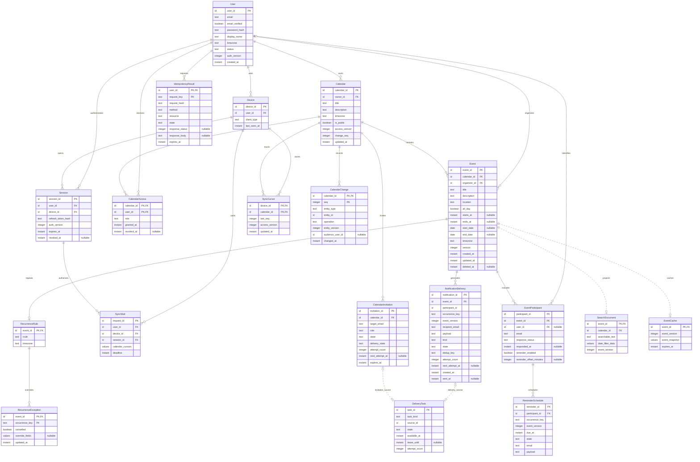

# Google Calendar

## Оглавление

1. [Тема и целевая аудитория](#глава-1-тема-и-целевая-аудитория)
2. [Расчёт нагрузки](#2-расчёт-нагрузки)
3. [Глобальная балансировка нагрузки](#3-глобальная-балансировка-нагрузки)
4. [Локальная балансировка нагрузки](#4-локальная-балансировка-нагрузки)
6. Физическая схема базы данных
7. Алгоритмы
8. Технологии
9. Обеспечение надёжности
10. Схема проекта
11. Расчёт ресурсов
12. [Список использованных источников](#список-использованных-источников)

---

## Глава 1. Тема и целевая аудитория

### 1.1 Тема проекта, рыночная ниша и аналоги

**Выбранная тема:** проектирование бэкенда высоконагруженного сервиса для планирования встреч, событий и дел - **«Google Calendar»**.

**Реальные аналоги:** Microsoft Outlook Calendar, Apple iCloud Calendar, Zoho Calendar, Calendly. Наличие независимых глобальных игроков на протяжении последних лет однозначно подтверждает существование устойчивой и крупной рыночной ниши - потребности массового пользователя и корпоративных клиентов в планировании встреч, событий, дел и синхронизации расписаний между различными устройствами.

---

### 1.2 Целевая аудитория: размер и локализация

Целевая аудитория - массовый пользователь мобильных устройств и ПК, использующий сервис для планирования встреч, событий и дел, а также корпоративные клиенты через Google Workspace. Сервис имеет глобальное распространение с выраженной концентрацией в США и развитых рынках.

#### Ключевые метрики аудитории

| Метрика | Значение | Период | Источник |
| :--- | :--- | :--- | :--- |
| **MAU (Monthly Active Users) Google Calendar** | **500 млн** | 2025–2026 | [1], [2] |
| **Пользователей Google Workspace** (включая Gmail, Drive, Calendar) | **3 млрд** | 2025 | [1], [2] |
| **Платящих B2B-компаний Workspace** | **6 млн** | 2025 | [2] |
| **Компаний из Fortune 500, использующих Google Workspace** | **40%** | 2025 | [2] |

Google не публикует отдельные метрики по количеству событий, уведомлений и устройств для Google Calendar. Эти значения выводятся в разделе 2 как расчётные продуктовые допущения на основе исследований рынка труда и официальных документов.

#### Географическое распространение (2026)

Распределение оценивается по данным о региональной структуре рынка Google Workspace (Dataintelo, 2025 [3]):

| Регион | Доля рынка | MAU (оценка) |
| :--- | :--- | :--- |
| **Северная Америка** | **38,4%** [3] | ~192 млн |
| **Европа** | **26,7%** [3] | ~134 млн |
| **Азиатско-Тихоокеанский регион** | **22,8%** [3] | ~114 млн |
| **Латинская Америка + MEA** | **~12%** [3] | ~60 млн |

---

### 1.3 Функционал MVP

Для проектирования выделены следующие **6 ключевых функций**, покрывающих основной пользовательский путь:

1. **Регистрация и авторизация.** Создание аккаунта, вход в систему и управление сессиями.
2. **Создание и редактирование календарей.** Базовое управление сущностями календарей.
3. **Управление доступом.** Каждый календарь можно сделать общедоступным либо предоставить отдельным людям доступ к нему (просмотр или редактирование) через приглашение по электронной почте.
4. **Уведомления.** Отправка уведомлений о предстоящих событиях по электронной почте.
5. **Управление событиями.** Создание и редактирование событий внутри календарей.
6. **Поиск по событиям.** Полнотекстовый поиск по названию, описанию, участникам и дате события внутри всех календарей пользователя с фильтрацией по дате и ключевым словам.

#### Ключевые продуктовые решения

1. **Хранение повторяющихся событий.** Вместо создания тысяч отдельных записей для каждой встречи (например, "планёрка каждый понедельник на год вперёд") в базе данных хранится только одно правило повторения. Конкретные встречи создаются "на лету" при просмотре календаря. Это позволяет экономить огромное количество места и легко редактировать всю серию сразу.

2. **Синхронизация между устройствами.** Когда пользователь открывает календарь на телефоне, приложение не скачивает все события заново. Оно запрашивает только те события, которые изменились с момента последнего открытия. Это экономит мобильный трафик пользователя и снижает нагрузку на серверы.

3. **Гарантированная доставка уведомлений.** Система устроена так, что напоминание о встрече может прийти дважды, но никогда не потеряется. Это важнее, чем избежать дублей, потому что пропустить напоминание о важной встрече - гораздо хуже для пользователя.

---

## 2. Расчёт нагрузки

### 2.1. Исходные продуктовые метрики

| Показатель | Значение | Основание |
| --- | --- | --- |
| Месячная аудитория (MAU) | **500 млн** | [1], [2] |
| Дневная аудитория (DAU) | **275 млн** | MAU × 55%; проектное допущение |
| Зарегистрированных аккаунтов | 3 млрд | [1], [2] |
| Событий создаётся в месяц | **3,55 млрд** | DAU × 0,43 × 30; проектная частота |
| Уведомлений доставляется в месяц | **16,8 млрд** | События × 7,9 × 0,6; проектные средние |
| Устройств на пользователя | **3** | Телефон + рабочее устройство + личное устройство |
| Окно использования календаря на DAU | **15 минут/день** | Одно активное устройство; проектное допущение |
| Sync-запросов на DAU в день | **1** | Один long-polling запрос в принятом дневном окне |
| Коэффициент пика | **4** | Утренний и вечерний пики |

#### Обоснование DAU

Для смешанной аудитории корпоративных и личных пользователей принимается проектный коэффициент DAU/MAU = 55%.
```
DAU = 500 млн × 0,55 = 275 млн
```

#### Обоснование количества событий

Частоты действий и доли сегментов ниже являются проектными допущениями.

| Сегмент | Доля | Событий/день | Обоснование частоты | Вклад |
| --- | ---: | ---: | --- | ---: |
| Корпоративные организаторы | 8% | 3,0 | Активный организатор: 3 создаваемых события/день | 0,240 |
| Корпоративные участники | 12% | 0,1 | В основном принимают приглашения, редко создают сами | 0,012 |
| Личные активные | 20% | 0,8 | Типичный паттерн: 5-6 личных событий в неделю | 0,160 |
| Пассивные | 45% | 0,03 | ~1 событие в месяц | 0,0135 |
| Минимальные | 15% | 0,005 | 1-2 события в год | 0,00075 |
| **Итого** | **100%** | — | — | **0,426 ≈ 0,43** |

```
Событий в месяц = 275 млн × 0,43 × 30 ≈ 3,55 млрд
```

#### Обоснование количества уведомлений

Уведомления считаются как фан-аут событий на участников. 

Среднее число участников определяется проектной сегментацией. Лимит гостей — 200 [4]; модель участника описана в iCalendar [5].

| Тип события | Доля | Участников | Обоснование | Вклад |
| --- | ---: | ---: | --- | ---: |
| Личная встреча | 50% | 1,5 | Встречи 1-на-1, личные дела | 0,75 |
| Рабочая встреча | 35% | 5 | Проектное среднее: 5 участников | 1,75 |
| Крупное мероприятие | 12% | 20 | Командные встречи, тренинги | 2,40 |
| Массовое | 3% | 100 | All-hands, вебинары (лимит 200 [4]) | 3,00 |
| **Итого** | **100%** | — | Средневзвешенное количество участников | **7,9** |

Принимаем, что **60% событий генерируют уведомления** (остальные 40% - личные заметки и события без гостей, которые не требуют фан-аута).

```
Уведомлений в месяц = 3,55 млрд × 7,9 × 0,6 ≈ 16,8 млрд
```

#### Обоснование частоты синхронизации

Проектный сценарий: одно 15-минутное окно открытого календаря на DAU в день и одно одновременно активное устройство. В окне выполняется один GET /sync: ответ при наличии изменений либо через 900 секунд; при закрытии календаря запрос отменяется. В пределах принятого окна завершённый запрос не запускается повторно. Email-уведомления работают независимо от открытого приложения.

```text
Sync-запросов/сутки = 275 млн DAU × 1 = 275 млн
Средний Sync RPS = 275 млн / 86 400 ≈ 3 183
Пиковый Sync RPS = round(275 млн / 86 400 × 4) = 12 731
Q_peak = ceil(275 млн × 900 / 86 400 × 4) = 11 458 334 ожидания
```

Q_peak — оценка при ожидании всех запросов до таймаута и распределённых началах окон с коэффициентом пика 4; ранние ответы и закрытие уменьшают её. Три устройства относятся к хранению за 30 дней, а не к одновременному подключению. Время использования — допущение, не опубликованная статистика сервиса.

Для объёмов хранения используются двоичные приставки: 1 КиБ = 1024 Б, 1 МиБ = 1024² Б, 1 ГиБ = 1024³ Б, 1 ТиБ = 1024⁴ Б. Для сетевого трафика используются десятичные приставки: 1 Гбит/с = 10⁹ бит/с.

---

### 2.2. Действия пользователей и RPS

$$N_i = DAU \times a_i, \quad RPS_{avg,i} = \frac{N_i}{86\,400}, \quad RPS_{peak,i} = 4 \times RPS_{avg,i}$$

| Действие | Метод | На DAU в день | Млн запросов/сутки | Средний RPS | Пиковый RPS |
| --- | --- | --: | --: | --: | --: |
| Вход / регистрация | `POST /auth/login` | 0,01 | 2,75 | 32 | 127 |
| Обновление сессии | `POST /auth/refresh` | 0,3 | 82,5 | 955 | 3 819 |
| Создание календаря | `POST /calendars` | 0,001 | 0,275 | 3 | 13 |
| Редактирование календаря | `PATCH /calendars/{id}` | 0,01 | 2,75 | 32 | 127 |
| Создание события | `POST /events` | 0,43 | 118,25 | 1 369 | 5 475 |
| Редактирование события | `PATCH /events/{id}` | 0,22 | 60,5 | 700 | 2 801 |
| Удаление события | `DELETE /events/{id}` | 0,07 | 19,25 | 223 | 891 |
| Приглашение / изменение доступа | `POST /calendars/{id}/share` | 0,02 | 5,5 | 64 | 255 |
| Ответ на приглашение | `POST /events/{id}/respond` | 0,05 | 13,75 | 159 | 637 |
| Поиск по событиям | `GET /search` | 0,5 | 137,5 | 1 591 | 6 366 |
| Синхронизация устройств (long-polling) | `GET /sync` | 1 | 275 | 3 183 | 12 731 |
| **Итого** | - | **2,611** | **718,025** | **8 311** | **33 242** |

Создание событий: `3,55 млрд/мес ÷ 30 дней ÷ 275 млн DAU = 0,43`. Sync — один запрос на DAU в принятом дневном окне; RPS округлены по строкам, итог — сумма строк.

---

### 2.3. Хранилище активного пользователя

| Тип данных | Количество | Б/объект | Объём, Б |
| --- | ---: | ---: | ---: |
| Профиль и настройки | 1 | 965 | 965 |
| Личные календари | 5 | 3 480 | 17 400 |
| Доступ к чужим календарям | 10 | 48 | 480 |
| События за 5 лет | 785 | 3 513 | 2 757 705 |
| Участники событий | 785×7,9 | 80 | 496 120 |
| Правила повторения | 785×10% | 640 | 50 240 |
| Исключения серии | 785×1% | 160 | 1 256 |
| Уведомления за 30 дней | ≈61 | 1 040 | 63 440 |
| Напоминания на 7 дней | ≈4,28 | 1 040 | 4 451,2 |
| Устройства | 3 | 96 | 288 |
| Сессии | 3 | 256 | 768 |
| Курсоры синхронизации | 3×15 | 48 | 2 160 |
| Поисковая проекция | 785 | 500 | 392 500 |
| Итого | — | — | ≈3,61 МиБ |

Это расчётный профиль активного пользователя, а не среднее по 3 млрд зарегистрированных аккаунтов. Глобальная ёмкость ниже считается по числу объектов и потокам их создания; приглашения, журнал и рабочие буферы учитываются отдельно.

---

### 2.4. Общий объём хранения

| Тип данных | Количество, млн | Б/объект | Объём, ТиБ |
| --- | ---: | ---: | ---: |
| Профиль и авторизация | 3 000 | 965 | 2,633 |
| Календарь и публичность | 15 000 | 3 480 | 47,476 |
| Права доступа | 30 000 | 48 | 1,310 |
| Email-приглашение | 165 | 160 | 0,024 |
| Событие | 213 000 | 3 513 | 680,547 |
| Участник и ответ | 1 682 700 | 80 | 122,433 |
| Правило повторения | 21 300 | 640 | 12,398 |
| Исключение серии | 2 130 | 160 | 0,310 |
| Расписание напоминания | 1 176 | 1 040 | 1,112 |
| История доставки | 16 800 | 1 040 | 15,891 |
| Устройство | 1 500 | 96 | 0,131 |
| Сессия | 1 500 | 256 | 0,349 |
| Курсор календаря | 22 500 | 48 | 0,982 |
| Поисковая проекция | 213 000 | 500 | 96,861 |
| Результаты идемпотентных запросов | 1 222,128 | 2 048 | 2,276 |
| Основные данные и проекции | — | — | 984,733 |
| Журнал и рабочие очереди | Проектный бюджет | — | 9,924 |
| Итого полезное хранение | — | — | 994,657 |
| Кеш и буферы long-polling (RAM) | Проектный бюджет | — | 10,530 |
| Хранение и рабочая память, без репликации | — | — | 1 005,187 |

Ёмкость событий: 3,55 млрд/месяц × 60 месяцев = 213 млрд записей до вычета досрочных удалений. 3 513 Б — размер самого события; участники и повторения считаются дополнительно. Проектные параметры: 7,9 участника/событие, 10% повторяющихся событий, 1% исключений; размеры остальных записей — проектные бюджеты. Итог объединяет полезное хранение и рабочую память; индексы СУБД и резервные копии не входят.

---

### 2.5. Сетевой трафик

$$V_{day,i} = \frac{N_i \times S_i}{10^9} \text{ [ГБ]}, \quad B_{peak,i} = \frac{V_{day,i} \times 8 \times 4}{86\,400} \text{ [Гбит/с]}$$

| Тип трафика | Направление | ГБ/сутки | Пик, Гбит/с |
| --- | --- | --: | --: |
| API: входящие запросы | Входящий | 765 | 0,28 |
| API: ответы | Исходящий | 4 412 | 1,63 |
| Синхронизация: запросы | Входящий | 137,5 | 0,05 |
| Синхронизация: ответы | Исходящий | 162,25 | 0,06 |
| Уведомления, включая запущенные напоминаниями | Исходящий | 560 | 0,21 |
| Email-приглашения в календарь | Исходящий | 5,632 | 0,002 |
| **Всего входящий** | Клиент - сервис | **902,5** | **0,33** |
| **Всего исходящий** | Сервис - клиент | **5 139,882** | **1,90** |

Sync-запрос — 500 Б, средний ответ — 590 Б. Расчёт использует неокруглённые значения; таблица показывает округлённый трафик.

С **20% запасом** на транспортные накладные расходы:

| Направление | Без запаса | С запасом 20% |
| --- | --: | --: |
| Входящий | 0,33 Гбит/с | **0,40 Гбит/с** |
| Исходящий | 1,90 Гбит/с | **2,28 Гбит/с** |

---

## 3. Глобальная балансировка нагрузки

### 3.1 Функциональное разбиение по поддоменам

| Поддомен | Назначение | Транспорт | Таймаут | Выбор ДЦ |
| --- | --- | --- | --- | --- |
| api.calendar.google.com | Авторизация, календари, доступ и события | HTTPS | 5–30 с | GeoDNS + ECS |
| sync.calendar.google.com | Инкрементальная синхронизация | HTTPS long-polling | Ожидание до 900 с; прокси-таймаут 930 с | GeoDNS + ECS |
| search.calendar.google.com | Поиск по событиям | HTTPS | 60–120 с | GeoDNS + ECS |

Поддомены позволяют независимо масштабировать сервисы и задавать таймауты. DNS выбирает адрес ДЦ, а локальные L4/L7 выполняют балансировку соединений и запросов.

### 3.2 Обоснование расположения ДЦ и их ролей

| ДЦ | Регион | Доля | Роль |
| --- | --- | ---: | --- |
| Франкфурт | Европа | 26,7% | Единый мастер и локальное чтение |
| Вирджиния | Северная Америка | 38,4% | Реплика для чтения |
| Мумбаи | АТР | 22,8% | Реплика для чтения |
| Сан-Паулу | Латинская Америка и MEA | 12,1% | Реплика для чтения |

Расположение соответствует аудитории раздела 1. Все изменения фиксируются во Франкфурте; содержимое читается из региональной реплики. Права доступа и отзыв сессии проверяются по актуальному состоянию мастера через приватные сервисные соединения.

### 3.3 Распределение трафика по ДЦ

Из раздела 2.2: клиентский пик 33 242 RPS; операции изменения — 14 145 RPS, чтение и Sync — 19 097 RPS. Клиентские запросы распределяются по региональным долям методом наибольших остатков; неевропейские изменения дополнительно обрабатываются во Франкфурте.

| ДЦ | Клиентские RPS | Из них запись | Проксированные записи, дополнительно | Обработки Ingress/с | Клиентский вход, Гбит/с | Клиентский выход, Гбит/с |
| --- | ---: | ---: | ---: | ---: | ---: | ---: |
| Вирджиния | 12 765 | 5 432 | 0 | 12 765 | 0,154 | 0,877 |
| Франкфурт | 8 876 | 3 777 | 10 368 | 19 244 | 0,107 | 0,610 |
| Мумбаи | 7 579 | 3 225 | 0 | 7 579 | 0,091 | 0,521 |
| Сан-Паулу | 4 022 | 1 711 | 0 | 4 022 | 0,049 | 0,276 |
| Всего | 33 242 | 14 145 | 10 368 | 43 610 | 0,401 | 2,284 |

| Межрегиональный поток | Расчёт |
| --- | --- |
| Проксирование записи | 10 368 запросов/с; при 1 КиБ запроса и ответа — 0,085 Гбит/с в каждом направлении |
| Проверка актуальной авторизации | Верхняя оценка 33 242−8 876=24 366 приватных RPC/с; при 1 КиБ запроса и ответа — 0,200 Гбит/с в каждом направлении Франкфурта |
| Передача журнала в три ДЦ | 16 381 изменений/с × 256 Б × 8 × 3 = 0,101 Гбит/с; содержимое объектов передаётся отдельно |

Служебные RPC используют постоянные соединения и не проходят через внешний Ingress. Журнал переносит порядок изменений и tombstones, но не заменяет полную передачу содержимого данных.

### 3.4 Схема DNS балансировки (GeoDNS + EDNS)

GeoDNS возвращает адрес регионального ДЦ. При поддержке ECS резолвер передаёт префикс клиентской подсети; иначе выбор выполняется по адресу резолвера. TTL записи — 30 с: он ограничивает время кеширования DNS, но не срок существования уже открытого long-polling соединения.

### 3.5 Отказ от BGP Anycast для прикладного трафика

Глобальный BGP Anycast не используется. Внутри ДЦ ECMP распределяет потоки между локальными L4.

### 3.6 Механизм регулировки трафика между ДЦ

При отказе ДЦ health checks исключают его из DNS-выдачи; клиент переподключается к доступному региону с задержкой и случайным разбросом повторов. Перенос нагрузки требует свободной ёмкости принимающего ДЦ; локальное N×2 защищает от потери группы внутри ДЦ, а не от любого межрегионального переноса.

При отказе Франкфурта запись и операции, требующие актуальной авторизации, приостанавливаются до ручного выбора нового мастера. Старый мастер изолируется от записи; доступность и позиция реплики проверяются до переключения. Асинхронные копии допускают потерю последних изменений; обратно мастер переключается только после согласования данных.

---

## 4. Локальная балансировка нагрузки

### 4.1 Схема балансировки и уровни резервирования

GeoDNS возвращает клиенту IP регионального ДЦ. После этого клиент подключается напрямую к его L4; DNS не участвует в передаче HTTP-трафика.

```text
                 [ Клиент → IP регионального ДЦ ]
                                │
                                ▼
┌──────────────────────────────────────────────────────────────────┐
│ 1. L4: балансировка TCP-соединений                               │
│    • BGP-анонс VIP; ECMP от двух маршрутизаторов                 │
│    • Maglev: GRE к NGINX; ответ клиенту напрямую (DSR)           │
│    • Резервирование: N+1, группы A и B в режиме active-active    │
└───────────────────────────────┬──────────────────────────────────┘
                                │ TCP / TLS
                                ▼
┌──────────────────────────────────────────────────────────────────┐
│ 2. L7: NGINX Ingress                                             │
│    • TLS termination и маршрутизация к API / Sync / Search       │
│    • API: weighted round-robin; Search/Sync: least_conn          │
│    • Sync: HTTPS long-polling, ожидание до 900 секунд            │
│    • Резервирование: N×2, независимые группы A и B               │
└───────────────────────────────┬──────────────────────────────────┘
                                │ HTTP, переиспользуемые соединения
                                ▼
┌──────────────────────────────────────────────────────────────────┐
│ 3. Межсервисная клиентская балансировка                          │
│    • Service discovery и выбор доступного endpoint               │
│    • Least request для HTTP-вызовов                              │
│    • Резервирование: минимум два экземпляра каждого сервиса      │
└──────────────────────────────────────────────────────────────────┘

Запись из другого ДЦ:
Региональный API → внутренний Ingress Франкфурта → API записи
                 → VIP пулеров (1 активный + 1 резервный) → мастер
```

Внутренний Ingress Франкфурта входит в его общий пул L7; местные записи идут из Ingress сразу к API записи. Проверки актуальных прав выполняются по приватным сервисным соединениям.

### 4.2 Алгоритмы и резервирование

#### 4.2.1 Алгоритмы балансировки

| Уровень | Компонент | Алгоритм | Причина выбора |
| --- | --- | --- | --- |
| Вход в ДЦ | Два маршрутизатора | ECMP по параметрам потока | Распределение потоков между активными L4 |
| L4 → NGINX | Программный L4 по схеме Maglev [11] | Согласованное хеширование и учёт соединений | Устойчивое назначение TCP-потоков; GRE доставляет пакеты, DSR возвращает ответы в обход L4 |
| NGINX → API, включая внутренний вход Франкфурта | Общий пул NGINX Ingress | Weighted Round Robin, фиксированные веса | Простое распределение коротких запросов с учётом мощности экземпляров |
| NGINX → Search | Общий пул NGINX Ingress | Weighted Least Connections (`least_conn` с весами) | Учёт активных соединений при различной длительности поиска |
| NGINX → Sync | Общий пул NGINX Ingress | Least Connections | Распределение ожидающих long-polling соединений и расхода памяти |
| Межсервисный HTTP | Клиентский балансировщик | Least Request | Учёт выполняемых запросов при переиспользовании соединений |

Веса фиксированы и не корректируются автоматически. `least_conn` не измеряет стоимость запроса или CPU; длительное ожидание Sync не считается медленным выполнением. Алгоритмы NGINX — в [документации](https://nginx.org/en/docs/http/ngx_http_upstream_module.html).

#### 4.2.2 Режимы резервирования и переключение

| Компонент | Формула / количество | Режим | Протокол / механизм переключения |
| --- | --- | --- | --- |
| Маршрутизаторы | N+1, независимые пути | Active-Active | Маршрутизация BGP и исключение недоступного пути; оставшийся маршрутизатор выдерживает поток |
| L4 | N+1 | Active-Active | BGP-анонс VIP + ECMP; проверка L4 и отзыв маршрута при отказе [11] |
| Общий пул NGINX | N×2, две независимые группы | Active-Active | Health checks со стороны L4 и исключение недоступного NGINX; API/Search/Sync используют один расчётный пул L7 |
| API / Search / Sync | N×2 для каждого сервиса; N определяется его нагрузкой и производительностью. | Active-Active | Readiness, service discovery и исключение по ошибкам; количество определяется нагрузкой |
| Пулеры во Франкфурте | N+1, каждый выдерживает полный поток | Active-Passive | Keepalived/VRRP, общий VIP и проверка процесса пулера; резервный принимает VIP |

N×2 рассчитано на потерю целой группы; N+1 технически применимо и рассчитано на потерю одного узла. Минимум два экземпляра сервиса сам по себе не доказывает достаточность мощности. При плановом отключении используется graceful drain; отказ может оборвать TCP-соединения, Sync переподключается с курсором.

Пулеры размещаются в общей локальной сети; активный предоставляет соединение на транзакцию. [VRRP (RFC 9568)](https://www.rfc-editor.org/rfc/rfc9568.html) переключает VIP, но не сохраняет соединения: приложения переподключаются. Запись повторяется только с тем же ключом идемпотентности и телом запроса.

### 4.3 Расчёт количества

| Параметр | Значение |
| --- | --- |
| Нагрузка | Региональные обработки Ingress из раздела 3.3 |
| NGINX, 8 CPU без HT [8] | 31 485 новых TLS-соединений/с; 8,64 Гбит/с в отдельных тестах |
| Коэффициент загрузки u | 0,8: 25 188 TLS-соединений/с; 6,912 Гбит/с |
| Консервативный TLS-сценарий | Каждый запрос, включая Sync и проксированную запись, создаёт новое TLS-соединение |
| Одновременные Sync-запросы | Q=11 458 334 по сценарию раздела 2.1; одно активное устройство на пользователя |
| Проектный L7-узел | 8 физических ядер сопоставимого класса, 192 ГиБ RAM |
| Условная память ожидания | 64 КиБ на запрос и пару соединений; сценарий оценки, не измеренный расход NGINX |
| Сетевые допущения | Дополнительно 3 КиБ TLS/TCP-обмена в каждом направлении на новое соединение; проксированная запись — по 1 КиБ запроса и ответа |
| L4, ориентир Maglev [11] | 10 Гбит/с на узел; с u=0,8 — 8 Гбит/с. Проектный запас IPv4/GRE — 30% к входящему потоку |

T_i — обработки Ingress/с, p_i — доля региона. Q_i распределяются методом наибольших остатков из Q. Базовые B_in и B_out берутся из неокруглённых расчётов раздела 2.5; сеть измеряется в Гбит/с.

```text
B_in,base = 902,5 × 8 × 4 / 86 400 × 1,2 = 0,401111… Гбит/с
B_out,base = 5 139,882 × 8 × 4 / 86 400 × 1,2 = 2,284392 Гбит/с
B_proxy,F = 10 368 × 1 024 × 8 / 10^9; в других ДЦ B_proxy = 0
B_in,i  = B_in,base × p_i + T_i × 3 072 × 8 / 10^9 + B_proxy,i
B_out,i = B_out,base × p_i + T_i × 3 072 × 8 / 10^9 + B_proxy,i

N_TLS = ceil(T_i / 25 188)
N_net = ceil(max(B_in,i, B_out,i) / 6,912)
N_conn = ceil(Q_i × m / (0,8 × 192 × 2^30)); m = 65 536 Б
L7_i = 2 × max(N_TLS, N_net, N_conn)
L4_i = 2 × ceil(1,3 × B_in,i / 8)
```

| ДЦ | T_i, соединений/с | Вход / выход, Гбит/с | Q_i, ожиданий | N_TLS | N_net | N_conn | L7 с резервом | L4 с резервом |
| --- | ---: | ---: | ---: | ---: | ---: | ---: | ---: | ---: |
| Вирджиния | 12 765 | 0,468 / 1,191 | 4 400 000 | 1 | 1 | 2 | 4 | 2 |
| Франкфурт | 19 244 | 0,665 / 1,168 | 3 059 375 | 1 | 1 | 2 | 4 | 2 |
| Мумбаи | 7 579 | 0,278 / 0,707 | 2 612 500 | 1 | 1 | 2 | 4 | 2 |
| Сан-Паулу | 4 022 | 0,147 / 0,375 | 1 386 459 | 1 | 1 | 1 | 2 | 2 |
| Всего | 43 610 | 1,558 / 3,441 | 11 458 334 | 4 | 4 | 7 | 14 | 8 |

Пример для Вирджинии: N_conn=ceil(4 400 000×65 536/(0,8×192×2^30))=2; L7=2×max(1,1,2)=4, L4=2×ceil(1,3×0,467739/8)=2.

Итог — предварительно 14 L7 и 8 L4, два пулера отдельно. Производительность подтверждается тестом совместной нагрузки: память, клиентские/upstream-соединения, TLS и сеть; отдельные тесты [8] не измеряют long-polling. Keep-alive и TLS resumption не уменьшают расчёт без измерений, ориентир Maglev не переносится на произвольный L4.

---
## 5. Логическая схема базы данных

### 5.1 Схема и описание данных

На схеме показаны данные, необходимые для MVP и API из разделов 1–2, включая служебные наборы, кеш и буферы [13]. Идентификаторы и связи логические; выбор СУБД, индексов и шардинга относится к части 6.



`PK` — логический ключ, `FK` — ссылка, `nullable` — необязательное поле. `||` означает один объект, `o|` — ноль или один, `o{` — ноль или много. Пунктир обозначает связь производных данных или задания с источником. Типы полей смысловые, без привязки к СУБД. У `DeliveryTask` поле `task_kind` определяет единственный источник `source_id`: `NotificationDelivery` либо `CalendarInvitation`, а не оба одновременно.

| Сущность | Назначение и основные поля |
| --- | --- |
| `User` | Профиль, авторизация и настройки пользователя. Ключ: `user_id`. |
| `Calendar` | Календарь, владелец, публичность и позиция изменений. Ключ: `calendar_id`. |
| `Event` | Событие или шаблон серии; дата/время и версия. Ключ: `event_id`. |
| `RecurrenceRule` | Правило повторения и часовой пояс серии по RFC 5545 [5]. Ключ: `event_id`. |
| `RecurrenceException` | Отмена или перенос вхождения по исходному началу. Ключ: `event_id`, `occurrence_key`. |
| `Device` | Устройство пользователя и время последней активности. Ключ: `device_id`. |
| `CalendarAccess` | Право reader/writer; владелец указан в Calendar. Ключ: `calendar_id`, `user_id`. |
| `EventParticipant` | Адресат, ответ и настройка email-напоминания; user_id необязателен. Ключ: `participant_id`. |
| `ReminderSchedule` | Напоминание адресату о вхождении в ближайшие 7 дней. Ключ: `reminder_id`. |
| `NotificationDelivery` | Письмо о событии/напоминание и состояние доставки. Ключ: `notification_id`. |
| `Session` | Сессия устройства, хеш refresh-токена, срок и отзыв. Ключ: `session_id`. |
| `CalendarInvitation` | Приглашение на календарь по email, роль и отправка письма. Ключ: `invitation_id`. |
| `CalendarChange` | Журнал изменений и удалений для Sync и потребителей. Ключ: `calendar_id`, `seq`. |
| `DeliveryTask` | Очередь со ссылкой на доставку или email-приглашение. Ключ: `task_id`. |
| `SearchDocument` | Проекция названия, описания, участников и дат для поиска. Ключ: `event_id`. |
| `IdempotencyResult` | Ключ и хеш изменяющего запроса, состояние и ответ. Ключ: `user_id`, `request_key`. |
| `SyncCursor` | Подтверждённая позиция календаря для устройства. Ключ: `device_id`, `calendar_id`. |
| `SyncWait` | RAM: контекст ожидающего Sync и буферы соединений. Ключ: `request_id`. |
| `EventCache` | RAM: восстанавливаемый снимок основного события с версией. Ключ: `event_id`. |

### 5.2 Размеры данных и нагрузка

Используются метрики раздела 2: 3 млрд аккаунтов, MAU 500 млн, DAU 275 млн, 7,9 участника на событие. Размеры записей — средние проектные бюджеты, включая перечисленные на схеме поля. Для основных данных сохранены оценки раздела 2.4; это полезный объём одной копии без физических индексов и репликации.

`Объём, ТиБ = количество записей × Б/запись / 2^40`; `QPSср = обращений за сутки / 86 400`; `QPSпик = 4 × QPSср`. QPS означает логические обращения: пакет участников или курсоров считается одним обращением, но содержит несколько строк. В таблице QPS округлены до целых, значения меньше 1 — до сотых; для RAM-наборов это обращения к памяти.

| Набор | Записей, млн | Б/запись | Объём, ТиБ | QPS чтение ср./пик | QPS запись ср./пик | Срок хранения |
| --- | ---: | ---: | ---: | ---: | ---: | --- |
| `User` | 3 000,000 | 965 | 2,633 | 13 148 / 52 594 | 0,32 / 1 | До удаления аккаунта |
| `Calendar` | 15 000,000 | 3 480 | 47,476 | 12 095 / 48 380 | 2 549 / 10 198 | До удаления календаря |
| `Event` | 213 000,000 | 3 513 | 680,547 | 11 418 / 45 671 | 2 451 / 9 803 | 5 лет; действующая серия — до завершения |
| `RecurrenceRule` | 21 300,000 | 640 | 12,398 | 3 345 / 13 380 | 229 / 917 | Вместе с серией |
| `RecurrenceException` | 2 130,000 | 160 | 0,310 | 3 345 / 13 380 | 23 / 92 | Вместе с серией |
| `Device` | 1 500,000 | 96 | 0,131 | 987 / 3 947 | 987 / 3 947 | 30 дней неактивности |
| `CalendarAccess` | 30 000,000 | 48 | 1,310 | 12 095 / 48 380 | 64 / 255 | До отзыва |
| `EventParticipant` | 1 682 700,000 | 80 | 122,433 | 9 826 / 39 306 | 2 451 / 9 803 | Вместе с событием |
| `ReminderSchedule` | 1 176,000 | 1 040 | 1,112 | 1 944 / 7 778 | 4 166 / 16 663 | Горизонт 7 дней |
| `NotificationDelivery` | 16 800,000 | 1 040 | 15,891 | 6 481 / 25 926 | 19 444 / 77 778 | 30 дней после завершения |
| `Session` | 1 500,000 | 256 | 0,349 | 13 053 / 52 212 | 987 / 3 947 | До истечения; учёт за 30 дней |
| `CalendarInvitation` | 165,000 | 160 | 0,024 | 95 / 382 | 127 / 509 | 30 дней |
| `CalendarChange` | 42 459,552 | 256 | 9,886 | 14 014 / 56 057 | 2 549 / 10 198 | Не менее 30 дней |
| `DeliveryTask` | 141,375 | 256 | 0,033 | 6 545 / 26 181 | 19 635 / 78 542 | До подтверждения; ёмкость на 1 час пика |
| `SearchDocument` | 213 000,000 | 500 | 96,861 | 1 591 / 6 366 | 2 451 / 9 803 | Вместе с событием |
| `IdempotencyResult` | 1 222,128 | 2 048 | 2,276 | 3 536 / 14 145 | 7 072 / 28 289 | 24 часа для результата |
| `SyncCursor` | 22 500,000 | 48 | 0,982 | 3 183 / 12 731 | 3 183 / 12 731 | 30 дней неактивности |
| `SyncWait` | 11,458 | 65 536 | 0,683 | 3 183 / 12 731 | 6 366 / 25 463 | До 900 с |
| `EventCache` | 2 643,292 | 4 096 | 9,847 | 318 / 1 273 | 2 769 / 11 076 | До 15 минут |
| Служебные позиции и резерв журнала/очередей | — | — | 0,005 | — | — | По состоянию обработки |
| **Всего, включая RAM** | | | **1 005,187** | | | |

Количество основных записей рассчитывается так: календари — `3 млрд × 5`; права — `3 млрд × 10`; события — `3,55 млрд/месяц × 60 месяцев`; участники — `события × 7,9`; правила — `события × 10%`; исключения — `события × 1%`. Устройства и сессии — `500 млн × 3`, курсоры — `500 млн × 3 × 15`. Профиль 965 Б включает авторизацию; событие 3 513 Б не включает участников, повторения и поисковую проекцию. Настройка одного email-напоминания входит в запись участника.

**Допущения для временных данных:**

- Доставки событий `H = 16,8 млрд / 30 = 560 млн/сутки`. Из них 30% — напоминания по времени: `R = 168 млн/сутки`, расписание на 7 дней — `1,176 млрд` записей; остальные 70% — уведомления об изменениях. Приглашения в календарь — ещё `5,5 млн/сутки`, за 30 дней — `165 млн` записей.
- Идемпотентные результаты хранятся 24 часа: резерв `14 145 пиковых изменений/с × 86 400 = 1 222,128 млн` записей. Это ёмкость на сутки непрерывного пика, а не средний суточный поток.
- Для журнала сохраняется бюджет раздела 3.3: `16 381 × 86 400 × 30` записей по 256 Б. Для очереди — час пикового потока email с запасом 50%: `Q / 86 400 × 4 × 3 600 × 1,5` записей по 256 Б. Неиспользованный остаток бюджета 9,924 ТиБ — служебные позиции и резерв.
- Буферы Sync: `11 458 334 × 65 536 Б = 0,683 ТиБ`. Это тот же бюджет соединений, что в разделе 4.3; повторно прибавлять его к ресурсам L7 нельзя. Остаток RAM-бюджета 10,530 ТиБ отведён кешу: запись 4 096 Б, TTL до 15 минут; указан предел вместимости, а не фактическое заполнение.

**Расчёт обращений.** Суточные потоки из раздела 2.2, в млн: `L=2,75` — вход; `F=82,5` — refresh; `C=0,275` и `K=2,75` — создание/изменение календаря; `E=118,25`, `U=60,5`, `D=19,25` — создание/изменение/удаление события; `A=5,5` — доступ; `B=13,75` — ответ участника; `S=137,5` — поиск; `Y=275` — Sync. Производные: `T=718,025` — все запросы, `W=T−S−Y`, `Z=E+U+D+B`, `M=Z+C+K+A`, `Q=H+A`, `V=K+E+U+D+A+B+2S+2Y`.

Приняты: 1% входов — регистрации; выдача доступа в расчётном сценарии — зарегистрированному пользователю. Авторизованный запрос читает сессию и состояние пользователя; поиск/Sync повторяют проверку перед ответом. Проверки календарей и прав пакетные, в среднем по 15 календарей. У 10% Sync есть одно изменившееся событие (`f=0,1`); поиск выдаёт до 20 кандидатов, в 10% запросов проверяется одна серия (`p=0,1`). При записи 10% событий затрагивают правило, 1% — исключение; 30% изменений/удалений перепланируют напоминания.

Число обращений **чтение / запись за сутки** для воспроизведения QPS:

```text
User                 L+A+(T−L)+S+Y          / 0,01L
Session              T−L+S+Y                / L+F
Device               L+F                   / L+F
Calendar             V                     / M
CalendarAccess       V                     / A
CalendarInvitation   L+A                   / 2A
Event                U+D+B+S+fY+H+R        / Z
EventParticipant     U+D+B+fY+H+R          / E+U+D+B
RecurrenceRule       U+D+fY+R+pS           / 0,1(E+U+D)
RecurrenceException  U+D+fY+R+pS           / 0,01(E+U+D)
ReminderSchedule     R                     / 2R+0,3(U+D)
NotificationDelivery H                     / 3H
CalendarChange       2Y+3M                 / M
SyncCursor           Y                     / Y
SearchDocument       S                     / Z
IdempotencyResult    W                     / 2W
DeliveryTask         Q                     / 3Q
EventCache           fY                    / fY+Z
SyncWait             Y                     / 2Y
```

Планировщик читает событие, участника, правило и исключения на каждое напоминание; отправитель — событие, адресата и состояние доставки. Три потребителя читают журнал для поиска, кеша и уведомлений. Доставка записывается при создании, начале отправки и результате; очередь — при постановке, захвате и подтверждении; идемпотентная операция — при начале и завершении. Изменения события продвигают версию и позицию календаря. Успешные попадания в кеш не уменьшают оценку чтений источника.

Пакет не равен строке: запись участников затрагивает в среднем `7,9E+U+B+7,9D = 1 160,5 млн` строк/сутки; чтение/запись курсоров — `15Y = 4 125 млн` строк/сутки. QPS таблицы описывает обычную работу без повторов, очистки истёкших данных и полной пересинхронизации. Повторы увеличивают нагрузку доставки пропорционально числу попыток; очистка в установившемся режиме удаляет столько записей, сколько создаётся. Число событий для ёмкости округлено до 3,55 млрд/месяц, для QPS используется исходный суточный поток раздела 2.2.

### 5.3 Консистентность и распределение нагрузки

- **Авторизация и доступ:** проверки используют актуальное состояние согласно разделу 3. Отзыв права исключает дальнейшую выдачу данных через API, поиск и Sync; участник события не получает автоматически доступ ко всему календарю. Приглашение незарегистрированному адресу активируется после подтверждения соответствующего email.
- **События:** изменение события, участников/серии, версии и записи журнала — одна логическая операция. Для серии хранится правило, а не все вхождения; исключение идентифицируется исходным началом вхождения. Время хранится с именем часового пояса; для события на весь день используются даты. Конец интервала исключающий.
- **Синхронизация:** изменения упорядочены внутри календаря, удаления передаются как tombstone. Курсор хранит подтверждённую устройством позицию; при выходе за 30-дневное окно нужна полная синхронизация. Позиция ответа не опережает доступную версию данных. Поиск и кеш обновляются с допустимой задержкой, но перед выдачей проверяются актуальные права и удаление события.
- **Доставка и повторы:** задания обрабатываются как минимум один раз, поэтому возможны дубли email. Недоставленные задания и ещё не обработанные обязательным потребителем записи журнала не удаляются только из-за TTL; длительный отказ требует дополнительной ёмкости. Идемпотентный ключ защищает от повторного изменения при том же запросе в течение 24 часов. Риск потери последних изменений при аварии мастера остаётся таким, как принят в разделе 3.
- **Нагрузка по ключам:** популярные календари создают горячие `calendar_id`; массовые события — всплески по `event_id` и участникам; начала встреч в :00/:30 — пики по `due_at`. Пользователи активны неравномерно, повторные запросы концентрируются на ключах идемпотентности, а восстановление связи создаёт волну Sync. Средние 7,9 участника не заменяют продуктовый предел 200 гостей [4].

Файловые вложения в MVP не предусмотрены; email-содержимое учтено в доставках и напоминаниях. Основные данные и проекции занимают 984,733 ТиБ, журнал и очереди с резервом — 9,924 ТиБ, кеш и буферы — 10,530 ТиБ; суммарно 1 005,187 ТиБ, как в разделе 2.4. Постоянное хранение и RAM учитываются раздельно при дальнейшем расчёте ресурсов.

---


## Список использованных источников

1. Exploding Topics — *Google Workspace User Stats (2025)*. https://explodingtopics.com/blog/google-workspace-stats
2. Patronum — *Key Google Workspace Statistics for 2025*. https://www.patronum.io/key-google-workspace-statistics-for-2023/
3. Dataintelo — *Google Workspace Market Regional Outlook 2025–2034*. https://dataintelo.com/report/google-workspace-for-market
4. Google Calendar Help — *Guest limit for invitations*. https://support.google.com/calendar/answer/37161
5. RFC 5545 — *Internet Calendaring and Scheduling Core Object Specification (iCalendar)*. https://datatracker.ietf.org/doc/html/rfc5545
6. Android Developers — *PeriodicWorkRequest*. https://developer.android.com/reference/androidx/work/PeriodicWorkRequest
7. Microsoft Work Trend Index 2026 — *Agents, Human Agency, and the Opportunity for Every Organization*. https://www.microsoft.com/en-us/worklab/work-trend-index/
8. NGINX — *Testing the Performance of NGINX Ingress Controller for Kubernetes* (2019). https://blog.nginx.org/blog/testing-performance-nginx-ingress-controller-kubernetes
9. NGINX — *Testing the Performance of NGINX and NGINX Plus Web Servers* (2017). https://blog.nginx.org/blog/testing-the-performance-of-nginx-and-nginx-plus-web-servers
10. James Somers — *Heroku's Ugly Secret*. https://genius.com/James-somers-herokus-ugly-secret-annotated
11. Google Research — *Maglev: A Fast and Reliable Software Network Load Balancer*. https://research.google.com/pubs/pub44824.html
12. Badoo — *Автоматический подбор весов в балансировщике*. https://habr.com/company/oleg-bunin/blog/310366/
