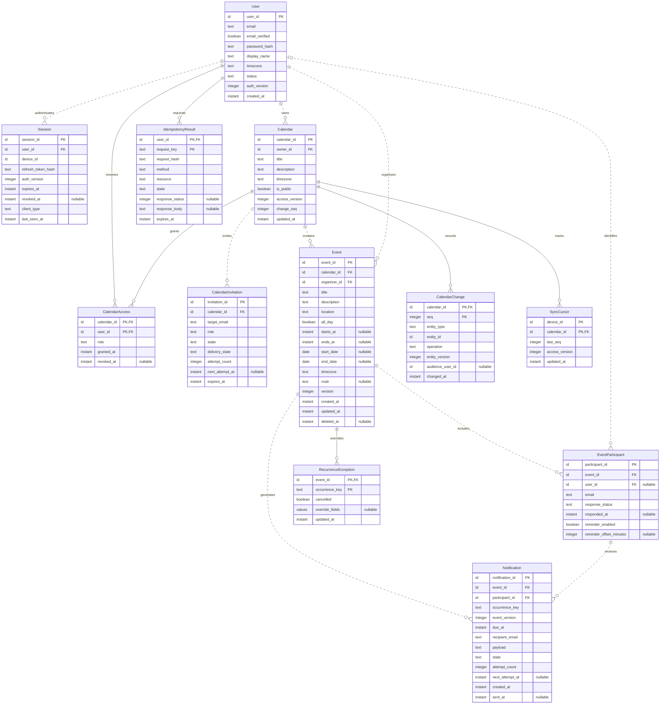
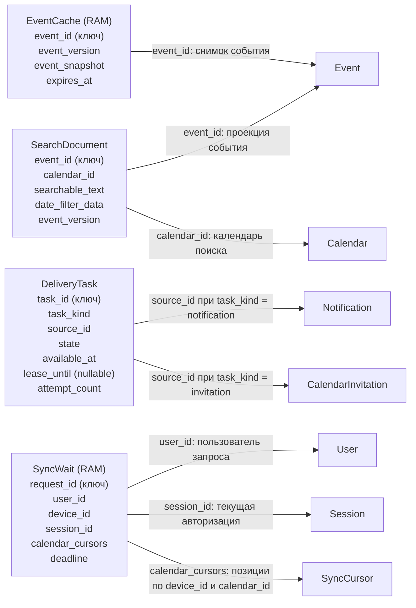
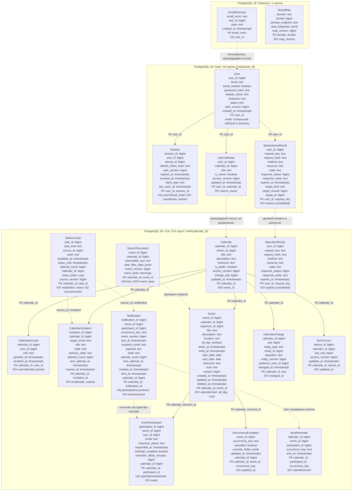

# Google Calendar

## Оглавление

1. [Тема и целевая аудитория](#глава-1-тема-и-целевая-аудитория)
2. [Расчёт нагрузки](#2-расчёт-нагрузки)
3. [Глобальная балансировка нагрузки](#3-глобальная-балансировка-нагрузки)
4. [Локальная балансировка нагрузки](#4-локальная-балансировка-нагрузки)
5. [Логическая схема базы данных](#5-логическая-схема-базы-данных)
6. [Физическая схема базы данных](#6-физическая-схема-базы-данных)
7. Алгоритмы
8. Технологии
9. Обеспечение надёжности
10. Схема проекта
11. Расчёт ресурсов
12. [Список использованных источников](#список-использованных-источников)

---

## Глава 1. Тема и целевая аудитория

### 1.1 Тема проекта, рыночная ниша и аналоги

**Выбранная тема:** проектирование бэкенда высоконагруженного сервиса для планирования встреч, событий и дел - **«Google Calendar»**.

**Реальные аналоги:** Microsoft Outlook Calendar, Apple iCloud Calendar, Zoho Calendar, Calendly. Наличие независимых глобальных игроков на протяжении последних лет однозначно подтверждает существование устойчивой и крупной рыночной ниши - потребности массового пользователя и корпоративных клиентов в планировании встреч, событий, дел и синхронизации расписаний между различными устройствами.

---

### 1.2 Целевая аудитория: размер и локализация

Целевая аудитория - массовый пользователь мобильных устройств и ПК, использующий сервис для планирования встреч, событий и дел, а также корпоративные клиенты через Google Workspace. Сервис имеет глобальное распространение с выраженной концентрацией в США и развитых рынках.

#### Ключевые метрики аудитории

| Метрика | Значение | Период | Источник |
| :--- | :--- | :--- | :--- |
| **MAU (Monthly Active Users) Google Calendar** | **500 млн** | 2025–2026 | [1], [2] |
| **Пользователей Google Workspace** (включая Gmail, Drive, Calendar) | **3 млрд** | 2025 | [1], [2] |
| **Платящих B2B-компаний Workspace** | **6 млн** | 2025 | [2] |
| **Компаний из Fortune 500, использующих Google Workspace** | **40%** | 2025 | [2] |

Google не публикует отдельные метрики по количеству событий, уведомлений и устройств для Google Calendar. Эти значения выводятся в разделе 2 как расчётные продуктовые допущения на основе исследований рынка труда и официальных документов.

#### Географическое распространение (2026)

Распределение оценивается по данным о региональной структуре рынка Google Workspace (Dataintelo, 2025 [3]):

| Регион | Доля рынка | MAU (оценка) |
| :--- | :--- | :--- |
| **Северная Америка** | **38,4%** [3] | ~192 млн |
| **Европа** | **26,7%** [3] | ~134 млн |
| **Азиатско-Тихоокеанский регион** | **22,8%** [3] | ~114 млн |
| **Латинская Америка + MEA** | **~12%** [3] | ~60 млн |

---

### 1.3 Функционал MVP

Для проектирования выделены следующие **6 ключевых функций**, покрывающих основной пользовательский путь:

1. **Регистрация и авторизация.** Создание аккаунта, вход в систему и управление сессиями.
2. **Создание и редактирование календарей.** Базовое управление сущностями календарей.
3. **Управление доступом.** Каждый календарь можно сделать общедоступным либо предоставить отдельным людям доступ к нему (просмотр или редактирование) через приглашение по электронной почте.
4. **Уведомления.** Отправка уведомлений о предстоящих событиях по электронной почте.
5. **Управление событиями.** Создание и редактирование событий внутри календарей.
6. **Поиск по событиям.** Полнотекстовый поиск по названию, описанию, участникам и дате события внутри всех календарей пользователя с фильтрацией по дате и ключевым словам.

#### Ключевые продуктовые решения

1. **Хранение повторяющихся событий.** Вместо создания тысяч отдельных записей для каждой встречи (например, "планёрка каждый понедельник на год вперёд") в базе данных хранится только одно правило повторения. Конкретные встречи создаются "на лету" при просмотре календаря. Это позволяет экономить огромное количество места и легко редактировать всю серию сразу.

2. **Синхронизация между устройствами.** Когда пользователь открывает календарь на телефоне, приложение не скачивает все события заново. Оно запрашивает только те события, которые изменились с момента последнего открытия. Это экономит мобильный трафик пользователя и снижает нагрузку на серверы.

3. **Гарантированная доставка уведомлений.** Система устроена так, что напоминание о встрече может прийти дважды, но никогда не потеряется. Это важнее, чем избежать дублей, потому что пропустить напоминание о важной встрече - гораздо хуже для пользователя.

---

## 2. Расчёт нагрузки

### 2.1. Исходные продуктовые метрики

| Показатель | Значение | Основание |
| --- | --- | --- |
| Месячная аудитория (MAU) | **500 млн** | [1], [2] |
| Дневная аудитория (DAU) | **275 млн** | MAU × 55%; проектное допущение |
| Зарегистрированных аккаунтов | 3 млрд | Проектная оценка ёмкости Calendar на основе аудитории Workspace [1], [2] |
| Событий создаётся в месяц | **3,55 млрд** | DAU × 0,43 × 30; проектная частота |
| Уведомлений доставляется в месяц | **16,8 млрд** | События × 7,9 × 0,6; проектные средние |
| Устройств на пользователя | **3** | Телефон + рабочее устройство + личное устройство |
| Окно использования календаря на DAU | **15 минут/день** | Одно активное устройство; проектное допущение |
| Sync-запросов на DAU в день | **1** | Один long-polling запрос в принятом дневном окне |
| Коэффициент пика | **4** | Утренний и вечерний пики |

#### Обоснование DAU

Для смешанной аудитории корпоративных и личных пользователей принимается проектный коэффициент DAU/MAU = 55%.
```
DAU = 500 млн × 0,55 = 275 млн
```

#### Обоснование количества событий

Частоты действий и доли сегментов ниже являются проектными допущениями.

| Сегмент | Доля | Событий/день | Обоснование частоты | Вклад |
| --- | ---: | ---: | --- | ---: |
| Корпоративные организаторы | 8% | 3,0 | Активный организатор: 3 создаваемых события/день | 0,240 |
| Корпоративные участники | 12% | 0,1 | В основном принимают приглашения, редко создают сами | 0,012 |
| Личные активные | 20% | 0,8 | Типичный паттерн: 5-6 личных событий в неделю | 0,160 |
| Пассивные | 45% | 0,03 | ~1 событие в месяц | 0,0135 |
| Минимальные | 15% | 0,005 | 1-2 события в год | 0,00075 |
| **Итого** | **100%** | — | — | **0,426 ≈ 0,43** |

```
Событий в месяц = 275 млн × 0,43 × 30 ≈ 3,55 млрд
```

#### Обоснование количества уведомлений

Уведомления считаются как фан-аут событий на участников. 

Среднее число участников определяется проектной сегментацией. Лимит гостей — 200 [4]; модель участника описана в iCalendar [5].

| Тип события | Доля | Участников | Обоснование | Вклад |
| --- | ---: | ---: | --- | ---: |
| Личная встреча | 50% | 1,5 | Встречи 1-на-1, личные дела | 0,75 |
| Рабочая встреча | 35% | 5 | Проектное среднее: 5 участников | 1,75 |
| Крупное мероприятие | 12% | 20 | Командные встречи, тренинги | 2,40 |
| Массовое | 3% | 100 | All-hands, вебинары (лимит 200 [4]) | 3,00 |
| **Итого** | **100%** | — | Средневзвешенное количество участников | **7,9** |

Принимаем, что **60% событий генерируют уведомления** (остальные 40% - личные заметки и события без гостей, которые не требуют фан-аута).

```
Уведомлений в месяц = 3,55 млрд × 7,9 × 0,6 ≈ 16,8 млрд
```

#### Обоснование частоты синхронизации

Проектный сценарий: одно 15-минутное окно открытого календаря на DAU в день и одно одновременно активное устройство. В окне выполняется один GET /sync: ответ при наличии изменений либо через 900 секунд; при закрытии календаря запрос отменяется. В пределах принятого окна завершённый запрос не запускается повторно. Email-уведомления работают независимо от открытого приложения.

```text
Sync-запросов/сутки = 275 млн DAU × 1 = 275 млн
Средний Sync RPS = 275 млн / 86 400 ≈ 3 183
Пиковый Sync RPS = round(275 млн / 86 400 × 4) = 12 731
Q_peak = ceil(275 млн × 900 / 86 400 × 4) = 11 458 334 ожидания
```

Q_peak — оценка при ожидании всех запросов до таймаута и распределённых началах окон с коэффициентом пика 4; ранние ответы и закрытие уменьшают её. Три устройства относятся к хранению за 30 дней, а не к одновременному подключению. Время использования — допущение, не опубликованная статистика сервиса.

Для объёмов хранения используются двоичные приставки: 1 КиБ = 1024 Б, 1 МиБ = 1024² Б, 1 ГиБ = 1024³ Б, 1 ТиБ = 1024⁴ Б. Для сетевого трафика используются десятичные приставки: 1 Гбит/с = 10⁹ бит/с.

---

### 2.2. Действия пользователей и RPS

$$N_i = DAU \times a_i, \quad RPS_{avg,i} = \frac{N_i}{86\,400}, \quad RPS_{peak,i} = 4 \times RPS_{avg,i}$$

| Действие | Метод | На DAU в день | Млн запросов/сутки | Средний RPS | Пиковый RPS |
| --- | --- | --: | --: | --: | --: |
| Вход / регистрация | `POST /auth/login` | 0,01 | 2,75 | 32 | 127 |
| Обновление сессии | `POST /auth/refresh` | 0,3 | 82,5 | 955 | 3 819 |
| Создание календаря | `POST /calendars` | 0,001 | 0,275 | 3 | 13 |
| Редактирование календаря | `PATCH /calendars/{id}` | 0,01 | 2,75 | 32 | 127 |
| Создание события | `POST /events` | 0,43 | 118,25 | 1 369 | 5 475 |
| Редактирование события | `PATCH /events/{id}` | 0,22 | 60,5 | 700 | 2 801 |
| Удаление события | `DELETE /events/{id}` | 0,07 | 19,25 | 223 | 891 |
| Приглашение / изменение доступа | `POST /calendars/{id}/share` | 0,02 | 5,5 | 64 | 255 |
| Ответ на приглашение | `POST /events/{id}/respond` | 0,05 | 13,75 | 159 | 637 |
| Поиск по событиям | `GET /search` | 0,5 | 137,5 | 1 591 | 6 366 |
| Синхронизация устройств (long-polling) | `GET /sync` | 1 | 275 | 3 183 | 12 731 |
| **Итого** | - | **2,611** | **718,025** | **8 311** | **33 242** |

Создание событий: `3,55 млрд/мес ÷ 30 дней ÷ 275 млн DAU = 0,43`. Sync — один запрос на DAU в принятом дневном окне; RPS округлены по строкам, итог — сумма строк.

---

### 2.3. Хранилище активного пользователя

| Тип данных | Количество | Б/объект | Объём, Б |
| --- | ---: | ---: | ---: |
| Профиль и настройки (`User`) | 1 | 965 | 965 |
| Личные календари (`Calendar`) | 5 | 3 480 | 17 400 |
| Доступ к чужим календарям (`CalendarAccess`) | 10 | 48 | 480 |
| События за 5 лет, включая правила (`Event`) | 785 | 3 577 | 2 807 945 |
| Участники событий (`EventParticipant`) | 785×7,9 | 128 | 793 792 |
| Исключения серии (`RecurrenceException`) | 785×1% | 160 | 1 256 |
| Будущие напоминания и успешная история (`Notification`) | ≈75,35 | 1 280 | 96 442,18 |
| Сессии со сведениями о клиентах (`Session`) | 3 | 320 | 960 |
| Курсоры синхронизации (`SyncCursor`) | 3×15 | 48 | 2 160 |
| Поисковая проекция (`SearchDocument`) | 785 | 4 096 | 3 215 360 |
| **Итого** | | | **6 936 760,18** |

Итого: `6 936 760,18 / 1 048 576 ≈ 6,61541 МиБ`, или **≈6,62 МиБ** на расчётный профиль. Промежуточные величины считаются без округления; в таблице показаны округлённые значения.

Профиль сохраняет 785 событий за пять лет, пять личных и десять доступных календарей, три клиентские установки и по одной активной сессии на установку. Средний размер события 3 577 Б уже включает правило повторения: `3 513+0,1×640`. Размер сессии 320 Б включает сведения о клиенте; отдельные объёмы устройств и правил не прибавляются.

Для оценки `Notification` поток `H=560 млн/сутки` распределён между **275 млн расчётных активных профилей**: успешная история — `30H/DAU ≈ 61,09` записи, будущие напоминания — `7H/DAU ≈ 14,25`, всего `(30H+7H)/DAU ≈ 75,35`. Это принятое распределение потока между типовыми активными профилями, а не статистика месячных уникальных получателей.

Это расчётный профиль активного пользователя, а не среднее по MAU или по всем 3 млрд аккаунтов. Его нельзя умножать на 3 млрд для получения глобального объёма. Глобальная ёмкость в 2.4 рассчитывается по числу объектов и срокам хранения; приглашения, идемпотентные результаты, журнал, очереди, кеш и рабочие буферы учитываются там отдельно.

---

### 2.4. Общий объём хранения

Состав данных и размеры записей соответствуют логической модели раздела 5: 12 основных сущностей и четыре вспомогательных набора. Объёмы рассчитаны для одной логической копии; физические индексы, репликация и резервные копии не включены. Постоянное хранение и RAM показаны раздельно.

| Сущность / набор | Количество, млн | Б/объект | Объём, ТиБ |
| --- | ---: | ---: | ---: |
| `User` | 3 000,000 | 965 | 2,633 |
| `Session` | 1 500,000 | 320 | 0,437 |
| `Calendar` | 15 000,000 | 3 480 | 47,476 |
| `CalendarAccess` | 30 000,000 | 48 | 1,310 |
| `CalendarInvitation` | 165,000 | 160 | 0,024 |
| `Event` | 213 000,000 | 3 577 | 692,945 |
| `EventParticipant` | 1 682 700,000 | 128 | 195,892 |
| `RecurrenceException` | 2 130,000 | 160 | 0,310 |
| `Notification` | 20 720,000 | 1 280 | 24,121 |
| `CalendarChange` | 42 459,552 | 256 | 9,886 |
| `SyncCursor` | 22 500,000 | 48 | 0,982 |
| `IdempotencyResult` | 1 222,128 | 2 048 | 2,276 |
| `SearchDocument` | 213 000,000 | 4 096 | 793,487 |
| `EventCache` (RAM) | 1,146 | 4 096 | 0,004 |
| `DeliveryTask` | 141,375 | 256 | 0,033 |
| `SyncWait` (RAM) | 11,458 | 65 536 | 0,683 |
| Служебные позиции и резерв журнала/очередей | — | — | 0,005 |
| **Постоянное хранение** |  |  | **1 771,817** |
| **Оперативная память** |  |  | **0,687** |
| **Всего, включая RAM** |  |  | **1 772,504** |

**Количество записей:** события — `3,55 млрд/месяц×60 месяцев = 213 млрд` до вычета досрочных удалений; участники — `события×7,9`; исключения — `события×1%`. Календари — `3 млрд×5`, права — `3 млрд×10`; сессии — `500 млн MAU×3`, курсоры — `500 млн×3×15`. Число 3 млрд аккаунтов — проектная оценка ёмкости, не подтверждённая статистика аккаунтов Calendar.

`Event` в среднем занимает `3 513+0,1×640 = 3 577 Б`, поэтому правило повторения отдельно не учитывается. `Session` размером 320 Б уже содержит сведения о клиентской установке. `Notification`: `(7+30)×560 млн = 20,72 млрд` записей по 1 280 Б — будущие напоминания и успешная история одной сущности. Ошибочные/незавершённые задания при длительном отказе потребуют дополнительной ёмкости.

Поисковая проекция — один документ 4 096 Б на событие/серию. Идемпотентные результаты рассчитаны на `14 145×86 400` записей за сутки непрерывного пика. Резерв журнала — `16 381×86 400×30` записей по 256 Б; очередь — час пикового email-потока с запасом 50%. Вместе со служебными позициями их бюджет составляет 9,924 ТиБ; это не срок автоматического удаления необработанных заданий.

`SyncWait` содержит принятые в 2.1 `11 458 334` ожидания по 65 536 Б. Кеш рассчитывается по пиковому наполнению и TTL: `ceil(0,1×275 млн/86 400×4×900)` записей по 4 096 Б. Кеш и буферы относятся к RAM; буферы соединений из этой оценки нельзя повторно прибавлять к тому же бюджету L7 в разделе 4.3.

Итого: постоянное хранение **1 771,817 ТиБ**, RAM **0,687 ТиБ**. Общий справочный объём — **1 772,504 ТиБ**; он получен из неокруглённых значений. Дисковая ёмкость и RAM при расчёте серверов учитываются отдельно. Подробные составы записей, сроки хранения и QPS приведены в разделе 5.

---

### 2.5. Сетевой трафик

$$V_{day,i} = \frac{N_i \times S_i}{10^9} \text{ [ГБ]}, \quad B_{peak,i} = \frac{V_{day,i} \times 8 \times 4}{86\,400} \text{ [Гбит/с]}$$

| Тип трафика | Направление | ГБ/сутки | Пик, Гбит/с |
| --- | --- | --: | --: |
| API: входящие запросы | Входящий | 765 | 0,28 |
| API: ответы | Исходящий | 4 412 | 1,63 |
| Синхронизация: запросы | Входящий | 137,5 | 0,05 |
| Синхронизация: ответы | Исходящий | 162,25 | 0,06 |
| Уведомления, включая запущенные напоминаниями | Исходящий | 560 | 0,21 |
| Email-приглашения в календарь | Исходящий | 5,632 | 0,002 |
| **Всего входящий** | Клиент - сервис | **902,5** | **0,33** |
| **Всего исходящий** | Сервис - клиент | **5 139,882** | **1,90** |

Sync-запрос — 500 Б, средний ответ — 590 Б. Расчёт использует неокруглённые значения; таблица показывает округлённый трафик.

С **20% запасом** на транспортные накладные расходы:

| Направление | Без запаса | С запасом 20% |
| --- | --: | --: |
| Входящий | 0,33 Гбит/с | **0,40 Гбит/с** |
| Исходящий | 1,90 Гбит/с | **2,28 Гбит/с** |

---

## 3. Глобальная балансировка нагрузки

### 3.1 Функциональное разбиение по поддоменам

| Поддомен | Назначение | Транспорт | Таймаут | Выбор ДЦ |
| --- | --- | --- | --- | --- |
| api.calendar.google.com | Авторизация, календари, доступ и события | HTTPS | 5–30 с | GeoDNS + ECS |
| sync.calendar.google.com | Инкрементальная синхронизация | HTTPS long-polling | Ожидание до 900 с; прокси-таймаут 930 с | GeoDNS + ECS |
| search.calendar.google.com | Поиск по событиям | HTTPS | 60–120 с | GeoDNS + ECS |

Поддомены позволяют независимо масштабировать сервисы и задавать таймауты. DNS выбирает адрес ДЦ, а локальные L4/L7 выполняют балансировку соединений и запросов.

### 3.2 Обоснование расположения ДЦ и их ролей

| ДЦ | Регион | Доля | Роль |
| --- | --- | ---: | --- |
| Франкфурт | Европа | 26,7% | Единый мастер и локальное чтение |
| Вирджиния | Северная Америка | 38,4% | Реплика для чтения |
| Мумбаи | АТР | 22,8% | Реплика для чтения |
| Сан-Паулу | Латинская Америка и MEA | 12,1% | Реплика для чтения |

Расположение соответствует аудитории раздела 1. Все изменения фиксируются во Франкфурте; содержимое читается из региональной реплики. Права доступа и отзыв сессии проверяются по актуальному состоянию мастера через приватные сервисные соединения.

### 3.3 Распределение трафика по ДЦ

Из раздела 2.2: клиентский пик 33 242 RPS; операции изменения — 14 145 RPS, чтение и Sync — 19 097 RPS. Клиентские запросы распределяются по региональным долям методом наибольших остатков; неевропейские изменения дополнительно обрабатываются во Франкфурте.

| ДЦ | Клиентские RPS | Из них запись | Проксированные записи, дополнительно | Обработки Ingress/с | Клиентский вход, Гбит/с | Клиентский выход, Гбит/с |
| --- | ---: | ---: | ---: | ---: | ---: | ---: |
| Вирджиния | 12 765 | 5 432 | 0 | 12 765 | 0,154 | 0,877 |
| Франкфурт | 8 876 | 3 777 | 10 368 | 19 244 | 0,107 | 0,610 |
| Мумбаи | 7 579 | 3 225 | 0 | 7 579 | 0,091 | 0,521 |
| Сан-Паулу | 4 022 | 1 711 | 0 | 4 022 | 0,049 | 0,276 |
| Всего | 33 242 | 14 145 | 10 368 | 43 610 | 0,401 | 2,284 |

| Межрегиональный поток | Расчёт |
| --- | --- |
| Проксирование записи | 10 368 запросов/с; при 1 КиБ запроса и ответа — 0,085 Гбит/с в каждом направлении |
| Проверка актуальной авторизации | Верхняя оценка 33 242−8 876=24 366 приватных RPC/с; при 1 КиБ запроса и ответа — 0,200 Гбит/с в каждом направлении Франкфурта |
| Передача журнала в три ДЦ | 16 381 изменений/с × 256 Б × 8 × 3 = 0,101 Гбит/с; содержимое объектов передаётся отдельно |

Служебные RPC используют постоянные соединения и не проходят через внешний Ingress. Журнал переносит порядок изменений и tombstones, но не заменяет полную передачу содержимого данных.

### 3.4 Схема DNS балансировки (GeoDNS + EDNS)

GeoDNS возвращает адрес регионального ДЦ. При поддержке ECS резолвер передаёт префикс клиентской подсети; иначе выбор выполняется по адресу резолвера. TTL записи — 30 с: он ограничивает время кеширования DNS, но не срок существования уже открытого long-polling соединения.

### 3.5 Отказ от BGP Anycast для прикладного трафика

Глобальный BGP Anycast не используется. Внутри ДЦ ECMP распределяет потоки между локальными L4.

### 3.6 Механизм регулировки трафика между ДЦ

При отказе ДЦ health checks исключают его из DNS-выдачи; клиент переподключается к доступному региону с задержкой и случайным разбросом повторов. Перенос нагрузки требует свободной ёмкости принимающего ДЦ; локальное N×2 защищает от потери группы внутри ДЦ, а не от любого межрегионального переноса.

При отказе Франкфурта запись и операции, требующие актуальной авторизации, приостанавливаются до ручного выбора нового мастера. Старый мастер изолируется от записи; доступность и позиция реплики проверяются до переключения. Асинхронные копии допускают потерю последних изменений; обратно мастер переключается только после согласования данных.

---

## 4. Локальная балансировка нагрузки

### 4.1 Схема балансировки и уровни резервирования

GeoDNS возвращает клиенту IP регионального ДЦ. После этого клиент подключается напрямую к его L4; DNS не участвует в передаче HTTP-трафика.

```text
                 [ Клиент → IP регионального ДЦ ]
                                │
                                ▼
┌──────────────────────────────────────────────────────────────────┐
│ 1. L4: балансировка TCP-соединений                               │
│    • BGP-анонс VIP; ECMP от двух маршрутизаторов                 │
│    • Maglev: GRE к NGINX; ответ клиенту напрямую (DSR)           │
│    • Резервирование: N+1, группы A и B в режиме active-active    │
└───────────────────────────────┬──────────────────────────────────┘
                                │ TCP / TLS
                                ▼
┌──────────────────────────────────────────────────────────────────┐
│ 2. L7: NGINX Ingress                                             │
│    • TLS termination и маршрутизация к API / Sync / Search       │
│    • API: weighted round-robin; Search/Sync: least_conn          │
│    • Sync: HTTPS long-polling, ожидание до 900 секунд            │
│    • Резервирование: N×2, независимые группы A и B               │
└───────────────────────────────┬──────────────────────────────────┘
                                │ HTTP, переиспользуемые соединения
                                ▼
┌──────────────────────────────────────────────────────────────────┐
│ 3. Межсервисная клиентская балансировка                          │
│    • Service discovery и выбор доступного endpoint               │
│    • Least request для HTTP-вызовов                              │
│    • Резервирование: минимум два экземпляра каждого сервиса      │
└──────────────────────────────────────────────────────────────────┘

Запись из другого ДЦ:
Региональный API → внутренний Ingress Франкфурта → API записи
                 → VIP пулеров (1 активный + 1 резервный) → мастер
```

Внутренний Ingress Франкфурта входит в его общий пул L7; местные записи идут из Ingress сразу к API записи. Проверки актуальных прав выполняются по приватным сервисным соединениям.

### 4.2 Алгоритмы и резервирование

#### 4.2.1 Алгоритмы балансировки

| Уровень | Компонент | Алгоритм | Причина выбора |
| --- | --- | --- | --- |
| Вход в ДЦ | Два маршрутизатора | ECMP по параметрам потока | Распределение потоков между активными L4 |
| L4 → NGINX | Программный L4 по схеме Maglev [11] | Согласованное хеширование и учёт соединений | Устойчивое назначение TCP-потоков; GRE доставляет пакеты, DSR возвращает ответы в обход L4 |
| NGINX → API, включая внутренний вход Франкфурта | Общий пул NGINX Ingress | Weighted Round Robin, фиксированные веса | Простое распределение коротких запросов с учётом мощности экземпляров |
| NGINX → Search | Общий пул NGINX Ingress | Weighted Least Connections (`least_conn` с весами) | Учёт активных соединений при различной длительности поиска |
| NGINX → Sync | Общий пул NGINX Ingress | Least Connections | Распределение ожидающих long-polling соединений и расхода памяти |
| Межсервисный HTTP | Клиентский балансировщик | Least Request | Учёт выполняемых запросов при переиспользовании соединений |

Веса фиксированы и не корректируются автоматически. `least_conn` не измеряет стоимость запроса или CPU; длительное ожидание Sync не считается медленным выполнением. Алгоритмы NGINX — в [документации](https://nginx.org/en/docs/http/ngx_http_upstream_module.html).

#### 4.2.2 Режимы резервирования и переключение

| Компонент | Формула / количество | Режим | Протокол / механизм переключения |
| --- | --- | --- | --- |
| Маршрутизаторы | N+1, независимые пути | Active-Active | Маршрутизация BGP и исключение недоступного пути; оставшийся маршрутизатор выдерживает поток |
| L4 | N+1 | Active-Active | BGP-анонс VIP + ECMP; проверка L4 и отзыв маршрута при отказе [11] |
| Общий пул NGINX | N×2, две независимые группы | Active-Active | Health checks со стороны L4 и исключение недоступного NGINX; API/Search/Sync используют один расчётный пул L7 |
| API / Search / Sync | N×2 для каждого сервиса; N определяется его нагрузкой и производительностью. | Active-Active | Readiness, service discovery и исключение по ошибкам; количество определяется нагрузкой |
| Пулеры во Франкфурте | N+1, каждый выдерживает полный поток | Active-Passive | Keepalived/VRRP, общий VIP и проверка процесса пулера; резервный принимает VIP |

N×2 рассчитано на потерю целой группы; N+1 технически применимо и рассчитано на потерю одного узла. Минимум два экземпляра сервиса сам по себе не доказывает достаточность мощности. При плановом отключении используется graceful drain; отказ может оборвать TCP-соединения, Sync переподключается с курсором.

Пулеры размещаются в общей локальной сети; активный предоставляет соединение на транзакцию. [VRRP (RFC 9568)](https://www.rfc-editor.org/rfc/rfc9568.html) переключает VIP, но не сохраняет соединения: приложения переподключаются. Запись повторяется только с тем же ключом идемпотентности и телом запроса.

### 4.3 Расчёт количества

| Параметр | Значение |
| --- | --- |
| Нагрузка | Региональные обработки Ingress из раздела 3.3 |
| NGINX, 8 CPU без HT [8] | 31 485 новых TLS-соединений/с; 8,64 Гбит/с в отдельных тестах |
| Коэффициент загрузки u | 0,8: 25 188 TLS-соединений/с; 6,912 Гбит/с |
| Консервативный TLS-сценарий | Каждый запрос, включая Sync и проксированную запись, создаёт новое TLS-соединение |
| Одновременные Sync-запросы | Q=11 458 334 по сценарию раздела 2.1; одно активное устройство на пользователя |
| Проектный L7-узел | 8 физических ядер сопоставимого класса, 192 ГиБ RAM |
| Условная память ожидания | 64 КиБ на запрос и пару соединений; сценарий оценки, не измеренный расход NGINX |
| Сетевые допущения | Дополнительно 3 КиБ TLS/TCP-обмена в каждом направлении на новое соединение; проксированная запись — по 1 КиБ запроса и ответа |
| L4, ориентир Maglev [11] | 10 Гбит/с на узел; с u=0,8 — 8 Гбит/с. Проектный запас IPv4/GRE — 30% к входящему потоку |

T_i — обработки Ingress/с, p_i — доля региона. Q_i распределяются методом наибольших остатков из Q. Базовые B_in и B_out берутся из неокруглённых расчётов раздела 2.5; сеть измеряется в Гбит/с.

```text
B_in,base = 902,5 × 8 × 4 / 86 400 × 1,2 = 0,401111… Гбит/с
B_out,base = 5 139,882 × 8 × 4 / 86 400 × 1,2 = 2,284392 Гбит/с
B_proxy,F = 10 368 × 1 024 × 8 / 10^9; в других ДЦ B_proxy = 0
B_in,i  = B_in,base × p_i + T_i × 3 072 × 8 / 10^9 + B_proxy,i
B_out,i = B_out,base × p_i + T_i × 3 072 × 8 / 10^9 + B_proxy,i

N_TLS = ceil(T_i / 25 188)
N_net = ceil(max(B_in,i, B_out,i) / 6,912)
N_conn = ceil(Q_i × m / (0,8 × 192 × 2^30)); m = 65 536 Б
L7_i = 2 × max(N_TLS, N_net, N_conn)
L4_i = 2 × ceil(1,3 × B_in,i / 8)
```

| ДЦ | T_i, соединений/с | Вход / выход, Гбит/с | Q_i, ожиданий | N_TLS | N_net | N_conn | L7 с резервом | L4 с резервом |
| --- | ---: | ---: | ---: | ---: | ---: | ---: | ---: | ---: |
| Вирджиния | 12 765 | 0,468 / 1,191 | 4 400 000 | 1 | 1 | 2 | 4 | 2 |
| Франкфурт | 19 244 | 0,665 / 1,168 | 3 059 375 | 1 | 1 | 2 | 4 | 2 |
| Мумбаи | 7 579 | 0,278 / 0,707 | 2 612 500 | 1 | 1 | 2 | 4 | 2 |
| Сан-Паулу | 4 022 | 0,147 / 0,375 | 1 386 459 | 1 | 1 | 1 | 2 | 2 |
| Всего | 43 610 | 1,558 / 3,441 | 11 458 334 | 4 | 4 | 7 | 14 | 8 |

Пример для Вирджинии: N_conn=ceil(4 400 000×65 536/(0,8×192×2^30))=2; L7=2×max(1,1,2)=4, L4=2×ceil(1,3×0,467739/8)=2.

Итог — предварительно 14 L7 и 8 L4, два пулера отдельно. Производительность подтверждается тестом совместной нагрузки: память, клиентские/upstream-соединения, TLS и сеть; отдельные тесты [8] не измеряют long-polling. Keep-alive и TLS resumption не уменьшают расчёт без измерений, ориентир Maglev не переносится на произвольный L4.

---
## 5. Логическая схема базы данных

Модель включает 12 основных сущностей и четыре служебные структуры; выбор СУБД и физического размещения относится к разделу 6 [13].

### 5.1. Идентификаторы

`PK` — первичный ключ, `FK` — ссылка на сущность, `nullable` — необязательное поле. Составные ключи: `CalendarAccess` — `(calendar_id, user_id)`, `RecurrenceException` — `(event_id, occurrence_key)`, `CalendarChange` — `(calendar_id, seq)`, `SyncCursor` — `(device_id, calendar_id)`, `IdempotencyResult` — `(user_id, request_key)`. Email аккаунта и пара `(event_id, email)` среди участников уникальны.

`device_id` обозначает установку клиента, сохраняется при смене сессии и проверяется через текущую авторизованную сессию; курсор от `session_id` не зависит. У `Notification` собственный ключ `notification_id` и уникальная пара `(participant_id, occurrence_key)` — одно напоминание участнику о вхождении.

### 5.2. Логическая схема

**Основные данные:**



`||` — ровно один, `o|` — ноль или один, `o{` — ноль или много. Сплошная связь — ключ родителя входит в ключ дочерней записи, пунктирная — не входит; необязательный `EventParticipant.user_id` допускает гостя без аккаунта.

**Служебные структуры и связи с основными данными:**



Стрелки показывают логические ссылки, а не физические FK; `task_kind` выбирает ровно один источник `source_id`: уведомление либо приглашение. Имена без полей — ссылки на основную схему; `nullable` — необязательное значение. Служебные структуры не обязательно являются самостоятельными таблицами БД.

### 5.3. Особенности хранения и консистентность

- **Повторения.** Правило хранится в `Event.rrule` и применяется в часовом поясе события [5]; исключения — в `RecurrenceException` по исходному началу вхождения. Обычные события используют моменты времени, события на весь день — даты; конец интервала исключающий.
- **Консистентность и доступ.** Событие, участники/исключения, версия и запись журнала изменяются атомарно как одна логическая операция. Участие не даёт доступа ко всему календарю; принятие приглашения требует подтверждённого email. Актуальные сессия и права проверяются перед выдачей поиска/Sync. Повтор запроса с тем же ключом защищён идемпотентностью на 24 часа; незавершённый результат не удаляется по TTL.
- **Напоминания.** До отправки перенос обновляет ту же `Notification`; после успешной отправки новое напоминание автоматически не создаётся. Задание очереди ссылается на уведомление или приглашение; отправитель проверяет срок, состояние и версию. Возможны дубли email и потеря последних изменений при аварии мастера согласно разделу 3. Отменённые неотправленные записи удаляются после обработки отмены; незавершённые и ошибочные не удаляются по TTL успешной истории, отправленные сохраняют снимок письма независимо от удаления события.
- **Sync, поиск и кеш.** Журнал хранит порядок изменений и удаления, курсор — подтверждённую клиентом позицию, не опережающую доступные версии данных. Вне 30-дневного окна нужна полная синхронизация. Поиск и кеш могут отставать и восстанавливаются из источников; выдача требует актуальной проверки прав и удаления события. Файловых вложений в MVP нет.

### 5.4. Описание данных

| Сущность | Назначение |
| --- | --- |
| `User` | Учётная запись, авторизация и настройки пользователя. |
| `Session` | Авторизованный вход и сведения о клиентской установке. |
| `Calendar` | Календарь, его владелец, публичность и версии. |
| `CalendarAccess` | Персональное право чтения или редактирования календаря. |
| `CalendarInvitation` | Приглашение на календарь по email и результат отправки письма. |
| `Event` | Событие или шаблон серии с необязательным правилом повторения. |
| `EventParticipant` | Участник, его ответ и настройка одного email-напоминания. |
| `RecurrenceException` | Отмена или изменение отдельного вхождения серии. |
| `Notification` | Запланированное напоминание и его последующий результат доставки. |
| `CalendarChange` | Порядок изменений календаря и сведения об удалениях. |
| `SyncCursor` | Подтверждённая позиция календаря для клиентской установки. |
| `IdempotencyResult` | Ключ, состояние и сохранённый результат изменяющего запроса. |

**Кеши, очередь и временные данные:**

| Структура | Назначение | Срок жизни |
| --- | --- | --- |
| `SearchDocument` | Проекция для поиска по текстам, участникам и датам. | Вместе с событием; восстанавливается из источников. |
| `EventCache` | RAM: снимок основного события с правилом повторения. | До 900 с; инвалидируется при изменении. |
| `DeliveryTask` | Работа на отправку напоминания или приглашения в календарь. | До подтверждения; расчётная ёмкость на час пика. |
| `SyncWait` | RAM: контекст ожидающего long-polling и буферы соединений. | До ответа/отмены, не более 900 с. |

### 5.5. Размеры данных и нагрузка

Исходные потоки — из раздела 2: DAU 275 млн, MAU 500 млн; 3 млрд аккаунтов — проектная оценка, не подтверждённая статистика Calendar.
Объёмы даны для одной логической копии без физических индексов, реплик и резервных копий. QPS — логические, в том числе пакетные обращения; для RAM — операции с памятью. В таблице указаны среднее / пик с округлением.

| Сущность / набор | Записей, млн | Б/запись | Объём, ТиБ | QPS чтение ср./пик | QPS запись ср./пик | Срок хранения |
| --- | ---: | ---: | ---: | ---: | ---: | --- |
| `User` | 3 000,000 | 965 | 2,633 | 13 148 / 52 594 | 0,32 / 1 | До удаления аккаунта |
| `Session` | 1 500,000 | 320 | 0,437 | 13 053 / 52 212 | 987 / 3 947 | До истечения; расчёт по MAU за 30 дней |
| `Calendar` | 15 000,000 | 3 480 | 47,476 | 12 095 / 48 380 | 2 549 / 10 198 | До удаления календаря |
| `CalendarAccess` | 30 000,000 | 48 | 1,310 | 12 095 / 48 380 | 64 / 255 | До отзыва |
| `CalendarInvitation` | 165,000 | 160 | 0,024 | 95 / 382 | 127 / 509 | 30 дней |
| `Event` | 213 000,000 | 3 577 | 692,945 | 15 955 / 63 819 | 2 451 / 9 803 | Пятилетняя ёмкость; действующая серия — до завершения |
| `EventParticipant` | 1 682 700,000 | 128 | 195,892 | 14 363 / 57 454 | 2 451 / 9 803 | Вместе с событием |
| `RecurrenceException` | 2 130,000 | 160 | 0,310 | 7 882 / 31 528 | 23 / 92 | Вместе с серией |
| `Notification` | 20 720,000 | 1 280 | 24,121 | 12 963 / 51 852 | 26 480 / 105 919 | Планирование на 7 дней; успешная история 30 дней |
| `CalendarChange` | 42 459,552 | 256 | 9,886 | 14 014 / 56 057 | 2 549 / 10 198 | Не менее 30 дней |
| `SyncCursor` | 22 500,000 | 48 | 0,982 | 3 183 / 12 731 | 3 183 / 12 731 | 30 дней неактивности |
| `IdempotencyResult` | 1 222,128 | 2 048 | 2,276 | 3 536 / 14 145 | 7 072 / 28 289 | 24 часа для результата |
| `SearchDocument` | 213 000,000 | 4 096 | 793,487 | 1 591 / 6 366 | 2 451 / 9 803 | Вместе с событием |
| `EventCache` (RAM) | 1,146 | 4 096 | 0,004 | 318 / 1 273 | 2 769 / 11 076 | До 900 с |
| `DeliveryTask` | 141,375 | 256 | 0,033 | 6 545 / 26 181 | 19 635 / 78 542 | До подтверждения; запас на час пика |
| `SyncWait` (RAM) | 11,458 | 65 536 | 0,683 | 3 183 / 12 731 | 6 366 / 25 463 | До 900 с |
| Служебные позиции и резерв журнала/очередей | — | — | 0,005 | — | — | По состоянию обработки |
| **Постоянное хранение** | | | **1 771,817** | | | |
| **Оперативная память** | | | **0,687** | | | |
| **Всего, включая RAM** | | | **1 772,504** | | | |

**Общие формулы:**

- `Объём, ТиБ = число записей × Б/запись / 2^40`.
- `Средний QPS = обращений за сутки / 86 400`.
- `Пиковый QPS = средний QPS × 4`.

**Расчётные допущения:**

- Количество записей и ёмкостные резервы приняты по разделу 2.4; размеры — проектные средние, не ограничения полей API. RAM ожиданий Sync уже включает буферы соединений и повторно к L7 не прибавляется.
- Обоснование размеров: `Event = 3 513 + 10% × 640 = 3 577 Б`; участник — `3×8 + 48 + 1 + 8 + 1 + 4 + 42 = 128 Б` (ID, email, ответ, время, флаг, интервал и резерв).
  Поисковая проекция: `3 577 + 7,9×48 + 1%×160 + 24 ≈ 3 982 Б`, с резервом — 4 096 Б.
- QPS учитывает пакетные обращения: проверка доступа — в среднем по 15 календарям, поиск — до 20 кандидатов. Пакет не равен одной строке или IOPS: участники — 1 160,5 млн изменённых строк/сутки, курсоры — 4 125 млн строк/сутки.
- 1% входов — регистрации; 10% базовых Sync возвращают одно изменившееся событие, 10% поисков проверяют серию, 1% операций записи событий затрагивает исключения.
- Учтены повторные проверки прав перед ответом поиска/Sync; попадания в кеш не уменьшают оценку чтений источника. Повторы доставки, очистка и полная пересинхронизация требуют дополнительной нагрузки и ёмкости при накоплении заданий.

**Обоснование расчётов:**

- **Напоминания:** 560 млн/сутки, включая вхождения серий; приглашения в календарь учтены отдельно, письма об изменениях событий в MVP не входят.
  Семидневное расписание и 30-дневная история: `560 млн × (7 + 30) = 20,72 млрд` записей по `1 024 + 256 = 1 280 Б` — 24,121 ТиБ.
  Два чтения на напоминание: `560 млн × 2 / 86 400 ≈ 12 963 QPS`. Четыре записи состояния и перепланирование у 60% изменяемых/удаляемых событий внутри семидневного горизонта:
  `[4 × 560 млн + 0,6 × (60,5 + 19,25) млн] / 86 400 ≈ 26 480 QPS`.
- **Кеш:** `ceil(27,5 млн / 86 400 × 4 × 900) = 1 145 834` уникальных заполнения за TTL при непрерывном пике; по 4 096 Б — 4,371 ГиБ. Инвалидации учитываются в QPS, но не увеличивают вместимость.
- **Резервы:** журнал — `16 381 × 86 400 × 30` записей по 256 Б; очередь — `565,5 млн / 86 400 × 4 × 3 600 × 1,5` записей по 256 Б, час пика с запасом 50%.
  Вместе со служебными позициями — 9,924 ТиБ; результаты идемпотентности рассчитаны на `14 145 × 86 400` записей. Это запас вместимости, а не TTL необработанных заданий.

**Ограничения исходных расчётов.** QPS использует базовый один Sync-запрос на DAU за окно; непрерывный long-polling повторяет запрос после ответа и требует уточнения частоты, доли непустых ответов и времени одновременных ожиданий.
Повторные проверки поиска/Sync при прежних региональных долях и одном RPC на проверку дают около 38,4 тыс. RPC/с вне Франкфурта вместо 24 366 в разделе 3.3; эти исходные расчёты здесь не пересматриваются.

### 5.6. Распределение нагрузки

Популярные календари создают горячие `calendar_id`, массовые события — всплески по `event_id` и участникам, начала встреч в :00/:30 — пики напоминаний по `due_at`.
Восстановление связи вызывает волну Sync, повторы запросов концентрируются на ключах идемпотентности; средние 7,9 участника не заменяют предел 200 гостей [4].

---

## 6. Физическая схема базы данных

### 6.1. Физическая схема

PostgreSQL хранит основные данные и обслуживает поиск и очередь. Redis хранит снимки событий, RAM сервиса Sync — контекст ожидания, S3 — резервные копии [14].



### 6.2. Таблицы и шардирование

Auth распределяется по `user_id`, Cal — по `calendar_id`. Хеш выбирает один из 16 384 виртуальных сегментов в каждом домене, а `ShardMap` указывает его группу. Directory размещается в одной группе. Физические FK действуют внутри группы; межшардовые ссылки проверяет приложение.

**PG 1+1+3** — primary и синхронная standby в разных стойках Франкфурта и по одной асинхронной копии в Вирджинии, Мумбаи и Сан-Паулу [15]. Индексы B-tree, если не указан другой тип.

| Данные | Назначение | СУБД | Ключи и индексы | Шард | Реплики |
| --- | --- | --- | --- | --- | --- |
| `User` | Аккаунт и авторизация; глобальная уникальность адреса через EmailDirectory. | PostgreSQL 18 | `(user_id)`; email_norm UNIQUE через EmailDirectory; локальный email | Auth: hash(user_id) | PG 1+1+3 |
| `Session` | Сессия установки; session_id содержит сегмент пользователя. | PostgreSQL 18 | `(user_id, session_id)`; UNIQUE(user_id, refresh_token_hash); (user_id, device_id); expires_at | Auth: hash(user_id) | PG 1+1+3 |
| `Calendar` | Владелец, версия прав и позиция журнала календаря. | PostgreSQL 18 | `(calendar_id)`; owner_id | Cal: hash(calendar_id) | PG 1+1+3 |
| `CalendarAccess` | Персональные права, проверяемые перед выдачей. | PostgreSQL 18 | `(calendar_id, user_id)`; (user_id, calendar_id) WHERE revoked_at IS NULL | Cal: hash(calendar_id) | PG 1+1+3 |
| `CalendarInvitation` | Приглашение по email и состояние доставки. | PostgreSQL 18 | `(calendar_id, invitation_id)`; (target_email, state); expires_at | Cal: hash(calendar_id) | PG 1+1+3 |
| `Event` | Событие и правило серии; запись вместе с журналом. | PostgreSQL 18 | `(calendar_id, event_id)`; (calendar_id, starts_at) WHERE deleted_at IS NULL; (calendar_id, start_date) WHERE all_day; calendar_id WHERE rrule IS NOT NULL | Cal: hash(calendar_id) | PG 1+1+3 |
| `EventParticipant` | Участники; добавлен calendar_id для совместного размещения. | PostgreSQL 18 | `(calendar_id, participant_id)`; UNIQUE(calendar_id, event_id, email); (calendar_id, event_id) | Cal: hash(calendar_id) | PG 1+1+3 |
| `RecurrenceException` | Перенос или отмена вхождения; добавлен calendar_id. | PostgreSQL 18 | `(calendar_id, event_id, occurrence_key)`; updated_at | Cal: hash(calendar_id) | PG 1+1+3 |
| `Notification` | Напоминание и история отправки; добавлен calendar_id. | PostgreSQL 18 | `(calendar_id, notification_id)`; UNIQUE(calendar_id, participant_id, occurrence_key); due_at WHERE state=scheduled; next_attempt_at WHERE state=retry; sent_at WHERE state=sent | Cal: hash(calendar_id) | PG 1+1+3 |
| `CalendarChange` | Журнал изменений в порядке seq внутри календаря. | PostgreSQL 18 | `(calendar_id, seq)`; changed_at | Cal: hash(calendar_id) | PG 1+1+3 |
| `SyncCursor` | Подтверждённая позиция установки в календаре. | PostgreSQL 18 | `(calendar_id, device_id)`; updated_at | Cal: hash(calendar_id) | PG 1+1+3 |
| `IdempotencyResult` | Резерв запроса; добавлены тип, сегмент и ID цели. | PostgreSQL 18 | `(user_id, request_key)`; expires_at WHERE state=completed | Auth: hash(user_id) | PG 1+1+3 |
| `SearchDocument` | Поисковая проекция; добавлен интервал event_span. Права и точные вхождения проверяются после отбора. | PostgreSQL 18 | `(calendar_id, event_id)`; GIN(to_tsvector('simple', searchable_text)); GiST(event_span) | Cal: hash(calendar_id) | PG 1+1+3 |
| `DeliveryTask` | Задание рядом с источником; добавлены calendar_id, lease_token и source_version. Захват через SKIP LOCKED. | PostgreSQL 18 | `(calendar_id, task_id)`; (available_at, task_id) WHERE state IN (ready,retry); lease_until WHERE state=leased; UNIQUE(calendar_id,task_kind,source_id,source_version) для активных задач | Cal: hash(calendar_id) | PG 1+1+3 |
| `EventCache` | Снимок события; TTL до 900 с, инвалидация по журналу. | Redis | `event:{calendar_id}:{event_id}`; версия + TTL | По ДЦ; внутри ДЦ без шардинга | 1 primary + 1 replica |
| `SyncWait` | Ожидание до 900 с; после сбоя клиент продолжает с подтверждённого курсора. | RAM Sync | Map по `request_id`; таймер `deadline` | По экземплярам сервиса | Переподключение; без копии контекста |
| `EmailDirectory` | Уникальный email → user_id; резерв адреса до создания аккаунта. | PostgreSQL 18 | PK (email_norm); user_id | Directory | PG 1+1+3 |
| `UserCalendar` | Производный список календарей пользователя; права берутся из Cal. | PostgreSQL 18 | PK (user_id, calendar_id); (user_id, is_owner) | Auth: hash(user_id) | PG 1+1+3 |
| `OperationResult` | Ответ сохраняется в транзакции с изменением; повтор читает сохранённый результат. | PostgreSQL 18 | PK (user_id, request_key); expires_at для завершённых | Целевой шард операции | PG 1+1+3 |
| `SentReminder` | Маркер отправки, сохраняемый после очистки 30-дневной истории. | PostgreSQL 18 | PK (calendar_id, participant_id, occurrence_key); (calendar_id, event_id) | Cal: hash(calendar_id) | PG 1+1+3 |
| `ShardMap` | Карта виртуальных сегментов Auth и Cal. | PostgreSQL 18 | PK (domain, bucket); (domain, group_id) | Directory | PG 1+1+3 |

### 6.3. Ёмкость и эксплуатация

Полезный объём PostgreSQL с физическими полями и таблицами — **1 855,180 ТиБ**. На узел предусмотрено 16 ТиБ NVMe. Бюджет учитывает строки и индексы (×2), перекос объёма (×1,25), 256 ГиБ WAL и 30% свободного места.

`Диск на узел = (2 × полезный объём группы × 1,25 + 0,25 ТиБ WAL) / 0,7`.

Для Cal: `(2 × (1 846,848 / 512) × 1,25 + 0,25) / 0,7 ≈ 13,240 ТиБ`.

| Группа | Полезный объём, ТиБ | Минимум групп по диску / SQL | Принято групп | ТиБ на узел | Требуется SQL/с на узел |
| --- | ---: | ---: | ---: | ---: | ---: |
| Auth | 7,983 | 2 / 21 | 32 | 1,248 | 12 811 |
| Cal | 1 846,848 | 422 / 329 | 512 | 13,240 | 12 824 |
| Directory | 0,349 | 1 / 1 | 1 | 1,604 | 925 |

Число групп — ближайшая степень двойки не меньше обоих минимумов. В SQL-нагрузке учтены пакетные обращения к нескольким шардам, множитель ×2 на перекос и 20% на фон. Пороги приёмки — 20 000 SQL/с на узел Auth и Cal и 2 000 для Directory. Это расчётные требования для проверки на стенде.

| Компонент | Решение |
| --- | --- |
| Подключения | Go `pgx/v5`, ограниченные пулы, PgBouncer в режиме `transaction` [16]. |
| Запросы | Запись, очередь, проверка прав и чтение сразу после записи — primary. Остальные чтения — региональная копия, если позволяет её позиция WAL. |
| Реплики | При отказе primary изолируется перед повышением standby. Возможная потеря при региональном переключении зависит от отставания копии [15]. |
| Redis и Sync | `go-redis` через Sentinel; по primary и реплике Redis на ДЦ. Кеш восстанавливается из PostgreSQL. Sync освобождает SQL-подключение на время ожидания. |
| Backup | pgBackRest → S3: еженедельная полная и ежедневная инкрементальная копии, непрерывный WAL, окно PITR 30 дней. Независимая региональная копия и ежемесячная проверка восстановления [17]. |

## Список использованных источников

1. Exploding Topics — *Google Workspace User Stats (2025)*. https://explodingtopics.com/blog/google-workspace-stats
2. Patronum — *Key Google Workspace Statistics for 2025*. https://www.patronum.io/key-google-workspace-statistics-for-2023/
3. Dataintelo — *Google Workspace Market Regional Outlook 2025–2034*. https://dataintelo.com/report/google-workspace-for-market
4. Google Calendar Help — *Guest limit for invitations*. https://support.google.com/calendar/answer/37161
5. RFC 5545 — *Internet Calendaring and Scheduling Core Object Specification (iCalendar)*. https://datatracker.ietf.org/doc/html/rfc5545
6. Android Developers — *PeriodicWorkRequest*. https://developer.android.com/reference/androidx/work/PeriodicWorkRequest
7. Microsoft Work Trend Index 2026 — *Agents, Human Agency, and the Opportunity for Every Organization*. https://www.microsoft.com/en-us/worklab/work-trend-index/
8. NGINX — *Testing the Performance of NGINX Ingress Controller for Kubernetes* (2019). https://blog.nginx.org/blog/testing-performance-nginx-ingress-controller-kubernetes
9. NGINX — *Testing the Performance of NGINX and NGINX Plus Web Servers* (2017). https://blog.nginx.org/blog/testing-the-performance-of-nginx-and-nginx-plus-web-servers
10. James Somers — *Heroku's Ugly Secret*. https://genius.com/James-somers-herokus-ugly-secret-annotated
11. Google Research — *Maglev: A Fast and Reliable Software Network Load Balancer*. https://research.google.com/pubs/pub44824.html
12. Badoo — *Автоматический подбор весов в балансировщике*. https://habr.com/company/oleg-bunin/blog/310366/
13. init/highload — *Методические указания к курсовой работе: логическая и физическая схемы БД*. https://github.com/init/highload/blob/main/homework_architecture.md
14. Лекция 6 — *Выбор баз данных*, 20231010_highload_l6.pdf, слайды 2–3, 10–14. https://cloud.mail.ru/public/92X8/okchPFYJD
15. PostgreSQL 18 — *Log-Shipping Standby Servers*. https://www.postgresql.org/docs/18/warm-standby.html
16. PgBouncer — *Features and transaction pooling compatibility*. https://www.pgbouncer.org/features.html
17. pgBackRest — *User Guide: S3, retention, standby backup and restore*. https://pgbackrest.org/user-guide.html
