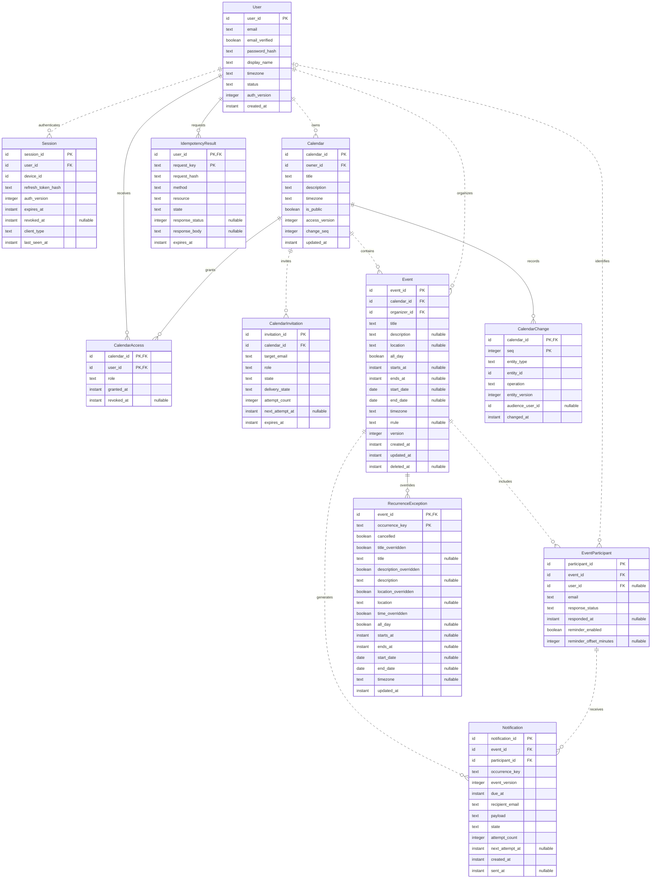
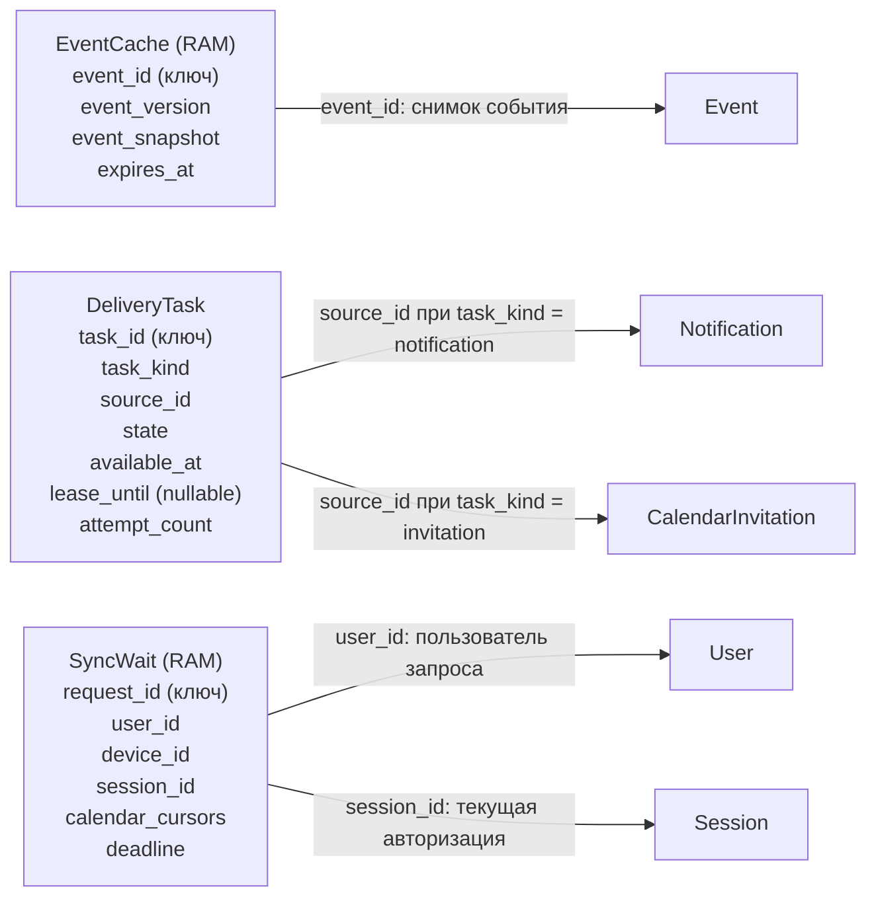
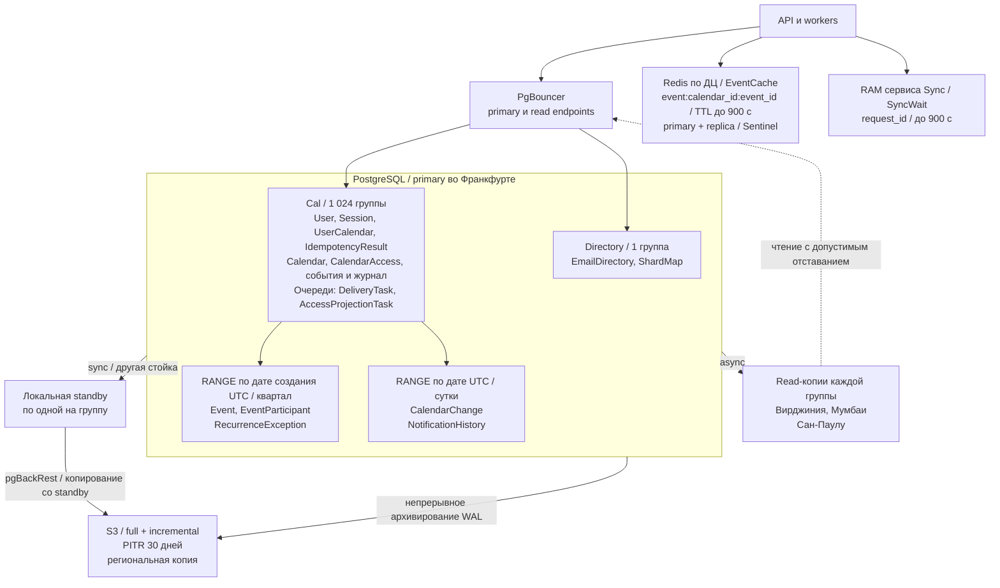
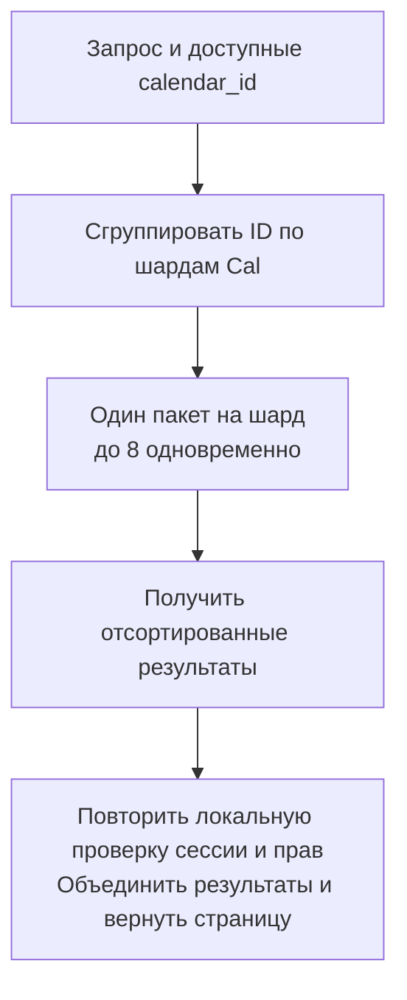
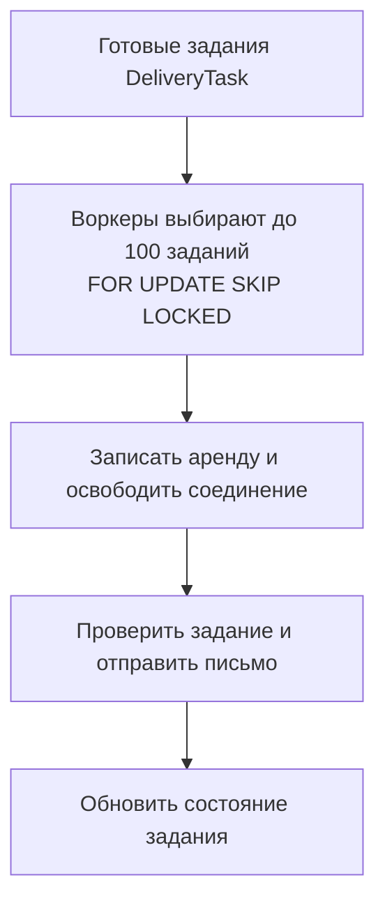

# Google Calendar

## Оглавление

1. [Тема и целевая аудитория](#глава-1-тема-и-целевая-аудитория)
2. [Расчёт нагрузки](#2-расчёт-нагрузки)
3. [Глобальная балансировка нагрузки](#3-глобальная-балансировка-нагрузки)
4. [Локальная балансировка нагрузки](#4-локальная-балансировка-нагрузки)
5. [Логическая схема базы данных](#5-логическая-схема-базы-данных)
6. [Физическая схема базы данных](#6-физическая-схема-базы-данных)
7. [Алгоритмы](#7-алгоритмы)
8. [Технологии](#8-технологии)
9. [Обеспечение надёжности](#9-обеспечение-надёжности)
10. [Схема проекта](#10-схема-проекта)
11. [Список серверов, ресурсы и стоимость](#11-список-серверов-ресурсы-и-стоимость)
12. [Список использованных источников](#список-использованных-источников)

---

## Глава 1. Тема и целевая аудитория

### 1.1 Тема проекта, рыночная ниша и аналоги

**Выбранная тема:** проектирование бэкенда высоконагруженного сервиса для планирования встреч, событий и дел - **«Google Calendar»**.

**Реальные аналоги:** Microsoft Outlook Calendar, Apple iCloud Calendar, Zoho Calendar, Calendly. Наличие независимых глобальных игроков на протяжении последних лет однозначно подтверждает существование устойчивой и крупной рыночной ниши - потребности массового пользователя и корпоративных клиентов в планировании встреч, событий, дел и синхронизации расписаний между различными устройствами.

---

### 1.2 Целевая аудитория: размер и локализация

Целевая аудитория - массовый пользователь мобильных устройств и ПК, использующий сервис для планирования встреч, событий и дел, а также корпоративные клиенты через Google Workspace. Сервис имеет глобальное распространение с выраженной концентрацией в США и развитых рынках.

#### Ключевые метрики аудитории

| Метрика | Значение | Период | Источник |
| :--- | :--- | :--- | :--- |
| **Месячная аудитория Google Calendar (MAU)** | **500 млн** | Оценка из публикаций | Patronum [2] и Exploding Topics [1] приводят более 500 млн пользователей в месяц. Для расчётов используется округлённое значение 500 млн |
| **Пользователей Google Workspace** (включая Gmail, Drive, Calendar) | **3 млрд** | 2025 | [1], [2] |
| **Платящих B2B-компаний Workspace** | **6 млн** | 2025 | [2] |
| **Компаний из Fortune 500, использующих Google Workspace** | **40%** | 2025 | [2] |

Google не публикует отдельные метрики по количеству событий, уведомлений и устройств для Google Calendar. Эти значения выводятся в разделе 2 как расчётные продуктовые допущения на основе исследований рынка труда и официальных документов.

#### Региональное распределение рынка Workspace и оценка аудитории Calendar

Региональные доли взяты из отраслевого отчёта Dataintelo о рынке Google Workspace [3]. В курсовой эти доли используются как приближение для географии пользователей Google Calendar. Значения в столбце MAU получены умножением исходных долей на 500 млн.

| Регион | Доля рынка Workspace по Dataintelo [3] | MAU Calendar по модели |
| :--- | :--- | :--- |
| **Северная Америка** | **38,4%** [3] | ~192 млн |
| **Европа** | **26,7%** [3] | ~134 млн |
| **Азиатско-Тихоокеанский регион** | **22,8%** [3] | ~114 млн |
| **Латинская Америка + MEA** | **~12%** [3] | ~60 млн |

---

### 1.3 Функционал MVP

Для проектирования выделены следующие **6 ключевых функций**, покрывающих основной пользовательский путь:

1. **Регистрация и авторизация.** Создание аккаунта, вход в систему и управление сессиями.
2. **Создание и редактирование календарей.** Базовое управление сущностями календарей.
3. **Управление доступом.** Каждый календарь можно сделать общедоступным либо предоставить отдельным людям доступ к нему (просмотр или редактирование) через приглашение по электронной почте.
4. **Уведомления.** Отправка уведомлений о предстоящих событиях по электронной почте.
5. **Управление событиями.** Создание и редактирование событий внутри календарей.
6. **Поиск по событиям.** Полнотекстовый поиск по названию, описанию, участникам и дате события внутри всех календарей пользователя с фильтрацией по дате и ключевым словам.

#### Ключевые продуктовые решения

1. **Хранение повторяющихся событий.** Вместо создания тысяч отдельных записей для каждой встречи (например, "планёрка каждый понедельник на год вперёд") в базе данных хранится только одно правило повторения. Конкретные встречи создаются "на лету" при просмотре календаря. Это позволяет экономить огромное количество места и легко редактировать всю серию сразу.

2. **Синхронизация между устройствами.** Когда пользователь открывает календарь на телефоне, приложение не скачивает все события заново. Оно запрашивает только те события, которые изменились с момента последнего открытия. Это экономит мобильный трафик пользователя и снижает нагрузку на серверы.

3. **Асинхронная отправка уведомлений.** Задание сохраняется в PostgreSQL и повторяется при временной ошибке. Между приёмом письма Amazon SES и фиксацией результата возможен дубль. Постоянные ошибки требуют разбора, а аварийное повышение асинхронной реплики может привести к потере последних изменений.

---

## 2. Расчёт нагрузки

### 2.1. Исходные продуктовые метрики

| Показатель | Значение | Основание |
| --- | --- | --- |
| Месячная аудитория (MAU) | **500 млн** | Округлённая опубликованная оценка [1], [2] |
| Дневная аудитория (DAU) | **275 млн** | MAU × 55%; проектное допущение |
| Зарегистрированных аккаунтов | 3 млрд | Проектная оценка ёмкости Calendar на основе аудитории Workspace [1], [2] |
| Событий создаётся в месяц | **3,55 млрд** | DAU × 0,43 × 30; проектная частота |
| Уведомлений доставляется в месяц | **16,8 млрд** | События × 7,9 × 0,6; проектные средние |
| Устройств на пользователя | **3** | Телефон + рабочее устройство + личное устройство |
| Окно использования календаря на DAU | **15 минут/день** | Одно активное устройство; проектное допущение |
| Sync-запросов на DAU в день | **1** | Один long-polling запрос в принятом дневном окне |
| Коэффициент пика | **4** | Утренний и вечерний пики |

#### Обоснование DAU

Для смешанной аудитории корпоративных и личных пользователей принимается проектный коэффициент DAU/MAU = 55%.
```
DAU = 500 млн × 0,55 = 275 млн
```

#### Обоснование количества событий

Частоты действий и доли сегментов ниже являются проектными допущениями.

| Сегмент | Доля | Событий/день | Обоснование частоты | Вклад |
| --- | ---: | ---: | --- | ---: |
| Корпоративные организаторы | 8% | 3,0 | Активный организатор: 3 создаваемых события/день | 0,240 |
| Корпоративные участники | 12% | 0,1 | В основном принимают приглашения, редко создают сами | 0,012 |
| Личные активные | 20% | 0,8 | Типичный паттерн: 5-6 личных событий в неделю | 0,160 |
| Пассивные | 45% | 0,03 | ~1 событие в месяц | 0,0135 |
| Минимальные | 15% | 0,005 | 1-2 события в год | 0,00075 |
| **Итого** | **100%** | — | — | **0,426 ≈ 0,43** |

```
Событий в месяц = 275 млн × 0,43 × 30 ≈ 3,55 млрд
```

#### Обоснование количества уведомлений

Уведомления считаются как фан-аут событий на участников. 

Среднее число участников определяется проектной сегментацией. Лимит гостей — 200 [4]; модель участника описана в iCalendar [5].

| Тип события | Доля | Участников | Обоснование | Вклад |
| --- | ---: | ---: | --- | ---: |
| Личная встреча | 50% | 1,5 | Встречи 1-на-1, личные дела | 0,75 |
| Рабочая встреча | 35% | 5 | Проектное среднее: 5 участников | 1,75 |
| Крупное мероприятие | 12% | 20 | Командные встречи, тренинги | 2,40 |
| Массовое | 3% | 100 | All-hands, вебинары (лимит 200 [4]) | 3,00 |
| **Итого** | **100%** | — | Средневзвешенное количество участников | **7,9** |

Принимаем, что **60% событий генерируют уведомления** (остальные 40% - личные заметки и события без гостей, которые не требуют фан-аута).

```
Уведомлений в месяц = 3,55 млрд × 7,9 × 0,6 ≈ 16,8 млрд
```

#### Обоснование частоты синхронизации

Проектный сценарий: одно 15-минутное окно открытого календаря на DAU и одно активное устройство. В окне выполняется один `GET /sync`, который отвечает при появлении изменений или через 900 с и отменяется при закрытии календаря. Клиент применяет изменения, сохраняет возвращённый курсор на устройстве и передаёт его в следующем `GET /sync`. Повтор запроса с прежним курсором может вернуть пакет повторно. Уведомления по электронной почте работают независимо от открытого приложения.

```text
Sync-запросов/сутки = 275 млн DAU × 1 = 275 млн
Средний Sync RPS = 275 млн / 86 400 ≈ 3 183
Пиковый Sync RPS = round(275 млн / 86 400 × 4) = 12 731
Q_peak = ceil(275 млн × 900 / 86 400 × 4) = 11 458 334 ожидания
```

Q_peak — оценка при ожидании всех запросов до таймаута и распределённых началах окон с коэффициентом пика 4; ранние ответы и закрытие уменьшают её. Три устройства относятся к хранению за 30 дней, а не к одновременному подключению. Время использования — допущение, не опубликованная статистика сервиса.

Для объёмов хранения используются двоичные приставки: 1 КиБ = 1024 Б, 1 МиБ = 1024² Б, 1 ГиБ = 1024³ Б, 1 ТиБ = 1024⁴ Б. Для сетевого трафика используются десятичные приставки: 1 Гбит/с = 10⁹ бит/с.

---

### 2.2. Действия пользователей и RPS

$$N_i = DAU \times a_i, \quad RPS_{avg,i} = \frac{N_i}{86\,400}, \quad RPS_{peak,i} = 4 \times RPS_{avg,i}$$

| Действие | Метод | На DAU в день | Млн запросов/сутки | Средний RPS | Пиковый RPS |
| --- | --- | --: | --: | --: | --: |
| Вход / регистрация | `POST /auth/login` | 0,01 | 2,75 | 32 | 127 |
| Обновление сессии | `POST /auth/refresh` | 0,3 | 82,5 | 955 | 3 819 |
| Создание календаря | `POST /calendars` | 0,001 | 0,275 | 3 | 13 |
| Редактирование календаря | `PATCH /calendars/{id}` | 0,01 | 2,75 | 32 | 127 |
| Создание события | `POST /events` | 0,43 | 118,25 | 1 369 | 5 475 |
| Редактирование события | `PATCH /events/{id}` | 0,22 | 60,5 | 700 | 2 801 |
| Удаление события | `DELETE /events/{id}` | 0,07 | 19,25 | 223 | 891 |
| Приглашение / изменение доступа | `POST /calendars/{id}/share` | 0,02 | 5,5 | 64 | 255 |
| Ответ на приглашение | `POST /events/{id}/respond` | 0,05 | 13,75 | 159 | 637 |
| Поиск по событиям | `GET /search` | 0,5 | 137,5 | 1 591 | 6 366 |
| Синхронизация устройств (long-polling) | `GET /sync` | 1 | 275 | 3 183 | 12 731 |
| **Итого** | - | **2,611** | **718,025** | **8 311** | **33 242** |

Создание событий: `3,55 млрд/мес ÷ 30 дней ÷ 275 млн DAU = 0,43`. Sync — один запрос на DAU в принятом дневном окне; RPS округлены по строкам, итог — сумма строк.

---

### 2.3. Хранилище активного пользователя

| Тип данных | Количество | Б/объект | Объём, Б |
| --- | ---: | ---: | ---: |
| Профиль и настройки (`User`) | 1 | 965 | 965 |
| Личные календари (`Calendar`) | 5 | 3 480 | 17 400 |
| Доступ к чужим календарям (`CalendarAccess`) | 10 | 48 | 480 |
| События за 5 лет, включая правила (`Event`) | 785 | 3 577 | 2 807 945 |
| Участники событий (`EventParticipant`) | 785×7,9 | 128 | 793 792 |
| Исключения серии (`RecurrenceException`) | 785×1% | 512 | 4 019,20 |
| Будущие напоминания и успешная история (`Notification`) | ≈75,35 | 1 280 | 96 442,18 |
| Сессии со сведениями о клиентах (`Session`) | 3 | 320 | 960 |
| **Итого** | | | **3 722 003,38** |

Итого: `3 722 003,38 / 1 048 576 ≈ 3,54958 МиБ`, или **≈3,55 МиБ** на расчётный профиль. Промежуточные величины считаются без округления; в таблице показаны округлённые значения.

Профиль сохраняет 785 событий за пять лет, пять личных и десять доступных календарей, три клиентские установки и по одной активной сессии на установку. Средний размер события 3 577 Б уже включает правило повторения: `3 513+0,1×640`. Исключение серии в среднем занимает 512 Б; поиск использует исходные таблицы. Размер сессии 320 Б включает сведения о клиенте; отдельные объёмы устройств и правил не прибавляются.

Для оценки `Notification` поток `H=560 млн/сутки` распределён между **275 млн расчётных активных профилей**: успешная история — `30H/DAU ≈ 61,09` записи, будущие напоминания — `7H/DAU ≈ 14,25`, всего `(30H+7H)/DAU ≈ 75,35`. Это принятое распределение потока между типовыми активными профилями, а не статистика месячных уникальных получателей.

Это расчётный профиль активного пользователя, а не среднее по MAU или по всем 3 млрд аккаунтов. Его нельзя умножать на 3 млрд для получения глобального объёма. Глобальная ёмкость в 2.4 рассчитывается по числу объектов и срокам хранения; приглашения, идемпотентные результаты, журнал, очереди, кеш и рабочие буферы учитываются там отдельно.

---

### 2.4. Общий объём хранения

Состав данных и размеры записей соответствуют логической модели раздела 5: 11 основных сущностей и три служебные структуры. Объёмы рассчитаны для одной логической копии; физические индексы, репликация и резервные копии не включены. Постоянное хранение и RAM показаны раздельно.

| Сущность / набор | Количество, млн | Б/объект | Объём, ТиБ |
| --- | ---: | ---: | ---: |
| `User` | 3 000,000 | 965 | 2,633 |
| `Session` | 1 500,000 | 320 | 0,437 |
| `Calendar` | 15 000,000 | 3 480 | 47,476 |
| `CalendarAccess` | 30 000,000 | 48 | 1,310 |
| `CalendarInvitation` | 165,000 | 160 | 0,024 |
| `Event` | 213 000,000 | 3 577 | 692,945 |
| `EventParticipant` | 1 682 700,000 | 128 | 195,892 |
| `RecurrenceException` | 2 130,000 | 512 | 0,992 |
| `Notification` | 20 720,000 | 1 280 | 24,121 |
| `CalendarChange` | 42 459,552 | 256 | 9,886 |
| `IdempotencyResult` | 1 222,128 | 2 048 | 2,276 |
| `EventCache` (RAM) | 1,146 | 4 096 | 0,004 |
| `DeliveryTask` | 141,375 | 256 | 0,033 |
| `SyncWait` (RAM) | 11,458 | 65 536 | 0,683 |
| Служебные позиции и резерв журнала/очередей | — | — | 0,005 |
| **Постоянное хранение** |  |  | **978,030** |
| **Оперативная память** |  |  | **0,687** |
| **Всего, включая RAM** |  |  | **978,717** |

**Количество записей:** события — `3,55 млрд/месяц×60 месяцев = 213 млрд` до вычета досрочных удалений; участники — `события×7,9`; исключения — `события×1%`. Календари — `3 млрд×5`, права — `3 млрд×10`; сессии — `500 млн MAU×3`. Число 3 млрд аккаунтов — проектная оценка ёмкости, не подтверждённая статистика аккаунтов Calendar.

`Event` в среднем занимает `3 513+0,1×640 = 3 577 Б`, поэтому правило повторения отдельно не учитывается. `Session` размером 320 Б уже содержит сведения о клиентской установке. `Notification`: `(7+30)×560 млн = 20,72 млрд` записей по 1 280 Б — будущие напоминания и успешная история одной сущности. Ошибочные/незавершённые задания при длительном отказе потребуют дополнительной ёмкости.

Поиск использует события, участников и исключения; отдельные копии поисковых документов не хранятся. Идемпотентные результаты рассчитаны на `14 145×86 400` записей за сутки непрерывного пика. Резерв журнала — `16 381×86 400×30` записей по 256 Б; очередь — час пикового email-потока с запасом 50%. Вместе со служебными позициями их бюджет составляет 9,924 ТиБ; это не срок автоматического удаления необработанных заданий.

`SyncWait` содержит принятые в 2.1 `11 458 334` ожидания по 65 536 Б. Кеш рассчитывается по пиковому наполнению и TTL: `ceil(0,1×275 млн/86 400×4×900)` записей по 4 096 Б. Кеш и буферы относятся к RAM; это прежняя сводная оценка ожидания запроса и его соединений. В §11 ресурсный бюджет разделён по процессам, эту сводную величину повторно к нему не прибавляем.

Итого: постоянное хранение **978,030 ТиБ**, RAM **0,687 ТиБ**. Общий справочный объём — **978,717 ТиБ**; он получен из неокруглённых значений. Дисковая ёмкость и RAM при расчёте серверов учитываются отдельно. Подробные составы записей, сроки хранения и QPS приведены в разделе 5.

---

### 2.5. Сетевой трафик

$$V_{day,i} = \frac{N_i \times S_i}{10^9} \text{ [ГБ]}, \quad B_{peak,i} = \frac{V_{day,i} \times 8 \times 4}{86\,400} \text{ [Гбит/с]}$$

| Тип трафика | Направление | ГБ/сутки | Пик, Гбит/с |
| --- | --- | --: | --: |
| API: входящие запросы | Входящий | 765 | 0,28 |
| API: ответы | Исходящий | 4 412 | 1,63 |
| Синхронизация: запросы | Входящий | 137,5 | 0,05 |
| Синхронизация: ответы | Исходящий | 162,25 | 0,06 |
| Уведомления, включая запущенные напоминаниями | Исходящий | 560 | 0,21 |
| Email-приглашения в календарь | Исходящий | 5,632 | 0,002 |
| **Всего входящий** | Клиент - сервис | **902,5** | **0,33** |
| **Всего исходящий** | Сервис - клиент | **5 139,882** | **1,90** |

Sync-запрос — 500 Б, средний ответ — 590 Б. Расчёт использует неокруглённые значения; таблица показывает округлённый трафик.

С **20% запасом** на транспортные накладные расходы:

| Направление | Без запаса | С запасом 20% |
| --- | --: | --: |
| Входящий | 0,33 Гбит/с | **0,40 Гбит/с** |
| Исходящий | 1,90 Гбит/с | **2,28 Гбит/с** |

---

## 3. Глобальная балансировка нагрузки

### 3.1 Функциональное разбиение по поддоменам

| Поддомен | Назначение | Транспорт | Таймаут | Выбор ДЦ |
| --- | --- | --- | --- | --- |
| api.calendar.google.com | Авторизация, календари, доступ и события | HTTPS | 5–30 с | GeoDNS + ECS |
| sync.calendar.google.com | Инкрементальная синхронизация | HTTPS long-polling | Ожидание до 900 с; прокси-таймаут 930 с | GeoDNS + ECS |
| search.calendar.google.com | Поиск по событиям | HTTPS | 60–120 с | GeoDNS + ECS |

Поддомены позволяют независимо масштабировать сервисы и задавать таймауты. DNS выбирает адрес ДЦ, а локальные L4/L7 выполняют балансировку соединений и запросов.

### 3.2 Обоснование расположения ДЦ и их ролей

| ДЦ | Регион | Доля | Роль |
| --- | --- | ---: | --- |
| Франкфурт | Европа | 26,7% | Единый мастер и локальное чтение |
| Вирджиния | Северная Америка | 38,4% | Реплика для чтения |
| Мумбаи | АТР | 22,8% | Реплика для чтения |
| Сан-Паулу | Латинская Америка и MEA | 12,1% | Реплика для чтения |

Расположение соответствует аудитории раздела 1. Изменения фиксируются во Франкфурте. В других ДЦ сессии и права для защищённого чтения проверяются на региональных репликах при подтверждённом отставании не более 2 с. При недоступной или отставшей реплике чтение возвращает 503 (§6.2).

### 3.3 Распределение трафика по ДЦ

Из раздела 2.2: клиентский пик 33 242 RPS; операции изменения — 14 145 RPS, чтение и Sync — 19 097 RPS. Клиентские запросы распределяются по региональным долям методом наибольших остатков; неевропейские изменения дополнительно обрабатываются во Франкфурте.

| ДЦ | Клиентские RPS | Из них запись | Проксированные записи, дополнительно | Обработки Ingress/с | Клиентский вход, Гбит/с | Клиентский выход, Гбит/с |
| --- | ---: | ---: | ---: | ---: | ---: | ---: |
| Вирджиния | 12 765 | 5 432 | 0 | 12 765 | 0,154 | 0,877 |
| Франкфурт | 8 876 | 3 777 | 10 368 | 19 244 | 0,107 | 0,610 |
| Мумбаи | 7 579 | 3 225 | 0 | 7 579 | 0,091 | 0,521 |
| Сан-Паулу | 4 022 | 1 711 | 0 | 4 022 | 0,049 | 0,276 |
| Всего | 33 242 | 14 145 | 10 368 | 43 610 | 0,401 | 2,284 |

| Межрегиональный поток | Расчёт |
| --- | --- |
| Проксирование записи | 10 368 запросов/с; при 1 КиБ запроса и ответа — 0,085 Гбит/с в каждом направлении |
| Контроль WAL | Два экземпляра API могут независимо снимать позиции CAL и Directory каждые 500 мс: до `2 × 1 025 × 2 = 4 100` коротких SQL-замеров/с на primary, около четырёх на группу. При 64 Б на отметку и рассылке обоих потоков в три ДЦ — ≈0,0063 Гбит/с исходящей полезной нагрузки |
| Передача журнала в три ДЦ | 16 381 изменений/с × 256 Б × 8 × 3 = 0,101 Гбит/с; содержимое объектов передаётся отдельно |

Служебные RPC используют постоянные соединения и не проходят через внешний Ingress. Журнал переносит порядок изменений и tombstones, но не заменяет полную передачу содержимого данных.

### 3.4 Схема DNS балансировки (GeoDNS + EDNS)

GeoDNS возвращает адрес регионального ДЦ. При поддержке ECS резолвер передаёт префикс клиентской подсети; иначе выбор выполняется по адресу резолвера. TTL записи — 30 с: он ограничивает время кеширования DNS, но не срок существования уже открытого long-polling соединения.

### 3.5 Отказ от BGP Anycast для прикладного трафика

Глобальный BGP Anycast не используется. Внутри ДЦ ECMP распределяет потоки между локальными L4.

### 3.6 Механизм регулировки трафика между ДЦ

При отказе ДЦ health checks исключают его из DNS-выдачи; клиент переподключается к доступному региону с задержкой и случайным разбросом повторов. Перенос нагрузки ограничивается доступной ёмкостью принимающих ДЦ. При перегрузке вход ограничивает допуск, в том числе новых долгих ожиданий Sync, и отвечает 503 с Retry-After, где применимо. Локальные резервы рассчитаны на отказ узла или группы в своём ДЦ. Полный пик отказавшего ДЦ в бюджет не заложен.

При отказе Франкфурта запись приостанавливается до ручного выбора нового primary. Защищённое чтение в регионах возвращает 503, как только перестаёт выполняться требование свежести. Старый мастер изолируется от записи; доступность и позиция реплики проверяются до переключения. Асинхронные копии допускают потерю последних изменений; обратно мастер переключается только после согласования данных.

---

## 4. Локальная балансировка нагрузки

### 4.1 Схема балансировки и уровни резервирования

GeoDNS возвращает клиенту IP регионального ДЦ. После этого клиент подключается напрямую к его L4; DNS не участвует в передаче HTTP-трафика.

```text
                 [ Клиент → IP регионального ДЦ ]
                                │
                                ▼
┌──────────────────────────────────────────────────────────────────┐
│ 1. L4: балансировка TCP-соединений                               │
│    • BGP-анонс VIP; ECMP от двух маршрутизаторов                 │
│    • Maglev: GRE к NGINX; ответ клиенту напрямую (DSR)           │
│    • Резервирование: N+1, группы A и B в режиме active-active    │
└───────────────────────────────┬──────────────────────────────────┘
                                │ TCP / TLS
                                ▼
┌──────────────────────────────────────────────────────────────────┐
│ 2. L7: NGINX Ingress                                             │
│    • TLS termination и маршрутизация к API / Sync / Search       │
│    • API: weighted round-robin; Search/Sync: least_conn          │
│    • Sync: HTTPS long-polling, ожидание до 900 секунд            │
│    • Резервирование: N×2, независимые группы A и B               │
└───────────────────────────────┬──────────────────────────────────┘
                                │ HTTP, переиспользуемые соединения
                                ▼
┌──────────────────────────────────────────────────────────────────┐
│ 3. Межсервисная клиентская балансировка                          │
│    • Service discovery и выбор доступного endpoint               │
│    • Least request для HTTP-вызовов                              │
│    • Резервирование: минимум два экземпляра каждого сервиса      │
└──────────────────────────────────────────────────────────────────┘

Запись из другого ДЦ:
Региональный API → внутренний Ingress Франкфурта → API записи
                 → VIP пулеров (1 активный + 1 резервный) → мастер
```

Внутренний Ingress Франкфурта входит в его общий пул L7; местные записи идут из Ingress сразу к API записи. Локальные реплики проверяют сессии и права для чтения. Региональный Sync принимает курсор от устройства и читает локальные реплики.

### 4.2 Алгоритмы и резервирование

#### 4.2.1 Алгоритмы балансировки

| Уровень | Компонент | Алгоритм | Причина выбора |
| --- | --- | --- | --- |
| Вход в ДЦ | Два маршрутизатора | ECMP по параметрам потока | Распределение потоков между активными L4 |
| L4 → NGINX | Программный L4 по схеме Maglev [11] | Согласованное хеширование и учёт соединений | Устойчивое назначение TCP-потоков; GRE доставляет пакеты, DSR возвращает ответы в обход L4 |
| NGINX → API, включая внутренний вход Франкфурта | Общий пул NGINX Ingress | Weighted Round Robin, фиксированные веса | Простое распределение коротких запросов с учётом мощности экземпляров |
| NGINX → Search | Общий пул NGINX Ingress | Weighted Least Connections (`least_conn` с весами) | Учёт активных соединений при различной длительности поиска |
| NGINX → Sync | Общий пул NGINX Ingress | Least Connections | Распределение ожидающих long-polling соединений и расхода памяти |
| Межсервисный HTTP | Клиентский балансировщик | Least Request | Учёт выполняемых запросов при переиспользовании соединений |

Веса фиксированы и не корректируются автоматически. `least_conn` не измеряет стоимость запроса или CPU; длительное ожидание Sync не считается медленным выполнением. Алгоритмы NGINX — в [документации](https://nginx.org/en/docs/http/ngx_http_upstream_module.html).

#### 4.2.2 Режимы резервирования и переключение

| Компонент | Формула / количество | Режим | Протокол / механизм переключения |
| --- | --- | --- | --- |
| Маршрутизаторы | N+1, независимые пути | Active-Active | Маршрутизация BGP и исключение недоступного пути; оставшийся маршрутизатор выдерживает поток |
| L4 | N+1 | Active-Active | BGP-анонс VIP + ECMP; проверка L4 и отзыв маршрута при отказе [11] |
| Общий пул NGINX | N×2, две независимые группы | Active-Active | Health checks со стороны L4 и исключение недоступного NGINX; API/Search/Sync используют один расчётный пул L7 |
| API / Search / Sync | N×2 для каждого сервиса; N определяется его нагрузкой и производительностью. | Active-Active | Readiness, service discovery и исключение по ошибкам; количество определяется нагрузкой |
| Пулеры во Франкфурте | N+1, каждый выдерживает полный поток | Active-Passive | Keepalived/VRRP, общий VIP и проверка процесса пулера; резервный принимает VIP |

N×2 рассчитано на потерю одной из двух групп; N+1 рассчитано на потерю одного узла. Минимум два экземпляра сервиса сам по себе не доказывает достаточность мощности. При плановом отключении используется graceful drain; отказ может оборвать TCP-соединения, Sync переподключается с курсором.

Пулеры размещаются в общей локальной сети; активный предоставляет соединение на транзакцию. [VRRP (RFC 9568)](https://www.rfc-editor.org/rfc/rfc9568.html) переключает VIP, но не сохраняет соединения: приложения переподключаются. Запись повторяется только с тем же ключом идемпотентности и телом запроса.

### 4.3 Расчёт количества

| Параметр | Значение |
| --- | --- |
| Нагрузка | Региональные обработки Ingress из раздела 3.3 |
| NGINX, 8 CPU без HT [8] | 31 485 новых TLS-соединений/с; 8,64 Гбит/с в отдельных тестах |
| Коэффициент загрузки u | 0,8: 25 188 TLS-соединений/с; 6,912 Гбит/с |
| Консервативный TLS-сценарий | Каждый запрос, включая Sync и проксированную запись, создаёт новое TLS-соединение |
| Одновременные Sync-запросы | Q=11 458 334 по сценарию раздела 2.1; одно активное устройство на пользователя |
| Проектный L7-узел | 8 физических ядер сопоставимого класса, 192 ГиБ RAM |
| Условная память ожидания | 64 КиБ на запрос и пару соединений; сценарий оценки, не измеренный расход NGINX |
| Сетевые допущения | Дополнительно 3 КиБ TLS/TCP-обмена в каждом направлении на новое соединение; проксированная запись — по 1 КиБ запроса и ответа |
| L4, ориентир Maglev [11] | 10 Гбит/с на узел; с u=0,8 — 8 Гбит/с. Проектный запас IPv4/GRE — 30% к входящему потоку |

T_i — обработки Ingress/с, p_i — доля региона. Q_i распределяются методом наибольших остатков из Q. Базовые B_in и B_out берутся из неокруглённых расчётов раздела 2.5; сеть измеряется в Гбит/с.

```text
B_in,base = 902,5 × 8 × 4 / 86 400 × 1,2 = 0,401111… Гбит/с
B_out,base = 5 139,882 × 8 × 4 / 86 400 × 1,2 = 2,284392 Гбит/с
B_proxy,F = 10 368 × 1 024 × 8 / 10^9; в других ДЦ B_proxy = 0
B_in,i  = B_in,base × p_i + T_i × 3 072 × 8 / 10^9 + B_proxy,i
B_out,i = B_out,base × p_i + T_i × 3 072 × 8 / 10^9 + B_proxy,i

N_TLS = ceil(T_i / 25 188)
N_net = ceil(max(B_in,i, B_out,i) / 6,912)
N_conn = ceil(Q_i × m / (0,8 × 192 × 2^30)); m = 65 536 Б
L7_i = 2 × max(N_TLS, N_net, N_conn)
L4_i = ceil(1,3 × B_in,i / 8) + 1
```

| ДЦ | T_i, соединений/с | Вход / выход, Гбит/с | Q_i, ожиданий | N_TLS | N_net | N_conn | L7 с резервом | L4 с резервом |
| --- | ---: | ---: | ---: | ---: | ---: | ---: | ---: | ---: |
| Вирджиния | 12 765 | 0,468 / 1,191 | 4 400 000 | 1 | 1 | 2 | 4 | 2 |
| Франкфурт | 19 244 | 0,665 / 1,168 | 3 059 375 | 1 | 1 | 2 | 4 | 2 |
| Мумбаи | 7 579 | 0,278 / 0,707 | 2 612 500 | 1 | 1 | 2 | 4 | 2 |
| Сан-Паулу | 4 022 | 0,147 / 0,375 | 1 386 459 | 1 | 1 | 1 | 2 | 2 |
| Всего | 43 610 | 1,558 / 3,441 | 11 458 334 | 4 | 4 | 7 | 14 | 8 |

Пример для Вирджинии: N_conn=ceil(4 400 000×65 536/(0,8×192×2^30))=2; L7=2×max(1,1,2)=4, L4=ceil(1,3×0,467739/8)+1=2.

Итог — предварительно 14 L7 и 8 L4, два пулера отдельно. Производительность подтверждается тестом совместной нагрузки: память, клиентские/upstream-соединения, TLS и сеть; отдельные тесты [8] не измеряют long-polling. Keep-alive и TLS resumption не уменьшают расчёт без измерений, ориентир Maglev не переносится на произвольный L4.

---
## 5. Логическая схема базы данных

Модель включает 11 основных сущностей и три служебные структуры; выбор СУБД и физического размещения относится к разделу 6 [13].

### 5.1. Идентификаторы

`PK` — первичный ключ, `FK` — ссылка на сущность, `nullable` — необязательное поле. Составные ключи: `CalendarAccess` — `(calendar_id, user_id)`, `RecurrenceException` — `(event_id, occurrence_key)`, `CalendarChange` — `(calendar_id, seq)`, `IdempotencyResult` — `(user_id, request_key)`. Email аккаунта и пара `(event_id, email)` среди участников уникальны.

`device_id` обозначает установку клиента, сохраняется при смене сессии и проверяется через текущую авторизованную сессию; курсор от `session_id` не зависит. У `Notification` собственный ключ `notification_id` и уникальная пара `(participant_id, occurrence_key)` — одно напоминание участнику о вхождении.

### 5.2. Логическая схема

**Основные данные:**



`||` — ровно один, `o|` — ноль или один, `o{` — ноль или много. Сплошная связь — ключ родителя входит в ключ дочерней записи, пунктирная — не входит; необязательный `EventParticipant.user_id` допускает гостя без аккаунта.

**Служебные структуры и связи с основными данными:**



Стрелки показывают логические ссылки, а не физические FK; `task_kind` выбирает ровно один источник `source_id`: уведомление либо приглашение. Имена без полей — ссылки на основную схему; `nullable` — необязательное значение. Служебные структуры не обязательно являются самостоятельными таблицами БД.

### 5.3. Особенности хранения и консистентность

- **Повторения.** Правило хранится в `Event.rrule` и применяется в часовом поясе события [5]; исключения — в `RecurrenceException` по неизменному исходному началу вхождения `occurrence_key`. Флаги `*_overridden` выбирают наследование или собственное значение; description/location можно очистить, title при переопределении обязателен. При time_overridden задаются timezone и целиком либо starts_at/ends_at, либо start_date/end_date с all_day; конец позже начала. Неактивные значения пусты. cancelled отменяет вхождение, rrule остаётся у серии. Обычные события используют моменты времени, события на весь день — даты; конец интервала исключающий.
- **Консистентность и доступ.** Событие, участники/исключения, версия и запись журнала изменяются атомарно как одна логическая операция. Участие не даёт доступа ко всему календарю; принятие приглашения требует подтверждённого email. Перед выдачей защищённых данных, в том числе результатов поиска и Sync, сервер проверяет сессию и права в регионе с допустимым отставанием до 2 с (§6.2). Повтор запроса с тем же ключом защищён идемпотентностью на 24 часа; незавершённый результат не удаляется по TTL.
- **Список доступных календарей.** Актуальное право на конкретный календарь хранится в `CalendarAccess`. Для списка календарей по пользователю используются служебные структуры `AccessProjectionTask` (задание на обновление) и `UserCalendar` (готовый список). Их размещение описано в [§6.1](#61-размещение-данных-и-маршрутизация), а работу процесса показывает [маршрут 7 в §10](#10-схема-проекта).
- **Напоминания.** До отправки перенос обновляет ту же `Notification`; после успешной отправки новое напоминание автоматически не создаётся. Задание очереди ссылается на уведомление или приглашение; отправитель проверяет срок, состояние и версию. Возможны дубли email и потеря последних изменений при аварии мастера согласно разделу 3. Отменённые неотправленные записи удаляются после обработки отмены; незавершённые и ошибочные не удаляются по TTL успешной истории, отправленные сохраняют снимок письма независимо от удаления события.
- **Sync, поиск и кеш.** Calendar.updated_at меняется при правке свойств календаря, CalendarChange.changed_at — время записи журнала. Изменение события, гостей или исключений повышает версию Event и даёт одну запись entity_type=event с event_id; несколько полей не создают отдельных записей. Для прав/свойств используется entity_type=calendar с calendar_id и entity_version=change_seq; seq задаёт порядок. Курсор на устройстве отмечает применённые изменения, включая удаления. Если курсора нет или нужная позиция вышла за 30-дневное окно журнала, регион выполняет полную синхронизацию. Поиск читает исходные Event, EventParticipant и RecurrenceException с проверкой текста, дат и прав; кеш может устаревать. Файловых вложений нет.

### 5.4. Описание данных

| Сущность | Назначение |
| --- | --- |
| `User` | Учётная запись, авторизация и настройки пользователя. |
| `Session` | Авторизованный вход и сведения о клиентской установке. |
| `Calendar` | Календарь, его владелец, публичность и версии. |
| `CalendarAccess` | Персональное право чтения или редактирования календаря. |
| `CalendarInvitation` | Приглашение на календарь по email и результат отправки письма. |
| `Event` | Событие или шаблон серии с необязательным правилом повторения. |
| `EventParticipant` | Участник, его ответ и настройка одного email-напоминания. |
| `RecurrenceException` | Отмена или изменение отдельного вхождения серии. |
| `Notification` | Запланированное напоминание и его последующий результат доставки. |
| `CalendarChange` | Порядок изменений календаря; записи событий охватывают гостей и исключения, удаления передаются tombstone. |
| `IdempotencyResult` | Ключ, состояние и сохранённый результат изменяющего запроса. |

**Кеши, очередь и временные данные:**

| Структура | Назначение | Срок жизни |
| --- | --- | --- |
| `EventCache` | RAM: снимок основного события с правилом повторения. | До 900 с; инвалидируется при изменении. |
| `DeliveryTask` | Работа на отправку напоминания или приглашения в календарь. | До подтверждения; расчётная ёмкость на час пика. |
| `SyncWait` | RAM: контекст ожидающего long-polling и буферы соединений. | До ответа/отмены, не более 900 с. |

### 5.5. Размеры данных и нагрузка

Исходные потоки — из раздела 2: DAU 275 млн, MAU 500 млн; 3 млрд аккаунтов — проектная оценка, не подтверждённая статистика Calendar.
Объёмы даны для одной логической копии без физических индексов, реплик и резервных копий. QPS — логические, в том числе пакетные обращения; для RAM — операции с памятью. В таблице указаны среднее / пик с округлением.

| Сущность / набор | Записей, млн | Б/запись | Объём, ТиБ | QPS чтение ср./пик | QPS запись ср./пик | Срок хранения |
| --- | ---: | ---: | ---: | ---: | ---: | --- |
| `User` | 3 000,000 | 965 | 2,633 | 13 148 / 52 594 | 0,32 / 1 | До удаления аккаунта |
| `Session` | 1 500,000 | 320 | 0,437 | 13 053 / 52 212 | 987 / 3 947 | До истечения; расчёт по MAU за 30 дней |
| `Calendar` | 15 000,000 | 3 480 | 47,476 | 12 095 / 48 380 | 2 549 / 10 198 | До удаления календаря |
| `CalendarAccess` | 30 000,000 | 48 | 1,310 | 12 095 / 48 380 | 64 / 255 | До отзыва |
| `CalendarInvitation` | 165,000 | 160 | 0,024 | 95 / 382 | 127 / 509 | 30 дней |
| `Event` | 213 000,000 | 3 577 | 692,945 | 17 546 / 70 185 | 2 451 / 9 803 | Пятилетняя ёмкость; действующая серия — до завершения |
| `EventParticipant` | 1 682 700,000 | 128 | 195,892 | 15 955 / 63 819 | 2 451 / 9 803 | Вместе с событием |
| `RecurrenceException` | 2 130,000 | 512 | 0,992 | 9 473 / 37 894 | 23 / 92 | Вместе с серией |
| `Notification` | 20 720,000 | 1 280 | 24,121 | 12 963 / 51 852 | 26 480 / 105 919 | Планирование на 7 дней; успешная история 30 дней |
| `CalendarChange` | 42 459,552 | 256 | 9,886 | 14 014 / 56 057 | 2 549 / 10 198 | Не менее 30 дней |
| `IdempotencyResult` | 1 222,128 | 2 048 | 2,276 | 3 536 / 14 145 | 7 072 / 28 289 | 24 часа для результата |
| `EventCache` (RAM) | 1,146 | 4 096 | 0,004 | 318 / 1 273 | 2 769 / 11 076 | До 900 с |
| `DeliveryTask` | 141,375 | 256 | 0,033 | 6 545 / 26 181 | 19 635 / 78 542 | До подтверждения; запас на час пика |
| `SyncWait` (RAM) | 11,458 | 65 536 | 0,683 | 3 183 / 12 731 | 6 366 / 25 463 | До 900 с |
| Служебные позиции и резерв журнала/очередей | — | — | 0,005 | — | — | По состоянию обработки |
| **Постоянное хранение** | | | **978,030** | | | |
| **Оперативная память** | | | **0,687** | | | |
| **Всего, включая RAM** | | | **978,717** | | | |

**Общие формулы:**

- `Объём, ТиБ = число записей × Б/запись / 2^40`.
- `Средний QPS = обращений за сутки / 86 400`.
- `Пиковый QPS = средний QPS × 4`.

**Расчётные допущения:**

- Количество записей и ёмкостные резервы приняты по разделу 2.4; размеры — проектные средние, не ограничения полей API. RAM ожиданий Sync здесь показана сводно. В §11 ресурсы NGINX и приложения учтены на тех узлах, которые их выделяют, без повторного прибавления сводной величины.
- Обоснование размеров: `Event = 3 513 + 10% × 640 = 3 577 Б`; участник — `3×8 + 48 + 1 + 8 + 1 + 4 + 42 = 128 Б` (ID, email, ответ, время, флаг, интервал и резерв).
- QPS учитывает пакетные обращения: проверка доступа — в среднем по 15 календарям, поиск — по одному пакету отбора в Event, EventParticipant и RecurrenceException и проверка до 20 кандидатов. Пакет не равен одной строке или IOPS: участники — 1 160,5 млн изменённых строк/сутки.
- Исключение серии — средние 512 Б: 128 Б на ключи, признаки и время, 384 Б на изменённые тексты; это проектный бюджет.
- 1% входов — регистрации; 10% базовых Sync возвращают одно изменившееся событие, каждый поиск отбирает кандидатов из событий, участников и исключений; 10% дополнительно раскрывают серию, 1% операций записи событий затрагивает исключения.
- Учтены повторные проверки прав перед ответом поиска/Sync; попадания в кеш не уменьшают оценку чтений источника. Повторы доставки, очистка и полная пересинхронизация требуют дополнительной нагрузки и ёмкости при накоплении заданий.

**Обоснование расчётов:**

- **Напоминания:** 560 млн/сутки, включая вхождения серий; приглашения в календарь учтены отдельно, письма об изменениях событий в MVP не входят.
  Семидневное расписание и 30-дневная история: `560 млн × (7 + 30) = 20,72 млрд` записей по `1 024 + 256 = 1 280 Б` — 24,121 ТиБ.
  Два чтения на напоминание: `560 млн × 2 / 86 400 ≈ 12 963 QPS`. Четыре записи состояния и перепланирование у 60% изменяемых/удаляемых событий внутри семидневного горизонта:
  `[4 × 560 млн + 0,6 × (60,5 + 19,25) млн] / 86 400 ≈ 26 480 QPS`.
- **Кеш:** `ceil(27,5 млн / 86 400 × 4 × 900) = 1 145 834` уникальных заполнения за TTL при непрерывном пике; по 4 096 Б — 4,371 ГиБ. Инвалидации учитываются в QPS, но не увеличивают вместимость.
- **Резервы:** журнал — `16 381 × 86 400 × 30` записей по 256 Б; очередь — `565,5 млн / 86 400 × 4 × 3 600 × 1,5` записей по 256 Б, час пика с запасом 50%.
  Вместе со служебными позициями — 9,924 ТиБ; результаты идемпотентности рассчитаны на `14 145 × 86 400` записей. Это запас вместимости, а не TTL необработанных заданий.

**Ограничения исходных расчётов.** QPS использует базовый один Sync-запрос на DAU за окно; непрерывный long-polling повторяет запрос после ответа и требует уточнения частоты, доли непустых ответов и времени одновременных ожиданий.
Проверки сессий и прав перед чтением и повторные проверки перед выдачей поиска/Sync входят в SQL-нагрузку. В других ДЦ этот SQL выполняют региональные реплики. Трафик подтверждений Sync и служебный контроль WAL рассчитаны в §3.3.

### 5.6. Распределение нагрузки

Популярные календари создают горячие `calendar_id`, массовые события — всплески по `event_id` и участникам, начала встреч в :00/:30 — пики напоминаний по `due_at`.
Восстановление связи вызывает волну Sync, повторы запросов концентрируются на ключах идемпотентности; средние 7,9 участника не заменяют предел 200 гостей [4].

---

## 6. Физическая схема базы данных

### 6.1. Размещение данных и маршрутизация

PostgreSQL хранит сессии, данные календаря, поиск и очередь. Redis хранит кеш событий, сервис Sync держит ожидающие запросы в RAM, S3 хранит резервные копии. Поля основных сущностей приведены в §5, физические поля, ключи и индексы — в §6.2.



В Cal запись `User`, сессии, каталог `UserCalendar` и результаты идемпотентности размещаем по `user_id`. Календарь и связанные с ним данные размещаем по неизменяемому `Calendar.owner_id`. Для владельца это один и тот же ID, поэтому профиль и собственные календари находятся в одной физической группе. `ShardMap` сопоставляет **16 384 виртуальных сегмента** с **1 024 группами Cal**, в среднем по 16 сегментов на группу. Номер сегмента — первые 14 бит SHA-256 от восьми байтов ID в сетевом порядке.

Сервис авторизации получает `user_id` по нормализованному email из отдельной группы Directory и читает профиль и сессию на группе пользователя. Чужие календари находим через `UserCalendar` на группе читателя. Право на конкретный календарь проверяем по `Calendar` и `CalendarAccess` группы владельца. Для чтения используем свежую региональную реплику, для записи — primary. При выдаче или отзыве права изменение `CalendarAccess` и запись `AccessProjectionTask` фиксируются одной транзакцией на группе владельца. Фоновый обработчик API Франкфурта забирает задачу оттуда и обновляет `UserCalendar` на группе пользователя. Запись создаётся при её отсутствии, а существующая изменяется только при более новой версии задачи. Запросы к нескольким календарям группируем по физической группе. Для популярного календаря ограничиваем параллелизм, а перенос его сегмента помогает разгрузить группу. [§7.1](#71-распределение-поисковых-запросов-по-шардам)

Положительные `bigint` для `calendar_id` и `event_id` кодируются как `(bucket << 49) | sequence`. Старшие 14 бит содержат виртуальный сегмент Cal, младшие 49 — номер из общего для календарей и событий монотонного счётчика сегмента. При выдаче номера используются зарезервированные блоки, поэтому отдельный счётчик обновляется на блок, а не на каждый запрос. По `bucket = id >> 49` и текущей карте сервис определяет группу. Для запроса по `event_id` локальный `EventLocator` возвращает `calendar_id` и дату партиции. Маршруты API с одним ID сохраняются.

При переносе сегмента копируем данные и догоняем изменения до контрольной позиции WAL, останавливаем запись сегмента на источнике и публикуем новую версию карты после применения остатка изменений на цели. Верхнюю границу зарезервированных ID переносим вместе с данными. Старый endpoint отклоняет запись с устаревшей версией маршрута. Для чтений с проверкой прав старый endpoint тоже помечается недействительным. Клиент обновляет карту и повторяет операцию с тем же ключом идемпотентности. SQL FK действуют внутри группы, межшардовые ссылки согласуются сервисами.

### 6.2. Таблицы, индексы и партиции

**PG 1+1+3** — primary, локальная sync-standby в другой стойке и три региональные async-копии [14]. PK и UNIQUE создают B-tree. IDX обозначает вторичный B-tree, если тип явно не указан. Ниже указаны физические дополнения к §5.

| Данные | Хранилище, поля, ключи и индексы | Размещение и резервирование |
| --- | --- | --- |
| `User` | PostgreSQL 18. PK `(user_id)`, IDX `(email)`. Глобальный UNIQUE нормализованного email обеспечивает `EmailDirectory`. | Cal пользователя, PG 1+1+3 |
| `Session` | PostgreSQL 18. PK `(user_id, session_id)`, UNIQUE `(user_id, refresh_token_hash)`, IDX `(user_id, device_id)` и `(expires_at)`. | Cal пользователя, PG 1+1+3 |
| `Calendar` | PostgreSQL 18. PK `(calendar_id)`, локальный FK `Calendar.owner_id → User.user_id`, IDX `(owner_id, calendar_id)`. `change_seq bigint` и `last_change_day date` задают позицию журнала. | Cal владельца, PG 1+1+3 |
| `CalendarAccess` | PostgreSQL 18. PK `(calendar_id, user_id)`, FK на `Calendar`, IDX `(user_id, calendar_id) WHERE revoked_at IS NULL`. Версия права берётся из позиции журнала. | Cal владельца, PG 1+1+3 |
| `CalendarInvitation` | PostgreSQL 18. PK `(calendar_id, invitation_id)`, FK на `Calendar`, IDX `(target_email, state)` и `(expires_at)`. | Cal владельца, PG 1+1+3 |
| `Event` | PostgreSQL 18. Доп. `event_created_on date`, `event_span tstzrange`, `next_plan_at timestamptz` и `planned_through timestamptz`. PK `(calendar_id, event_id, event_created_on)`, FK на `Calendar` и составной FK на `EventLocator`. IDX `(calendar_id, starts_at) WHERE deleted_at IS NULL`, `(calendar_id, start_date) WHERE all_day`, `(calendar_id) WHERE rrule IS NOT NULL`, `(next_plan_at, event_id) WHERE next_plan_at IS NOT NULL AND deleted_at IS NULL`. GIN по тексту названия, описания и места, GiST по `event_span`. | Cal владельца, квартал `event_created_on`, PG 1+1+3 |
| `EventLocator` | PostgreSQL 18. `event_id bigint`, `calendar_id bigint`, `event_created_on date`. PK `(event_id)`, UNIQUE `(calendar_id, event_id, event_created_on)`, FK на `Calendar`. | Cal владельца, PG 1+1+3 |
| `EventParticipant` | PostgreSQL 18. Доп. `calendar_id bigint` и `event_created_on date`. PK `(calendar_id, participant_id, event_created_on)`, UNIQUE `(calendar_id, event_id, email, event_created_on)`, FK `(calendar_id, event_id, event_created_on)` на `Event`, GIN по тексту email. | Cal владельца, квартал `event_created_on`, PG 1+1+3 |
| `RecurrenceException` | PostgreSQL 18. Доп. `calendar_id bigint` и `event_created_on date`. PK `(calendar_id, event_id, occurrence_key, event_created_on)`, составной FK на `Event`. IDX `(updated_at)`, GIN по переопределённому тексту, GiST по `override_span tstzrange` для фактических интервалов переносов. Флаги переопределения, тексты и поля времени соответствуют §5. | Cal владельца, квартал `event_created_on`, PG 1+1+3 |
| `Notification` | PostgreSQL 18. Рабочая часть сущности из §5. PK `(calendar_id, notification_id)`, UNIQUE `(calendar_id, participant_id, occurrence_key)`, IDX `(due_at) WHERE state='scheduled'`, `(next_attempt_at) WHERE state='retry'` и `(calendar_id, event_id)`. Доп. `source_version bigint`. | Cal владельца, PG 1+1+3 |
| `NotificationHistory` | PostgreSQL 18. Успешная часть той же сущности. PK `(calendar_id, notification_id, sent_on)`, IDX `(calendar_id, event_id, sent_at)`. Снимок доставки с датой `sent_on date` в UTC живёт независимо от события. | Cal владельца, сутки `sent_on`, PG 1+1+3 |
| `CalendarChange` | PostgreSQL 18. Доп. `changed_on date`, PK `(calendar_id, seq, changed_on)`, FK на `Calendar`. Порядок и уникальность `seq` задаёт обновление `Calendar.change_seq` под блокировкой строки. | Cal владельца, сутки `changed_on`, PG 1+1+3 |
| `IdempotencyResult` | PostgreSQL 18. PK `(user_id, request_key)`, IDX `(expires_at) WHERE state='completed'`. Поля `target_kind text, target_bucket bigint, target_id bigint` маршрутизируют повтор. | Cal пользователя, PG 1+1+3 |
| `DeliveryTask` | PostgreSQL 18. PK `(calendar_id, task_id)`, частичные IDX `(available_at, task_id)` для готовых/повторных и `(lease_until)` для арендованных, UNIQUE `(calendar_id, task_kind, source_id, source_version)` для активных. Поля `lease_token uuid` и `source_version bigint` проверяются при завершении. | Cal владельца, PG 1+1+3 |
| `SentReminder` | PostgreSQL 18. PK `(calendar_id, participant_id, occurrence_key)`, IDX `(calendar_id, event_id)`. Хранит `sent_at timestamptz` и сохраняет отметку, пока вхождение можно перепланировать. | Cal владельца, PG 1+1+3 |
| `EmailDirectory` | PostgreSQL 18. PK `(email_norm)`, UNIQUE `(user_id)`. Поля `email_norm text, user_id bigint, state text, created_at timestamptz`. | Directory, PG 1+1+3 |
| `UserCalendar` | PostgreSQL 18. PK `(user_id, calendar_id)`, IDX `(user_id, is_owner)`. Поля `role, is_owner, access_version, updated_at, revoked_at`. Отозванная запись хранит версию для защиты от старых обновлений. | Cal пользователя, PG 1+1+3 |
| `AccessProjectionTask` | PostgreSQL 18. PK `(calendar_id, user_id, access_version)`, IDX `(available_at)`, поля `role, is_owner, revoked_at, available_at, lease_until, lease_token`. Подтверждённая задача удаляется. | Cal владельца, PG 1+1+3 |
| `OperationResult` | PostgreSQL 18. PK `(user_id, request_key)`, IDX `(expires_at) WHERE state='completed'`. Хранит `request_hash`, цель, состояние и сохранённый ответ. | Целевая группа, PG 1+1+3 |
| `ShardMap` | PostgreSQL 18. PK `(domain, bucket)`, IDX `(map_version)`. Поля `primary_endpoint text, read_endpoints jsonb, map_version bigint`. | Directory, PG 1+1+3 |
| `EventCache` | Redis, ключ `event:{calendar_id}:{event_id}`, версия и TTL до 900 с с момента начала загрузки. | По ДЦ, primary + replica, Sentinel |
| `SyncWait` | RAM, Map по `request_id`, обратный индекс по `calendar_id` и таймер `deadline`. | По экземплярам Sync, восстановление переподключением |

Дата `event_created_on` фиксируется при создании события в UTC и копируется в дочерние строки. Локатор, событие, изменения участников и исключений, версия и журнал записываются атомарно. `event_span` охватывает серию и перенесённые вхождения, у бессрочной серии верхняя граница открыта. `override_span` хранит фактический интервал переноса. `CHECK` проверяет согласованность флагов и полей времени. `Calendar.updated_at` меняется при правке самого календаря. `calendar_id` и дата создания в дочерних строках, каталог доступа, поисковые интервалы и снимок письма — денормализация под операции чтения.

Квартальные и дневные RANGE-партиции используют полуоткрытые границы UTC. Создаём их заранее, на один квартал и семь дней вперёд соответственно. Ключ даты входит в PK и UNIQUE каждой партиционированной таблицы. Перенос встречи меняет её время и напоминания в исходном квартале. Точечное чтение передаёт дату из локатора и открывает одну партицию каждой нужной таблицы. Фильтр по дате встречи проверяет локальные индексы в кварталах создания, поскольку встречу могли перенести из любого квартала. Пять лет данных дают 20 кварталов по выровненным границам и до 21 при скользящем окне. Более старые партиции остаются доступны через родительские таблицы и могут использовать более дешёвый tablespace. Пятилетний объём — горизонт ёмкостной оценки. [18]

Партицию журнала или успешной истории удаляем, когда её верхняя граница старше 30 суток. Рабочие, ошибочные и просроченные задания имеют отдельный жизненный цикл. Факт отправки сохраняется в `SentReminder` после очистки истории писем, пока вхождение можно перепланировать.

**Запись.** API Франкфурта проверяет сессию на primary группы пользователя. Право на календарь API проверяет в транзакции изменения на primary группы владельца. Изменение и отзыв права берут блокировку одной строки календаря, чтобы согласовать порядок операций. Событие и запись журнала фиксируются атомарно. Очереди также записываются на primary. Если сессия находится на том же шарде, её можно проверить в этой же транзакции.

**Чтение.** API, Search и Sync проверяют сессию на группе пользователя и права на группах владельцев. Во Франкфурте читаем локальный primary, в остальных ДЦ — региональные реплики. Для каждой участвующей группы нужны отметка текущего поколения primary возрастом не более 2 с с учётом погрешности часов и применённый WAL не ниже позиции отметки. При неизвестном поколении, недоступном замере или просрочке хотя бы одной группы защищённый запрос получает 503. Подтверждённый отзыв даёт отказ в доступе. Кеш выдаётся после проверки и не заменяет проверку.

**Контроль свежести.** API Франкфурта каждые 500 мс публикует время замера, идентификатор группы, поколение primary и позицию `pg_current_wal_insert_lsn()`. Регион выбирает новейшую пригодную отметку, покрытую его `pg_last_wal_replay_lsn()`. Проверки читают снимок, открытый после подтверждения позиции. При смене primary старые отметки сбрасываются. Search и Sync повторно проверяют условия перед отправкой, чтобы отзыв права из применённого WAL учитывался и в уже открытом запросе. [14] [34]

**Курсор Sync.** Региональный `GET /sync` принимает курсор с позициями журналов календарей. Курсор привязан к пользователю и календарям, а право на чтение проверяется отдельно. Он переносим между ДЦ. Если локальный журнал текущего поколения ещё не достиг позиции, сервис возвращает 503. При утрате позиции вследствие смены поколения или истечения срока хранения журналов регион выполняет полную синхронизацию. Перед ответом Sync повторно проверяет свежесть, сессию и права и исключает отозванные календари. Курсор возвращается устройству, которое сохраняет его после применения пакета.

**Чтение после записи.** После коммита API возвращает позицию WAL с поколением группы. Если запросу требуется эта запись, регион проверяет и эту позицию, минует кеш и возвращает 503 до её применения. При обычном чтении журнал инвалидирует кеш при изменении, TTL ограничивает возраст снимка. При сбое Redis используем PostgreSQL с ограничением параллелизма.

### 6.3. Ёмкость и эксплуатация

На сервере Cal размещаем четыре экземпляра разных шардов. Проектная конфигурация — 128 vCPU, 512 ГиБ RAM, 10 ТиБ полезной ёмкости NVMe и 50 Гбит/с. Directory занимает отдельный узел: 64 vCPU, 256 ГиБ RAM, 2 ТиБ NVMe и 25 Гбит/с. Число копий на группу задано в §6.2, размещение по ДЦ — в §11.2.

**Таблицы.** 978,030 ТиБ из §5 — логический объём всей БД по всем шардам до репликации. При переходе к Cal добавляем 30,04 ТиБ на физические дополнения: `EventLocator` (213 млрд × 32 Б), дополнительные ключи и дату партиции для `EventParticipant` (1 682,7 млрд × 12 Б), `UserCalendar` (45 млрд × 56 Б), `SentReminder` (20,72 млрд × 48 Б) и `OperationResult` (1,222128 млрд × 2 048 Б). Ещё 6 ТиБ — бюджет прочих полей и служебных таблиц. С 10% на хранение строк и страниц бюджет таблиц Cal составляет **1 115,47 ТиБ** на комплект. Число записей `SentReminder` принято по объёму `Notification` из §5. На стенде его уточняем по сроку хранения отметок.

**Индексы.** Для таблицы умножаем число её строк на средний суммарный бюджет всех индексов в байтах на строку. Бюджеты учитывают ключи, ссылки и запас на страницы. Для GIN средний расход зависит от текстов и проверяется отдельно. Итог в таблице получен до округления строк.

| Таблица или группа | Строк, млрд | Б индексов на строку | Индексы, ТиБ |
| --- | ---: | ---: | ---: |
| Event | 213 | 512 · B-tree 192, GIN 256, GiST 64 | 99,19 |
| EventParticipant | 1 682,7 | 160 · B-tree 112, GIN 48 | 244,87 |
| EventLocator | 213 | 80 · PK и составной UNIQUE | 15,50 |
| Остальные таблицы Cal | По §5 и §6.2 | 40–224 по составу ключей, плюс 2 ТиБ для мелких служебных индексов | 13,52 |
| **Итого Cal** | | | **373,07** |
| Directory | 3 | 120 · два индекса EmailDirectory, карта сегментов входит в округление | 0,33 |

**WAL.** Из профиля §6 берём 510 912 календарных операций записи SQL/с на пике и оцениваем пользовательские записи в 102 800 SQL/с (`12 850 × 32 × 25%`, где 25% — сценарная доля записей). При коэффициенте пика 4 и сценарном среднем 1 КиБ WAL на операцию получаем `(510 912 + 102 800) / 4 × 86 400 × 1 024 / 2^40 ≈ 12,35 ТиБ/сутки` для полного потока. Для Cal на экземпляр закладываем 0,05 ТиБ WAL: около трёх суток по этой оценке с перекосом ×1,25. Для Directory принимаем 0,01 ТиБ. Средний объём WAL проверяем под пакетными записями и checkpoint. [32]

| PostgreSQL | Таблицы и индексы на полный комплект | Дисковый бюджет на узел | Выделено на сервер |
| --- | ---: | ---: | ---: |
| Cal | 1 115,47 + 373,07 ≈ **1 488,54 ТиБ** | `4 × (1,25 × 1 488,54 / 1 024 + 0,05) ≈ 7,47 ТиБ` на данные, индексы и WAL, ещё ≈0,43 ТиБ на обслуживание и рост (§11.3) | **10 ТиБ** при четырёх экземплярах |
| Directory | 0,384 + 0,327 ≈ **0,711 ТиБ** | `(0,711 + 0,01) / 0,70 ≈ 1,03 ТиБ` | **2 ТиБ** |

В расчёте Cal коэффициент 1,25 покрывает перекос по шардам. После бюджета на обслуживание и рост остаётся около 2,10 ТиБ на узел. Для Directory расчётный минимум включает 30% свободного места. Проверяем таблицы и индексы через `pg_table_size` и `pg_indexes_size` на партициях и оцениваем WAL по `pg_stat_wal`. [32] [34]

- **Пиковая нагрузка Cal.** `((2 780 123 + 510 912) × 2 × 1,2 + 12 850 × 32) / 1 024 ≈ 8 115 SQL/с` на группу с запасом. Локальные проверки на региональных репликах входят в этот профиль. Служебные замеры WAL добавляют до 4 коротких SQL/с на primary каждой группы. Для Directory — ≈925 SQL/с плюс замеры. Оценки проверяются нагрузочным тестом.

**Подключения.** Go `pgx/v5` и PgBouncer в режиме `transaction`. Суммарный лимит серверных соединений по всем пулерам на экземпляр: Cal 128, Directory 32. Redis подключается через `go-redis` и Sentinel. [15] [16]

**Репликация и резервные копии.** На группу одна локальная sync-standby и три региональные async-копии. Перед повышением реплики изолируем старый primary. pgBackRest сохраняет в S3 еженедельную полную и ежедневную инкрементную копии, непрерывный архив WAL и отдельную региональную копию. PITR — 30 дней. [14] [17]

---

## 7. Алгоритмы

### 7.1. Распределение поисковых запросов по шардам

Search распределяет чтение доступных календарей между группами Cal и собирает одну страницу результатов.



| Правило | Эффект на нагрузку |
| --- | --- |
| По пакету на физический шард | По маршруту из [§6.1](#61-размещение-данных-и-маршрутизация) собираем ID в пакеты. Все 5 своих календарей лежат вместе, 10 чужих могут лежать на разных группах. Получается **до 11 пакетов вместо 15** при отдельном запросе на каждый календарь. |
| До 8 пакетов одновременно | Стартовый лимит позволяет опрашивать шарды параллельно и ограничивает нагрузку одного поиска на пулы соединений. При 11 пакетах последние три запускаются по мере освобождения слотов. |
| Три начальные SQL-выборки в пакете | Читаем кандидатов из `Event`, `EventParticipant` и `RecurrenceException`. При `6 366 поисках/с × 11 групп × 3 выборки` получаем **до 210 078 SQL-выборок/с**. При запросах по отдельным календарям оценка составила бы `6 366 × 15 × 3 = 286 470`. Повторные выборки кандидатов считаются отдельно. [§6.3](#63-ёмкость-и-эксплуатация) |
| Общий порядок результатов | Каждый шард проверяет права и сортирует совпадения по общему ключу. С датами это (effective_start, calendar_id, event_id, occurrence_key), без дат — (calendar_id, event_id). Search сливает потоки, применяет лимит к общей странице и возвращает курсор последнего результата. |

Если нужный шард недоступен или свежесть его реплики не подтверждается, Search возвращает 503 с возможностью повтора, чтобы не отдавать неполную страницу.

### 7.2. Распределение заданий доставки между воркерами

Воркеры Cal распределяют между собой готовые задания `DeliveryTask` из очередей на шардах владельцев. Результат обработки — завершение задания, повтор или сохранение ошибки для разбора.



| Состояние задания | Кому оно доступно |
| --- | --- |
| **Готово** | Любому воркеру, обслуживающему эту группу Cal. Воркеры берут строки по `available_at`. `FOR UPDATE SKIP LOCKED` позволяет пропустить строки, которые сейчас захватывает другой воркер. [19] |
| **Арендовано** | Воркер получает `lease_token` на 60 с. Перед отправкой он проверяет версию события, срок и отсутствие отметки об успехе, затем вызывает `SendEmail` Amazon SES с таймаутом 15 с. Фиксация результата требует действующего токена. [26] |
| **Аренда истекла** | После снятия просроченной аренды задание может взять другой воркер. Если Amazon SES уже принял письмо, а результат ещё не записан, повтор может привести к дублированию письма. |
| **Временная ошибка** | Любому обслуживающему группу воркеру после наступления нового `available_at`. Повтор назначается с экспоненциальной задержкой и случайным разбросом. |
| **Успех или постоянная ошибка** | Из очереди отправки задание выбывает. После подтверждения приёма письма Amazon SES воркер завершает задание и фиксирует успех напоминания в `SentReminder` и `NotificationHistory` одной транзакцией. Доставку на почтовый сервер получателя Amazon SES отражает отдельным событием `Delivery`. Постоянную ошибку оставляем для разбора. [26] [27] |

Общая очередь позволяет свободному воркеру взять работу. При постоянном закреплении задания за одним воркером после его сбоя потребовалось бы отдельное переназначение.

| Пиковая нагрузка | Расчёт |
| --- | --- |
| Основной поток | `560 млн / 86 400 × 4 ≈ 25 926` напоминаний/с. До 100 заданий за транзакцию — стартовый размер пакета. При полных пакетах получаем около 260 захватов/с, при неполных — больше. Размер пакета проверяем на стенде по числу транзакций и доле заданий, обработанных до истечения аренды. |
| Повторы | При 5% временных ошибок на попытку и независимых повторах `25 926 × 0,05 / 0,95 ≈ 1 365` дополнительных отправок/с. По три SQL-операции на повтор — **≈4 095 SQL/с**. [§6.3](#63-ёмкость-и-эксплуатация) |

---

## 8. Технологии

| Технология | Область применения | Мотивация |
| --- | --- | --- |
| GeoDNS и EDNS Client Subnet | Выбор регионального ДЦ (§3.4) | DNS направляет клиента в доступный регион. Если резолвер передаёт ECS, при выборе учитывается префикс клиентской сети. [20] |
| BGP и ECMP | Маршрутизация VIP внутри ДЦ (§4.1–4.2) | ECMP распределяет потоки между активными L4. Отзыв BGP-маршрута исключает недоступный путь. |
| Maglev, GRE и DSR | L4-балансировка TCP (§4.1–4.2) | Maglev назначает соединение выбранному NGINX, GRE доставляет входящие пакеты. При DSR ответы идут клиенту напрямую и разгружают L4. [11] |
| NGINX Ingress и TLS | L7 для API, Search и Sync (§4.1–4.2) | NGINX завершает TLS и направляет запрос нужному сервису. API использует Weighted Round Robin, Search — Weighted Least Connections, Sync — Least Connections для длительных ожиданий. |
| Keepalived и VRRP | Пулеры PostgreSQL во Франкфурте (§4.2.2) | При отказе активного пулера резервный принимает общий VIP, через который сервисы подключаются к БД. |
| Go | API, Search, Sync и воркеры (§6.3, §7) | Горутины позволяют выполнять независимые сетевые операции параллельно, в том числе запросы к шардам и фоновые отправки писем. |
| HTTP(S) и long polling | Внешнее API, межсервисные вызовы и Sync (§3.1, §4.1) | Внешний трафик защищён TLS, внутренние HTTP-вызовы переиспользуют соединения. Long polling сокращает число пустых опросов, контекст ожидания хранится в RAM сервиса Sync. |
| Service Discovery и Least Request | Клиентская балансировка внутренних HTTP-вызовов (§4.1–4.2) | Service Discovery находит доступные экземпляры сервиса. Least Request предпочитает экземпляры с меньшим числом выполняемых запросов. |
| PostgreSQL 18 | Пользователи, календари, события, права, сессии и журналы (§6.1–6.2) | Профиль и собственные календари размещаются на одном шарде Cal по ID владельца, а `ShardMap` определяет физическую группу. Транзакции и локальные внешние ключи поддерживают целостность данных. Реплики обеспечивают резервирование и чтение в регионах, свежесть проверяется по позиции WAL. Партиции упрощают обслуживание крупных таблиц по периодам. [14] [18] |
| GIN и GiST в PostgreSQL | Поиск по тексту и временным интервалам (§6.2, §7.1) | GIN отбирает кандидатов для полнотекстового поиска. [21] GiST ускоряет отбор по пересечению временных диапазонов. [24] |
| `pgx/v5` и PgBouncer | Доступ Go-сервисов к PostgreSQL (§6.3) | `pgx` выполняет SQL из Go. PgBouncer в режиме `transaction` переиспользует серверные соединения между транзакциями и ограничивает их число. [16] [22] |
| Redis, Sentinel и `go-redis` | Региональный `EventCache` (§6.1–6.3) | Redis ускоряет чтение снимков событий, TTL до 900 секунд ограничивает срок их жизни. Sentinel повышает реплику при отказе primary. Кеш восстанавливается из PostgreSQL. [15] [23] |
| Очередь PostgreSQL и `FOR UPDATE SKIP LOCKED` | `DeliveryTask` у воркера доставки и `AccessProjectionTask` у обработчика API (§6.2, §7.2) | Задание можно записать в одной транзакции со связанными данными. Воркеры пропускают занятые строки при захвате, а после истечения аренды задание доступно для повторной обработки. [19] |
| RFC 5545 и `RRULE` | Повторяющиеся события (§5.3, §6.2) | Одно правило описывает серию. Отдельно храним исключения, а нужные вхождения вычисляем для заданного интервала. [5] |
| Amazon SES | Отправка приглашений и напоминаний (§2.5, §7.2) | Воркеры асинхронно передают письма через API `SendEmail`. Для расчётного потока около 566 млн писем/сутки и пика около 27,6 тыс. попыток/с нужно согласовать суточную квоту и скорость отправки с AWS. Пик включает приглашения и повторы при коэффициенте пика 4 и 5% временных ошибок на попытку. [26] [28] |
| pgBackRest и S3 | Резервные копии PostgreSQL и архив WAL (§6.3) | Полные и инкрементные копии вместе с WAL позволяют восстановить базу на выбранный момент в пределах 30 дней. [17] |

---

## 9. Обеспечение надёжности

### 9.1. Резервирование компонентов

`N+1` — запас на отказ одного узла на указанном уровне. `N×2` — две группы, каждая рассчитана на штатный пик этого ДЦ. Проверки доступности определяют, какие узлы участвуют в распределении. WRR, Least Connections и Least Request выбирают среди доступных экземпляров по правилам §4.2.

| Компонент | Какой отказ покрываем | Как срабатывает резерв | Ограничение |
| --- | --- | --- | --- |
| Авторитетный DNS (§3.4, §11.2) | Недоступен один DNS-сервер | Резолвер может запросить второй сервер в независимой сети. Оба сервера используют одну версию зоны. [25] | Два сервера покрывают отказ одного экземпляра DNS. |
| GeoDNS (§3.6) | Недоступен клиентский вход в ДЦ | Проверка через VIP выявляет недоступный вход. GeoDNS исключает его из новых ответов. | Перенесённый поток ограничен свободной мощностью других ДЦ. |
| Пограничные маршрутизаторы (§4.2, §11.2) | Отказ одного маршрутизатора или его пути | Два активных маршрутизатора, `N+1`. После потери BGP-соседа или пути маршрутизация использует оставшийся путь. | Резерв рассчитан на один отказ на этом уровне в пределах ДЦ. |
| L4 Maglev (§4.2, §11.2) | Отказ одного L4 | Два активных L4 на ДЦ, одного достаточно для штатного пика. BGP исключает маршрут через недоступный узел, ECMP распределяет новые соединения по доступным путям. Maglev назначает входящий TCP-поток экземпляру NGINX. [11] | Клиент повторно открывает оборванное TCP-соединение. |
| NGINX L7 (§4.2, §11.2) | Отказ экземпляра или целой группы NGINX | L4 исключает недоступный NGINX по health checks. В пуле `N×2` каждая группа рассчитана на штатный пик своего ДЦ. Во Франкфурте, Вирджинии и Мумбаи по `2+2` узла, в Сан-Паулу — `1+1`. Всего 14 NGINX. | После аварийного разрыва уже открытое соединение нужно восстановить. Во Франкфурте внешний и внутренний вход используют общий пул. |
| API, Search и Sync (§4.2, §11.2) | Отказ экземпляра или группы приложения | Readiness исключает недоступный экземпляр. Для каждого сервиса `N×2` сохраняет группу, рассчитанную на штатный пик. | Состояние оборванного ожидания Sync восстановит клиент своим курсором. |
| Service Discovery (§4.2, §11.2) | Отказ одного экземпляра каталога endpoint | В каждом ДЦ работают два экземпляра, по одному в каждой группе API. При временной недоступности выдачи клиент использует известные адреса в пределах срока их актуальности. | Если свежих доступных адресов нет, зависимый запрос завершается ошибкой. |
| PgBouncer во Франкфурте (§4.2, §11.2) | Отказ активного пулера | Keepalived обнаруживает отказ и переносит общий VIP на резервный узел через VRRP. Приложения открывают соединения заново. [16] [30] | Перенос VIP восстанавливает подключение к пулеру. Роль PostgreSQL определяется отдельно. |
| PostgreSQL Cal и Directory во Франкфурте (§6.2–6.3) | Отказ primary одной или нескольких групп | Для каждой затронутой группы изолируем старый primary и повышаем локальную sync-реплику из другой стойки. Обновляем маршруты к группе. [14] | Если потеряна sync-реплика, синхронное подтверждение записи ждёт восстановления пути. При падении сервера Cal затронуты до четырёх шардов. Их локальные sync-реплики размещены на четырёх разных серверах. |
| Региональные реплики PostgreSQL (§6.2, §11.2) | Реплика нужной группы недоступна или отстала | В Вирджинии, Мумбаи и Сан-Паулу развёрнуто по одному полному комплекту асинхронных копий: по одной реплике каждого из 1 024 шардов Cal и одна реплика Directory. Комплекты обслуживают чтение. | Если у нужной реплики нельзя подтвердить свежесть WAL в пределах 2 с, защищённый запрос получает `503`. Локальные синхронные реплики находятся во Франкфурте, бэкапы — в S3. После смены primary нужны отметки нового поколения. |
| Redis EventCache (§6, §8) | Отказ primary Redis в ДЦ | Реплика Redis и три Sentinel. При кворуме обнаружения отказа два и разрешении большинства Sentinel повышается реплика. Клиенты обновляют адрес. [15] | Пока кеш недоступен, API читает PostgreSQL с ограничением параллелизма. |
| Фоновый планировщик в API Франкфурта (§6, §10–11) | Отказ одного фонового обработчика API | По одному обработчику в каждой группе API. При отказе одного второй продолжает планирование. На схеме — «Каталог и напоминания», маршрут 8. PostgreSQL освобождает блокировку при откате, а после коммита задание и новое `next_plan_at` уже зафиксированы одной транзакцией. [19] | Каждый обработчик рассчитан на полный поток. Планирование зависит от доступности Cal primary. |
| Воркер доставки и обработчик каталога (§6, §7.2, §10) | Исполнитель упал после захвата задания | После истечения аренды задание доступно другому исполнителю. Токен аренды защищает фиксацию завершения, версия — обновление `UserCalendar`. | До истечения аренды повтор может ждать. Падение после приёма письма SES, но до записи результата допускает дубль. |
| Amazon SES (§7.2) | Временная ошибка отправки или превышение квоты | Воркер сохраняет задачу для повтора с увеличивающейся задержкой и случайным разбросом. Постоянные ошибки фиксируются для разбора. [26]–[29] | Ответ SES с идентификатором означает приём письма. Факт доставки отражается отдельным событием. |
| pgBackRest и S3 (§6.3) | Потеря данных или ошибочное изменение | Для каждой группы pgBackRest сохраняет резервные копии с локальной sync-реплики и архив WAL с primary. В S3 хранится дополнительный региональный комплект. [17] | PITR до 30 дней требует подходящей базовой копии и непрерывной цепочки WAL. |

### 9.2. Поведение при отказах

- **Отказ внутри ДЦ.** Оставшийся путь или группа обслуживает штатный пик в пределах резерва из §11. Клиент переподключается после обрыва. Sync продолжает с сохранённого устройством курсора. Если соединение оборвалось при записи и результат неизвестен, клиент повторяет запрос с тем же телом и ключом идемпотентности. При отказе primary временно приостанавливается запись в затронутую группу, пока не завершено переключение. Другие группы продолжают работу в пределах своих ресурсов.
- **Потеря входа в региональный ДЦ.** При недоступности входа в ДЦ GeoDNS направляет новые подключения в доступные ДЦ. Клиенты с закешированным адресом сначала могут получить ошибку и переподключаются после обновления DNS. TTL 30 с задаёт срок кеширования ответа, а возврат сервиса зависит ещё от обнаружения сбоя и переподключения. Принимающие ДЦ обслуживают трафик в пределах свободной мощности и при перегрузке могут возвращать `503` с `Retry-After`. Отставание реплики одного шарда затрагивает запросы к этому шарду.
- **Потеря Франкфурта.** GeoDNS перенаправляет клиентский вход. Запись, планирование и отправка фоновых заданий приостанавливаются. Региональное защищённое чтение возвращает `503` после истечения отметок свежести WAL. Для записи вручную повышаем выбранные региональные реплики после изоляции прежних primary, проверки WAL и согласованности Cal и Directory. Затем обновляем маршруты и запускаем фоновые обработчики. Защищённое чтение возобновляется с подтверждёнными отметками нового поколения. Время восстановления зависит от этих шагов, возможная потеря последних записей — от отставания async-реплик.
- **Ошибочное удаление данных.** Репликация переносит удаление вместе с WAL. Для восстановления поднимаем нужную базу из копии и воспроизводим WAL до точки перед ошибкой. После проверки восстановленных данных возвращаем их в рабочую систему.

---

## 10. Схема проекта

[](img/architecture.svg)

| Маршрут на схеме | Поток и выбор экземпляра |
| --- | --- |
| **1. Внешний вход** | Клиент запрашивает адрес через DNS-резолвер. GeoDNS возвращает VIP доступного ДЦ. HTTPS идёт напрямую к этому VIP; маршрутизаторы используют ECMP, L4 Maglev закрепляет TCP-поток за NGINX. GRE доставляет пакеты, DSR возвращает ответ от NGINX. |
| **2. Локальная и межсервисная балансировка** | NGINX завершает TLS и выбирает API по WRR, Search по взвешенному Least Connections и Sync по Least Connections. Для HTTP-вызова одного сервиса к другому клиент получает endpoint через Service Discovery и выбирает Least Request. PostgreSQL маршрутизируется по `ShardMap`, роли узла и допустимой позиции WAL. |
| **3. Запись** | Региональный API отправляет изменение через внутренний вход NGINX Франкфурта. API проверяет сессию на primary группы пользователя, а право и изменение согласует одной транзакцией на primary группы владельца (§6.2). Локальный запрос во Франкфурте сразу попадает в API записи. Повторы используют тот же ключ идемпотентности. |
| **4. Чтение и права** | Сессия и `CalendarAccess` проверяются в обслуживающем ДЦ. Регион читает только с реплик, чья свежесть подтверждена по WAL с пределом 2 с. Проверка обязательна и для выдачи из EventCache. При неподтверждённой свежести либо недостаточной позиции для чтения после записи возвращается 503. |
| **5. Поиск** | Search группирует доступные календари по Cal через `ShardMap` и объединяет результаты в страницу. Перед выдачей повторяет локальную проверку сессии, прав и свежести нужных шардов. При отставании или недоступности нужного шарда возвращает 503. |
| **6. Синхронизация** | Устройство отправляет курсор в региональный Sync. Sync читает локальный журнал, держит ожидание до 900 с и повторно проверяет свежесть и права перед ответом. Устройство сохраняет новый курсор после применения изменений. |
| **7. Каталог календарей** | Фоновый обработчик в API Франкфурта читает `AccessProjectionTask` на группе владельца и обновляет `UserCalendar` на группе получателя, соблюдая версию. Актуальное право определяется по `CalendarAccess`. |
| **8. Напоминания** | Фоновый планировщик внутри API Франкфурта берёт события по `next_plan_at` через `FOR UPDATE SKIP LOCKED`. В одной транзакции он создаёт `DeliveryTask` в Cal и обновляет время следующего планирования. Воркер доставки забирает созревшее задание, вызывает SES и сохраняет результат. |
| **9. Репликация и бэкапы** | Primary передаёт WAL, включая отзывы прав, локальной синхронной и трём региональным асинхронным репликам. API Франкфурта публикует отдельные отметки позиций WAL для проверки свежести. pgBackRest сохраняет копии и архив WAL в S3 для восстановления на выбранный момент. |

---

## 11. Список серверов, ресурсы и стоимость

### 11.1. Расчёт количества серверов

Из §2–4 берём **33 242 клиентских запроса/с**, **43 610 обработок Ingress/с**, **8 L4** и **14 L7**. Пик Франкфурта — **19 244 обработки Ingress/с** при проектном пределе **25 188** TLS-соединений/с на узел.

Для сервиса с резервом `N×2` число экземпляров в каждом ДЦ равно `2 × ceil(пик / производительность экземпляра)`. Для Sync берём максимум между расчётом по обработкам/с и по одновременным ожиданиям. Производительность экземпляров — проектная оценка при загрузке CPU до 75%.

| Сервис и источник | Нагрузка и расчёт | Серверы |
| --- | --- | ---: |
| DNS и маршрутизаторы (§3.4, §4.2) | Два DNS-сервера в независимых сетях и по два маршрутизатора в каждом из четырёх ДЦ | 2 сервера и 8 маршрутизаторов |
| L4 и NGINX (§4.3) | L4: `ceil(1,3 × B_in,i / 8) + 1 = 2` на ДЦ. NGINX: `2 × max(N_TLS, N_net, N_conn)` | 8 L4 + 14 NGINX |
| API (§3.3) | Делим `14 145 / 5 432 / 3 225 / 1 711` вызовов/с на 1 500 вызовов/с на сервер (4 vCPU по 2 мс CPU при 75%), округляем вверх и удваиваем | `20 + 8 + 6 + 4 = 38` |
| Search (§2.2, §3.3, §7.1) | Делим `1 700 / 2 445 / 1 451 / 770` RPS на 500 RPS на сервер (4 vCPU по 6 мс CPU при 75%), округляем вверх и удваиваем. Один поиск даёт до 11 пакетов, из них до 8 параллельно | `8 + 10 + 6 + 4 = 28` |
| Sync (§2.1, §3.3, §4.3) | `2 × max(ceil(RPS / 1 500), ceil(Q_i / 500 000))` по ДЦ. Пиковые старты: `3 399 / 4 889 / 2 903 / 1 540` в секунду, всего 12 731. Ограничитель — одновременные ожидания из §4.3 | `14 + 18 + 12 + 6 = 50` |
| PgBouncer (§4.2, §6.3) | Один активный пулер на полный поток Франкфурта и один резервный с тем же бюджетом | 2 |
| Redis и Sentinel (§5.5, §9.1) | Primary и реплика на каждый из четырёх ДЦ. Три процесса Sentinel на ДЦ размещены на существующих узлах Redis и API | 8 |
| Воркеры писем (§5.5, §7.2) | `565,5 млн × 4 / 86 400 / 0,95 ≈ 27 558` попыток/с. При 800 попытках/с и до 128 одновременных вызовах на экземпляр получаем `2 × ceil(27 558 / 800)` | 70 |
| Планировщик, каталог и Service Discovery (§9.1, §11.2) | Планировщик — до 25 926 напоминаний/с, 0,2 мс CPU на напоминание. Каталог — до 268 задач/с при бюджете 500 задач/с на обработчик. По одному обработчику каждого типа на группу API Франкфурта. Service Discovery — два экземпляра на ДЦ. Ресурсы учтены в узлах API | Совместное размещение |
| **Итого без PostgreSQL** | В порядке Франкфурт, Вирджиния, Мумбаи и Сан-Паулу: 123 / 45 / 32 / 20 серверов | **220 серверов и 8 маршрутизаторов** |

**Пример Sync в Вирджинии.** 4,4 млн ожиданий × 64 КиБ дают **268,6 ГиБ** на стороне NGINX. Два узла после потери группы дают **307,2 ГиБ** при загрузке 80%. На приложение приходится ещё **67,1 ГиБ** по 16 КиБ на ожидание и `2 × ceil(4,4 млн / 500 тыс.) = 18` экземпляров Sync. При отказе группы NGINX на один оставшийся узел приходится до 2,2 млн пар соединений. Проектный минимум — 5 млн файловых дескрипторов и 12 исходящих IP с пулом от 32 тыс. портов на каждый. [33]

**Штатная мощность по ДЦ.** В таблице приведён предел одной группы. За счёт второй группы штатный пик можно обслуживать при отказе группы внутри площадки. Лимиты TLS, SQL и сети проверяются одновременно с указанной нагрузкой.

| ДЦ | Пик Ingress/с | API, пик / предел, вызовов/с | Search, пик / предел, RPS | Sync, пик / предел, млн ожиданий |
| --- | ---: | ---: | ---: | ---: |
| Франкфурт | 19 244 | 14 145 / 15 000 | 1 700 / 2 000 | 3,059 / 3,5 |
| Вирджиния | 12 765 | 5 432 / 6 000 | 2 445 / 2 500 | 4,400 / 4,5 |
| Мумбаи | 7 579 | 3 225 / 4 500 | 1 451 / 1 500 | 2,613 / 3,0 |
| Сан-Паулу | 4 022 | 1 711 / 3 000 | 770 / 1 000 | 1,386 / 1,5 |

**Полная потеря Франкфурта (§9.2).** GeoDNS перенаправляет новые подключения. Для сценария считаем, что его 8 876 клиентских RPS уйдут в Вирджинию, Мумбаи и Сан-Паулу в пропорции 45/35/20. После ручного повышения реплик во Вирджинии все записи направляются туда. Тогда ориентир для входа составляет **23,8 / 10,7 / 5,8 тыс. обработок/с**, а для Sync — **5,78 / 3,68 / 2,00 млн ожиданий**. Действующие пулы NGINX, Search и Sync укладываются в эти пределы при работе обеих групп. При потере ещё одной группы запас проверяется отдельно.

Сразу после отказа запись и фоновые задачи приостановлены, а защищённое чтение возвращает `503` после истечения отметок WAL. После повышения реплик и восстановления маршрутов расчётный предел API записи Вирджинии составляет `8 × 1 500 = 12 000` вызовов/с против **14 145** на пике. Если сохранить **10 368** исходных записей/с трёх работающих ДЦ, останется до **1 632** записей/с из Франкфурта. Вместе с его **5 099** запросами/с Search и Sync это даёт верхнюю оценку **6 731 из 8 876 клиентских RPS (≈76%)** на уровне входа и приложений. Она действует после подтверждения свежести реплик и при восстановленном доступе к PostgreSQL. Отправка писем зависит от запуска фоновых обработчиков и доступности SES.

### 11.2. Список серверов по ДЦ

В каждом из пяти пулов Cal по 1 024 экземпляра. При четырёх экземплярах на сервер это `1 024 / 4 = 256` серверов на пул и `256 × 5 = 1 280` серверов Cal. Во Франкфурте пул primary и пул sync-реплик расположены на разных стойках. Для четырёх разных шардов одного primary-сервера их sync-реплики разнесены по четырём разным серверам. В каждом из остальных ДЦ работает один полный пул async-реплик. Для Directory выделено по одному серверу на пул, всего пять. Sentinel размещён совместно с Redis и API.

| Сервис или узел | Конфигурация одного узла | Франкфурт | Вирджиния | Мумбаи | Сан-Паулу | Всего | Резерв |
| --- | --- | ---: | ---: | ---: | ---: | ---: | --- |
| Авторитетный GeoDNS и проверка входов | 2 vCPU, 4 ГиБ RAM, 40 ГиБ SSD, 1 Гбит/с | 1 | 1 | 0 | 0 | 2 | Две независимые сети |
| Пограничный маршрутизатор | Аппаратная L3-пересылка, 2×100 Гбит/с WAN, не менее 100 Гбит/с суммарно к локальной сети | 2 | 2 | 2 | 2 | 8 | N+1 |
| L4 Maglev | 8 физических ядер, 32 ГиБ, 120 ГиБ SSD, 2×25 Гбит/с | 2 | 2 | 2 | 2 | 8 | N+1 |
| NGINX L7 | 8 физических ядер, 192 ГиБ, 120 ГиБ SSD, 2×25 Гбит/с | 4 | 4 | 4 | 2 | 14 | N×2 |
| API | 4 vCPU, 8 ГиБ, 80 ГиБ SSD, 10 Гбит/с | 20 | 8 | 6 | 4 | 38 | N×2 |
| Search | 4 vCPU, 16 ГиБ, 80 ГиБ SSD, 10 Гбит/с | 8 | 10 | 6 | 4 | 28 | N×2 |
| Sync | 8 vCPU, 32 ГиБ, 80 ГиБ SSD, 10 Гбит/с | 14 | 18 | 12 | 6 | 50 | N×2 |
| PgBouncer | 128 vCPU, 256 ГиБ, 120 ГиБ SSD, 2×100 Гбит/с | 2 | 0 | 0 | 0 | 2 | N+1, active-passive |
| PostgreSQL Cal | 128 vCPU, 512 ГиБ, 10 ТиБ NVMe, 50 Гбит/с, по четыре экземпляра | 512 | 256 | 256 | 256 | 1 280 | 1+1+3 по группам |
| PostgreSQL Directory | 64 vCPU, 256 ГиБ, 2 ТиБ NVMe, 25 Гбит/с | 2 | 1 | 1 | 1 | 5 | 1+1+3 |
| Redis EventCache | 6 vCPU, 10 ГиБ, 80 ГиБ SSD, 10 Гбит/с, включая один Sentinel | 2 | 2 | 2 | 2 | 8 | Primary и реплика |
| Redis Sentinel | 1 vCPU и 512 МиБ на процесс. Два на узлах Redis и один на узле API, в трёх независимых стойках ДЦ | 3 | 3 | 3 | 3 | 12 процессов | Большинство и кворум 2 |
| Воркеры писем | 4 vCPU, 8 ГиБ, 80 ГиБ SSD, 10 Гбит/с | 70 | 0 | 0 | 0 | 70 | N×2 |
| **Серверы** | Физические узлы | **637** | **302** | **289** | **277** | **1 505** | |
| **Всего единиц оборудования** | Серверы и маршрутизаторы | **639** | **304** | **291** | **279** | **1 513** | 1 505 серверов и 8 маршрутизаторов |

В каждом ДЦ два учтённых узла API (по одному на группу) имеют 6 vCPU и 12 ГиБ RAM для размещения Service Discovery. Один из них также запускает Sentinel. Во Франкфурте эти два узла дополнительно обрабатывают каталог и публикуют отметки WAL. Под фоновую работу перенесены 4 vCPU и 8 ГиБ с каждого бывшего выделенного узла, итоговая конфигурация двух узлов API — 10 vCPU и 20 ГиБ. В каждой из двух групп API Франкфурта на отдельном узле работает фоновый планировщик напоминаний. На каждый узел добавлены бывшие выделенные 8 vCPU и 16 ГиБ RAM, итоговая конфигурация — 12 vCPU и 24 ГиБ RAM. pgBackRest работает на узлах PostgreSQL, S3 и SES предоставляются AWS. Лимит серверных соединений на экземпляр PostgreSQL — 128 для Cal и 32 для Directory.

### 11.3. Хранилище и сеть

| Ресурс | Расчёт |
| --- | --- |
| PostgreSQL | `1 280 × 10 + 5 × 2 = 12 810 ТиБ`, из них 2 562 ТиБ под primary и 10 248 ТиБ под реплики. Всего 1 285 серверов на 5 125 экземпляров, 164 160 vCPU и 656 640 ГиБ RAM |
| Данные и дисковый резерв | §5 даёт **978,030 ТиБ** на всю логическую БД до репликации, или **4 890,150 ТиБ** на пять копий. В §6 отдельно рассчитаны таблицы и индексы. Для четырёх экземпляров Cal на узле закладываем `4 × (1,25 × 1 488,54 / 1 024 + 0,05) ≈ 7,47 ТиБ` под таблицы, индексы с перекосом и локальный WAL. Остаток предназначен для обслуживания и роста |
| Нагрузка на сервер Cal | По §6 — ≈8 115 SQL/с на группу. Для четырёх групп проверяем ≈32 460 SQL/с и до 512 серверных соединений (`4 × 128`) на узле 128 vCPU и 512 ГиБ RAM. 40 тыс. IOPS и 2 ГиБ/с — стартовый ориентир для SSD. Запас CPU, RAM и I/O определяем на стенде при одновременном SQL, репликации и резервном копировании. Для Directory оценка — ≈925 SQL/с. [32] |
| WAL между ДЦ | При среднем потоке 12,35 ТиБ/сутки и пике ×4 получаем **≈5,03 Гбит/с** на направление и **≈15,1 Гбит/с** на три направления |
| Резервные копии S3 | `(1 488,54 + 0,711) × 0,60 × (6 + 36 × 0,01) + 37 × 12,35 ≈ 6 140 ТиБ` на комплект. В сценарии учтены 6 полных и 36 инкрементальных копий (по 1%), сжатие и 37 дней WAL. Два комплекта — **≈12 280 ТиБ**. [17] |

Резерв Cal рассчитываем как сумму места под **одну обслуживаемую партицию с её индексами**, максимального одновременного объёма временных файлов и прогнозного прироста за 30 дней до расширения. Допускаем одну операцию перестроения на физический узел, включая все четыре экземпляра. Размер обычных временных файлов контролируем по узлу, чтобы учесть параллельные запросы. При перестроении отдельно проверяем, что локальный WAL укладывается в выделенные `4 × 0,05 = 0,20 ТиБ`. [32] [34] [35]

Сценарный бюджет обслуживания и роста составляет **≈0,43 ТиБ**. Из них ≈0,18 ТиБ — оценка одной партиции с индексами по удвоенному квартальному среднему `2 × 1,25 × 1 488,54 / 1 024 / 20`, 0,125 ТиБ — лимит временных файлов и ≈0,12 ТиБ — рост за 30 дней при равномерном накоплении пятилетнего объёма `7,27 × 30 / 1 825`. На узле с **10 ТиБ** сверх этих расходов остаётся **≈2,10 ТиБ**. При **8 ТиБ** остаток составил бы **≈0,11 ТиБ**. Для проверки варианта 8 ТиБ измеряем максимальный `pg_total_relation_size` отдельной партиции на загруженных шардах, пики временных файлов и WAL при перестроении и задержке реплики, а также максимальный прирост за 30 дней. Стендовый сценарий включает рабочие запросы и бэкап.

CPU и RAM включают восемь усиленных узлов API с Service Discovery и ресурсы Sentinel.

**Стендовая проверка.** На пике проверяем L4/L7, API и резервный PgBouncer. При отказе узла Cal проверяем перенос четырёх шардов на разные серверы под нагрузкой с WAL и бэкапом. Проверяем предел свежести 2 с, отзыв прав при чтении, записи и долгом Sync, смену primary и продолжение Sync после переподключения. Для фоновых задач проверяем повторы доставки, переключение планировщика до и после коммита и защиту каталога от устаревшего задания.

### 11.4. Стоимость проекта

Месяц — 30 суток (720 часов), пять лет — 60 расчётных месяцев. Смета в долларах США при фиксированных ценах и нагрузке, без налогов, дисконтирования и остаточной стоимости.

**SES.** Базовая отправка без вложений за 30 дней стоит `565,5 млн × 30 / 1 000 × $0,10`. Квоты согласуем под число получателей и пиковые попытки отправки. [28] [29] [31]

**S3.** По ≈6 140 ТиБ в Standard во Франкфурте и Вирджинии. Ставки за первые 50 ТиБ, следующие 450 ТиБ и объём сверх 500 ТиБ составляют соответственно `$0,0245 / $0,0235 / $0,0225` и `$0,023 / $0,022 / $0,021` за ГиБ в месяц. Записи оценены для объектов копии 256 МиБ и сегментов WAL 16 МиБ. Восстановление оплачивается по факту. [36] [39]

#### AWS On-Demand и Savings Plan

Для Cal берём Linux `m6i.32xlarge` (128 vCPU, 512 ГиБ, до 50 Гбит/с по спецификации), для Directory — `m6i.16xlarge`, для PgBouncer — `m6in.32xlarge`. Для L4 и NGINX в смете используем `m6in.8xlarge` и `m6in.12xlarge`, для остальных — `m6i.large`–`m6i.4xlarge` по CPU и RAM из §11.2. В облачной смете функции восьми пограничных маршрутизаторов покрывает сеть VPC. Проверка маршрутизации, квот EC2 и доступности вычислительной мощности обязательна перед переносом архитектуры в AWS. [36] [37] [43]

Cal получает четыре тома gp3 по 2,5 ТиБ, 10 тыс. IOPS и 512 МиБ/с на каждый том. Всего **40 тыс. IOPS и 2 ГиБ/с на узел**. Оплачиваем 10 240 ГиБ, `4 × (10 000 − 3 000)` IOPS и `4 × (512 − 125)` МиБ/с сверх включённого уровня. Для Directory считаем 2 ТиБ с базовой производительностью, для загрузочных томов PostgreSQL — ещё 40 ГиБ на узел, для прочих серверов берём диски из §11.2. Проверяем запас каждого тома и задержки EBS под смешанной нагрузкой. [36] [38]

| Регион | Ставка Cal, $/ч | gp3, $/ГиБ·мес. | EC2, млн $/мес. | EBS, млн $/мес. |
| --- | ---: | ---: | ---: | ---: |
| Франкфурт (`eu-central-1`) | 7,360 | 0,0952 | 2,772 | 0,625 |
| Вирджиния (`us-east-1`) | 6,144 | 0,0800 | 1,156 | 0,263 |
| Мумбаи (`ap-south-1`) | 6,464 | 0,0912 | 1,213 | 0,299 |
| Сан-Паулу (`sa-east-1`) | 9,792 | 0,1520 | 1,827 | 0,499 |
| **Итого** | | | **6,969** | **1,686** |

Если замеры подтвердят возможность перехода на 8 ТиБ, выделенная ёмкость сократится на `1 280 × 2 = 2 560 ТиБ`, а плата AWS за gp3 — на **≈$269 тыс./мес.** при прежних IOPS и пропускной способности.

Сеть AWS стоит **≈$140 тыс./мес.** В расчёте ≈205 тыс. ГиБ исходящего клиентского трафика (§2.5 и 3 КиБ на запрос), 379 392 ГиБ WAL на каждое из трёх межрегиональных направлений и на локальную sync-реплику, ≈4 430 ТиБ бэкапов в Вирджинию и служебный трафик. Для передачи из Франкфурта и потока между зонами закладываем $0,02/ГиБ. Клиентский трафик считаем по региональным ступеням. Дополнительно $20 тыс./мес. на сетевые сервисы, DNS и телеметрию и $120 тыс./мес. на эксплуатацию. [36] [43]

Для трёхлетнего Compute Savings Plan без предоплаты моделируем снижение **цены EC2 на 50%** при полной утилизации часового обязательства. Скидка 50% — сценарное среднее по парку. В пятилетнем расчёте первые 36 месяцев считаем по плану, оставшиеся 24 — по On-Demand. При скидке от 40% до 60% итог составляет **≈$504–554 млн** за пять лет. [40]

#### Своё оборудование и площадки

Сценарные цены закупки — **$30 тыс. за Cal**, $11 тыс. за Directory, $4,5 тыс. в среднем за прочий сервер и $0,60 млн на сетевое оборудование. На 49-м месяце обновляем серверы по тем же ценам. [46]

| ДЦ | IT-нагрузка / заказанная мощность, кВт | Стоек | Аренда, $/(кВт·мес.) | Аренда, тыс. $/мес. | Электричество, $/кВт·ч | Ориентир стройки, $/Вт |
| --- | ---: | ---: | ---: | ---: | ---: | ---: |
| Франкфурт | 451,25 / 565 | 57 | 250 | 141,25 | 0,15 | 12,49 |
| Вирджиния | 226,50 / 284 | 29 | 212,50 | 60,35 | 0,10 | 11,80 |
| Мумбаи | 223,25 / 280 | 28 | 110 | 30,80 | 0,11 | 6,83 |
| Сан-Паулу | 220,25 / 276 | 28 | 160 | 44,16 | 0,14 | 11,66 |
| **Всего** | **1 121,25 / 1 405** | **142** | | **276,56** | | |

IT-нагрузка — 0,80 кВт на Cal, 0,45 кВт на Directory, 0,25 кВт в среднем на прочий сервер и 10 кВт на сеть в каждом ДЦ. Заказанная мощность включает 25% запаса. При лимитах 10 кВт и 40U на стойку и 2U на узел Франкфурту нужно `max(ceil(565 / 10), ceil(639 × 2 / 40)) = 57` стоек. Электричество оплачиваем отдельно по формуле `IT-кВт × 0,65 × PUE 1,45 × 720 × тариф`.

Для Франкфурта, Вирджинии и Сан-Паулу берём середины диапазонов CBRE $235–265, $190–235 и $130–190 за кВт в месяц. Во Франкфурте применяем ставку для блоков 250–500 кВт к заказу на 565 кВт. Для Мумбаи ориентир Cushman & Wakefield — ₹7 000–10 000 за кВт в месяц при заказе 250 кВт – 1 МВт и стойках 5–7 кВА. По курсу на 26.11.2026 это ≈$76–108. В смету закладываем $110. [41] [44] [45]

Покупка и дооснащение четырёх ДЦ оценены в **$15 млн**. Строительство стоит `Σ(заказанные кВт × 1 000 × $/Вт) × 1,20 ≈ $18,65 млн`. Надбавка покрывает землю, внешние подключения и проектирование. Ставки взяты из индекса для объектов около 60 МВт и применены как ориентир. В обоих вариантах закладываем ещё **$85 тыс./мес.** на эксплуатацию площадок. [42]

#### Сравнение вариантов размещения

| Вариант | Первоначальные вложения | Расходы за 30 дней | Полная стоимость за 5 лет |
| --- | ---: | ---: | ---: |
| AWS On-Demand | $0 | $10,91 млн | $654,41 млн |
| AWS с трёхлетним обязательством | $0 | $7,42 млн первые 36 месяцев, затем $10,91 млн | $528,98 млн |
| **Свои серверы в арендованных стойках** | **$40,05 млн** | **$2,53 млн** | **$231,11 млн** |
| Свои серверы в купленных ДЦ | $55,05 млн | $2,34 млн | $234,62 млн |
| Свои серверы в построенных ДЦ | $58,69 млн | $2,34 млн | $238,26 млн |

Пятилетняя стоимость включает запуск, 60 месяцев эксплуатации, S3 и SES, а для вариантов со своими серверами ещё одно обновление оборудования. Расходы за 30 дней показаны без разовых закупок. Суммы рассчитаны до округления.

**Выбираем свои серверы в арендованных стойках.** За пять лет экономия относительно строительства составляет **$7,15 млн**. Собственные площадки экономят `$276 560 − $85 000 = $191 560` в месяц, поэтому пятилетний порог вложений — **$11,49 млн**, а срок окупаемости строительства — **≈8,1 года**.

**Резерв на потерю Франкфурта (§11.1).** Для двух групп после переключения добавляем **110 серверов** (96 в Вирджинии, 10 в Мумбаи, 4 в Сан-Паулу). В расчёт входят 14 API, 10 Search, 12 Sync, 2 NGINX, 2 PgBouncer и 70 воркеров писем. Четыре API Вирджинии усиливаем для планировщика, каталога и отметок WAL. Закупка — `106 × $4 500 + 2 × $12 000 + 2 × $20 000 + 4 × $1 000`. Расходы на размещение опции учитывают мощность и электричество. Полный пик зависит от проверки повышенных реплик и квот SES, а восстановление прежней схемы копий требует отдельной сметы.

**Итого по проекту**

| Показатель | Итого по проекту |
| --- | ---: |
| Оборудование | **1 513 единиц** · 1 505 серверов и 8 маршрутизаторов |
| Размещение | **142 стойки и 1 405 кВт** заказанной IT-мощности на четырёх площадках |
| Процессоры | **165 452 vCPU** и **176 физических ядер** на L4/L7 |
| Оперативная память серверов | **663 176 ГиБ** |
| Локальные диски | **≈12 828,05 ТиБ** · 12 810 ТиБ PostgreSQL и 18 480 ГиБ на остальных серверах |
| Резервные копии S3 | **≈12 280 ТиБ** на два региональных комплекта |
| Пиковая сеть для репликации WAL | **≈15,1 Гбит/с** суммарно на три направления |
| Amazon SES | **565,5 млн писем в сутки**, до **27,6 тыс. попыток/с** с повторами |
| **Все затраты за 5 лет** | **$231,11 млн** |

---

## Список использованных источников

1. Exploding Topics — *Google Workspace User Stats (2025)*. https://explodingtopics.com/blog/google-workspace-stats
2. Patronum — *Key Google Workspace Statistics for 2025*. https://www.patronum.io/key-google-workspace-statistics-for-2023/
3. Dataintelo — *Google Workspace Market Regional Outlook 2025–2034*. https://dataintelo.com/report/google-workspace-for-market
4. Google Calendar Help — *Guest limit for invitations*. https://support.google.com/calendar/answer/37161
5. RFC 5545 — *Internet Calendaring and Scheduling Core Object Specification (iCalendar)*. https://datatracker.ietf.org/doc/html/rfc5545
6. Android Developers — *PeriodicWorkRequest*. https://developer.android.com/reference/androidx/work/PeriodicWorkRequest
7. Microsoft Work Trend Index 2026 — *Agents, Human Agency, and the Opportunity for Every Organization*. https://www.microsoft.com/en-us/worklab/work-trend-index/
8. NGINX — *Testing the Performance of NGINX Ingress Controller for Kubernetes* (2019). https://blog.nginx.org/blog/testing-performance-nginx-ingress-controller-kubernetes
9. NGINX — *Testing the Performance of NGINX and NGINX Plus Web Servers* (2017). https://blog.nginx.org/blog/testing-the-performance-of-nginx-and-nginx-plus-web-servers
10. James Somers — *Heroku's Ugly Secret*. https://genius.com/James-somers-herokus-ugly-secret-annotated
11. Google Research — *Maglev: A Fast and Reliable Software Network Load Balancer*. https://research.google.com/pubs/pub44824.html
12. Badoo — *Автоматический подбор весов в балансировщике*. https://habr.com/company/oleg-bunin/blog/310366/
13. init/highload — *Методические указания к курсовой работе: логическая и физическая схемы БД*. https://github.com/init/highload/blob/main/homework_architecture.md
14. PostgreSQL 18 — *Log-Shipping Standby Servers*. https://www.postgresql.org/docs/18/warm-standby.html
15. Redis — *High availability with Redis Sentinel*. https://redis.io/docs/latest/operate/oss_and_stack/management/sentinel/
16. PgBouncer — *Features and transaction pooling compatibility*. https://www.pgbouncer.org/features.html
17. pgBackRest — *User Guide: S3, retention, standby backup and restore*. https://pgbackrest.org/user-guide.html
18. PostgreSQL 18 — *Table Partitioning*. https://www.postgresql.org/docs/18/ddl-partitioning.html
19. PostgreSQL 18 — *SELECT, locking clause and SKIP LOCKED*. https://www.postgresql.org/docs/18/sql-select.html
20. RFC 7871 — *Client Subnet in DNS Queries*. https://datatracker.ietf.org/doc/html/rfc7871
21. PostgreSQL 18 — *Preferred Index Types for Text Search*. https://www.postgresql.org/docs/18/textsearch-indexes.html
22. pgx — *PostgreSQL Driver and Toolkit for Go*. https://github.com/jackc/pgx
23. go-redis — *Redis Go Client*. https://github.com/redis/go-redis
24. PostgreSQL 18 — *Range Types: Indexing*. https://www.postgresql.org/docs/18/rangetypes.html#RANGETYPES-INDEXING
25. RFC 2182 — *Selection and Operation of Secondary DNS Servers*. https://www.rfc-editor.org/rfc/rfc2182.html
26. AWS — *Amazon SES API v2: SendEmail*. https://docs.aws.amazon.com/ses/latest/APIReference-V2/API_SendEmail.html
27. AWS — *Amazon SES event publishing: event contents*. https://docs.aws.amazon.com/ses/latest/dg/event-publishing-retrieving-sns-contents.html
28. AWS — *Service quotas in Amazon SES*. https://docs.aws.amazon.com/ses/latest/dg/quotas.html
29. AWS — *Errors related to Amazon SES sending quotas*. https://docs.aws.amazon.com/ses/latest/dg/manage-sending-quotas-errors.html
30. RFC 9568 — *Virtual Router Redundancy Protocol Version 3*. https://www.rfc-editor.org/rfc/rfc9568.html
31. AWS — *Amazon SES Pricing*. https://aws.amazon.com/ses/pricing/
32. PostgreSQL 18 — *Monitoring Database Activity*. https://www.postgresql.org/docs/18/monitoring-stats.html
33. NGINX — *Core functionality: worker_connections and worker_rlimit_nofile*. https://nginx.org/en/docs/ngx_core_module.html
34. PostgreSQL 18 — *Database Object Size Functions*. https://www.postgresql.org/docs/18/functions-admin.html#FUNCTIONS-ADMIN-DBSIZE
35. PostgreSQL 18 — *REINDEX*. https://www.postgresql.org/docs/18/sql-reindex.html
36. AWS — *Price List Bulk API*. https://docs.aws.amazon.com/awsaccountbilling/latest/aboutv2/using-the-aws-price-list-bulk-api-fetching-price-list-files-manually.html
37. AWS — *Specifications for Amazon EC2 general purpose instances*. https://docs.aws.amazon.com/ec2/latest/instancetypes/gp.html
38. AWS — *Amazon EBS Pricing и параметры gp3*. https://aws.amazon.com/ebs/pricing/ · https://docs.aws.amazon.com/ebs/latest/userguide/general-purpose.html
39. AWS — *Amazon S3 Pricing*. https://aws.amazon.com/s3/pricing/
40. AWS — *Compute Savings Plans*. https://aws.amazon.com/savingsplans/compute-pricing/
41. CBRE — *Global Data Center Trends 2026, Rental Rates*. https://www.cbre.com/insights/reports/global-data-center-trends-2026
42. Turner & Townsend — *Data Centre Construction Cost Index 2026–27*. https://reports.turnerandtownsend.com/data-centre-construction-cost-index-2026/cost-trends · https://reports.turnerandtownsend.com/data-centre-construction-cost-index-2026/methodology
43. AWS — *EC2 On-Demand Pricing and Data Transfer*. https://aws.amazon.com/ec2/pricing/on-demand/
44. Cushman & Wakefield — *India Data Centre Market Overview H1 2025, Mumbai Monthly Rentals*, стр. 9. https://assets.cushmanwakefield.com/-/media/cw/apac/india/insights/indiadatacentreupdateh12025v4.pdf#page=9
45. Reserve Bank of India — *Exchange Rates*, курс INR/USD на 26.11.2026. https://www.rbi.org.in/
46. AMD — *4th Gen AMD EPYC Processors, 1kU Pricing*. https://ir.amd.com/news-events/press-releases/detail/1100/offering-unmatched-performance-leadership-energy-efficiency-and-next-generation-architecture-amd-brings-4th-gen-amd-epyc-processors-to-the-modern-data-center
